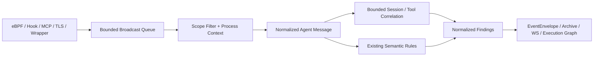

# 统一 Agent 消息驱动风险处理管线（第一阶段）

## 设计选择

保留现有 **一个消息摄取队列（appContext.Broadcast）和一个消费者（runEventBroadcaster）**。不再引入一个可能乱序或丢失关联事件的第二条异步队列。所有 eBPF、Native Hook、MCP、TLS、wrapper 及其他可归一化的 `pb.Event`，经 capture scope 与 process/cgroup attribution 后进入统一处理阶段：

`internal/agentpipeline.Message` 只保存规范化类型、操作、进程与会话标识、显式工具权限和不可信信号；**不保存 prompt、tool arguments、模型输出或 TLS 明文**。原有 protobuf 与 WS schema 不变，派生风险统一由 `semantic_alert` 表示。

## 上下文作用域及关联

优先用 `agent_run_id + task_id + conversation_id + root_agent_pid`；其次是 conversation/trace 与 root PID，最后回退 root PID 或 PID。ToolCallID **只在会话内部**索引，避免不同 Agent 同名调用串线；无父级身份的 ToolCallID 不参与关联。来源未携带一致 run/root/trace 时会漏关联，不能靠猜测补齐。

- 默认最大 4096 个活跃会话，每会话 64 条 tool call，LRU 淘汰；TTL 5 分钟。
- 只接受当前流中的监控范围事件；按原事件顺序处理；重复结果每条因果链只告警一次。
- 提示词注入链要求上游**明确**标记为 external/untrusted/tool_output 且同时标记 high/critical 或 prompt_injection_detected；单纯接触网页/工具输出不判恶意。
- 工具读写权限必须由可信 Hook 明确传输 `side_effect_scope=read_only` 等元数据；不从工具名臆断。
- 计划模式 `permission_mode=plan` 后观测到实际副作用单独生成风险事件。
- `BLOCK` 与失败 syscall 不计作成功的写入、执行或外联行为。
- 不执行自动阻断，所有新 findings 为审计告警，避免因假阳性修改已有内核策略。

## 新增告警

| Code | 证据要求 |
| --- | --- |
| `TOOL_SCOPE_VIOLATION` | 同一 scoped ToolCallID 明确只读，却观察到实际 write/exec/egress |
| `PLAN_MODE_SIDE_EFFECT` | 同一 scoped ToolCallID 明确 plan mode，却观察到副作用 |
| `UNTRUSTED_INPUT_ACTION_CHAIN` | 同一 Agent 上游明确高风险不可信输入，后续出现副作用 |
| `TOOL_CALL_ID_CONFLICT` | 同一作用域的调用 ID 在活跃窗口内被不同工具复用 |

## 兼容、限制与验证

- 新代码不改变 `proto/tracker_events.proto`、历史事件归档、WebSocket 订阅 API 或现有语义规则。
- Hook 中 `risk_level` / `source` / `side_effect_scope` / `permission_mode` 作为已有压缩元数据读取；新增可选 `prompt_injection_detected=true` 只作为标记，不传输原文。
- 依赖因果字段的告警不能代替跨主机分布式追踪；多服务场景需要进一步引入带认证的传输消息 ID、watermark 与落盘重放。
- 本阶段的 queue full 仍按原采集策略记录丢弃，**不声称 at-least-once 或 exactly-once**。
- 单元测试覆盖：跨 run 隔离、工具只读冲突、显式高风险链、过期及容量、重复抑制、并发竞争和 BLOCK 行为。
- 运行 `cd backend && go test ./internal/agentpipeline ./app/...`；完整 CI 仍需 Go 1.27.3 与实际 eBPF 环境。
