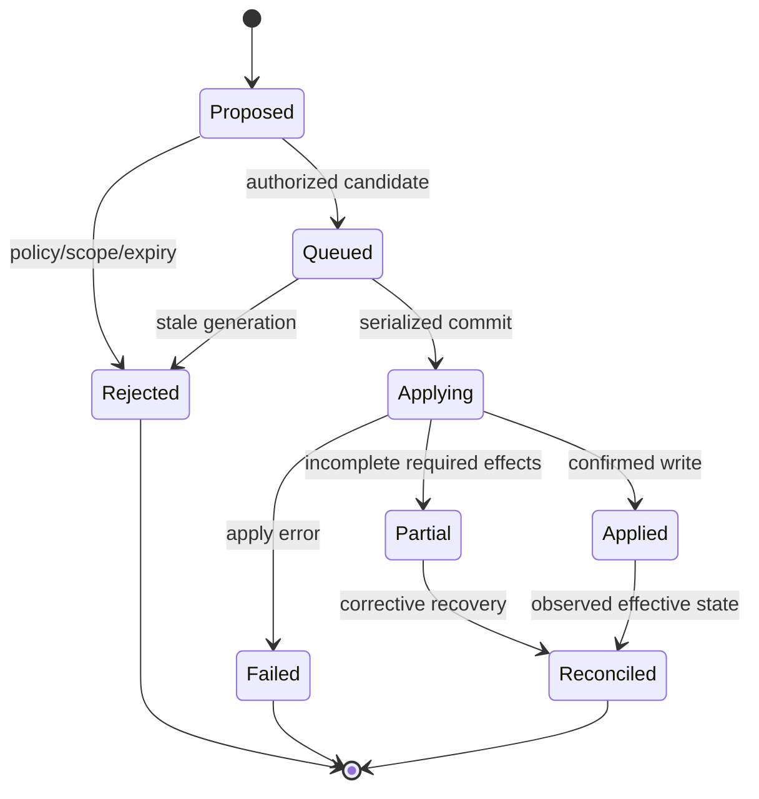

# 公理设计第三轮：动态闭环、策略所有权与证据守恒

基线 master: `86357e5a912b3a4b294c9cf4b94474fbc3481bd7`。承接 [一级分析](mit-axiomatic-design.md) 和 [第二轮验证](mit-axiomatic-design-validation.md)。本轮读取 10 个源码文件，执行 13 项追加文本锚点检查（13/13），并执行四类有限状态反例模型的五项断言（5/5）。没有加载 eBPF、运行 Go 测试或测量线上事故概率。

## 1. 设计理论修正：闭环不等于错误

传统静态矩阵应评价指定运行模式和设计范围内的 FR 可调性。主动防御是有意闭环：策略改变未来可观测行为，风险推断又可能改变策略。把这种时间因果性直接当作静态偏导或一律视为缺陷，会错误否定主动防御。

定义时刻 t 的原始证据 E_t、归属 C_t、推断 R_t、手工策略 M_t、自动策略 A_t、宿主能力 H_t、有效授权 G_t、发布证据 Z_t：

```text
C_t = correlate(E_t, identity_t)
R_t = detect(E_t, C_t, detectorVersion_t)
proposal_t = propose(R_t, C_t, evidenceID_t)
A_(t+1) = controller(A_t, proposal_t, G_t, budget_t)
P_t = compile(M_t, A_t, H_t)
E_(t+1) = observe(workload_(t+1), P_t, H_t)
Z_t = publish(redact(E_t, C_t, R_t), privacyPolicy_t)
```

这是目标语义模型，不是当前函数签名。静态执行 FR4a 必须在反馈关闭、无遥测或模型故障时仍遵守已确认策略；动态反馈 FR4b 必须在独立授权上界内受控改变自动策略。动态模式需要时序不变量、效应界限与恢复测试，而不能单用对角/三角矩阵判定。DP 的变化不应悄悄改变其他 FR 的**验收定义**。目标静态矩阵继续作为对照，不宣称覆盖动态系统。

### 子 FR/DP 重新分解

| FR | 可独立验证的功能结果 | 建议 DP |
| --- | --- | --- |
| FR4a.1 | 手工授权策略在检测器停止时仍准确生效 | 独立手工策略所有权、版本化编译 |
| FR4a.2 | 能明确区分期望策略与实际 map 状态 | reconcile + capability/readback |
| FR4b.1 | 只有获授权、未过期、当前代际候选能提交 | 版本化 action、提交时授权、明确线性化点 |
| FR4b.2 | 自动规则可独立撤销且不误撤手工规则 | 规则来源账本、有效策略合成 |
| FR4b.3 | 动作失败、重复、部分生效、重启均可审计 | 幂等 action ID、结果状态与恢复 |
| FR1a.1 | 能分别统计内核损失与用户态主动过滤 | 原始序列观察早于用户态过滤 |
| FR1b.1 | 捕获与监控配置在单条事件上有可解释版本 | 同一不可变 scope snapshot |
| FR5.1 | 审计关联键不依赖原始敏感数据 | 独立受控 action/evidence ID |

静态和动态控制之间仍共享内核资源、控制权限和可用性约束；按以上需求设计并不能自动证明消除实质耦合。

## 2. 追加源码发现

| ID | 证据（基线行号） | 结论与置信边界 |
| --- | --- | --- |
| F05 | [handlersbridge.go](../../backend/app/handlersbridge.go) L284–287、369–374；[networkflowsbridge.go](../../backend/app/networkflowsbridge.go) L96–100；[cgroup_ops.go](../../backend/app/sandbox/cgroup_ops.go) L80–161；[lsm_control.go](../../backend/app/sandbox/lsm_control.go) L88–147 | 人工 API 与自动反馈通过相同 helper 写目标 key，cgroup IP/port 和 LSM name map 用 uint32(1) 并按 key 删除。该表示本身不保存来源、租约或引用计数。不能由单个 key 判断手工与自动授权来源；不代表全仓绝无旁路账本，也不证明目前关闭反馈会删除手工规则。 |
| F06 | [lsm_control.go](../../backend/app/sandbox/lsm_control.go) L294–349 | path bit 更新有互斥锁，避免不同 bit 在 RMW 中相互擦除；但之后 inode 同步为 best effort，且 `_ = applyInodeBitsLocked(...)` 忽略错误。若功能承诺 path + inode 一致生效，则 nil return 不足以证明双 map 成功。若 inode 本来仅为可选增强，应显式暴露 degraded/unsupported 而不是当成同一成功语义。 |
| F07 | [kernel_risk_feedback.go](../../backend/app/events/kernel_risk_feedback.go) L37–39、87–101、157–185 | dedup 在 apply 前写 seen 和计数，失败的 apply 也会占用该目标冷却与预算。可解释为限制尝试而非限制成功；需要把指标与重试策略明确区分。该 seen map 的局部实现未见清理；速率限制不等于长期基数上界。尚未完成全仓所有写入/清理点审计，内存影响待测。 |
| F08 | [jobs_background.go](../../backend/app/jobs_background.go) L77–90；[kernelriskbridge.go](../../backend/app/kernelriskbridge.go) L62–81、100–102；[kernel_sequence_audit.go](../../backend/app/kernel_sequence_audit.go) L40–110、114–159；[agent_tracker_common.h](../../backend/ebpf/agent_tracker_common.h) L198–203 | self PID 和 disabled comm/type 在 builder 与序列观察之前返回。如果被过滤样本带连续 CPU sequence，后续样本可能形成非 reserve gap；应将用户态主动过滤从未解释缺失中区分。未运行真实探针，未证明所有事件都携带有效序号。 |
| F09 | [agent_scope_policy.go](../../backend/app/agent_scope_policy.go) L53–64、72–87、109–118；[ws_api.go](../../backend/app/ws_api.go) L161–167 | capture 与 monitor 分别加载原子 snapshot；配置写入可在两次读取之间发生，产生跨版本组合。原子指针不等于多次读取同一快照。若允许此 eventual consistency 应记录版本；若承诺单事件一致，应固定同一 snapshot。 |
| F10 | [handlers/runtimeconfig.go](../../backend/app/handlers/runtimeconfig.go) L214–217、279–281、305–313；[kernel_risk_feedback.go](../../backend/app/events/kernel_risk_feedback.go) L87–101、187–205 | HTTP PATCH 由 handler mutex 串行，但反馈 worker 在已查路径仅 snapshot 后执行；未见共享提交线性化点。第二次检查仍不能独立保证 check-to-apply 无竞态。配置更新成功的语义须明确是停止新增、等待已开始动作、还是撤销现存自动规则。 |

另：shutdown drain 通过读取 queue 丢弃动作（kernel_risk_feedback.go L147–155），该函数没有逐动作终态记录。是否另有全局 shutdown 统计尚未证明；不将“已消费”误记为“已应用”。

## 3. 可复现的有限状态反例

运行 [scripts/model_axiomatic_feedback.mjs](../../scripts/model_axiomatic_feedback.mjs)：

```sh
node scripts/model_axiomatic_feedback.mjs
# 或 bun scripts/model_axiomatic_feedback.mjs
```

脚本不导入生产代码、不修改真实 map、不构造真实攻击。模型与断言已执行；独立的源码锚点核查支撑这些模型的抽象前提。

### M01：配置变化与在途候选

设 Q=入队，C=worker 检查两个总 gate，U=提高阈值或撤销动作种类（总 gate 仍开启），A=尝试 apply。枚举 Q<C<A 且 Q<U 的全部 3 种交错。旧模型不重验代际，目标模型在与 U 同一线性化域内校验 generation 后 apply。

| 顺序 | 当前简化模型旧动作执行 | 目标模型旧动作执行 |
| --- | --- | --- |
| Q→C→U→A | 是 | 否 |
| Q→U→C→A | 是 | 否 |
| Q→C→A→U | 非 stale | 非 stale |

旧模型存在 2 个 stale witness；目标模型 0。它们不是发生概率，不表示线上 2/3 的动作错误。模型假设 A 是单一原子提交；真实多 map 操作、异步失败、崩溃恢复需要更强验证。已经开始且已提交的旧动作是否撤销是独立需求。

### M02：策略来源不可辨识

假设同一目标 k 同时被手工和自动规则阻断：

```text
effective(k) = manual(k) OR automatic(k)
```

单一 bit 无法区分 (1,0)、(0,1)、(1,1)。若未来实现“撤销自动策略时直接 delete(k)”，在 (1,1) 下会破坏静态控制独立性。模型枚举四个来源组合得到 1 个反例；建议来源化账本计算有效阻断，不直接将撤销动作映射为 delete。当前代码是否已经通过其他账本解决需进一步核查，不将反例描述为已观测到的生产事故。

### M03：证据守恒

同一 generation/CPU 的合成序列 1、2、3，全部到达用户态；2 被主动过滤，reserve loss=0。过滤后的观察器看到 1、3，gap=1；原始观察器看到 1、2、3，gap=0，另记 intentional filtered=1。

推荐的逐层账本（冻结 epoch、定义计数单位、扣除在途量及重复）：

```text
decoded = early_filtered + offered + builder_failed + in_flight_build
offered = accepted + rejected
accepted = consumed + abandoned + in_flight_queue
consumed = scope_filtered + noise_filtered + recorded_source + in_flight_consume
```

派生 alerts、recording、OTLP、WS fanout 必须使用各自分母；多个订阅者 delivery 不是额外原始事件。内核 attempts/reserve/emitted 的关系需按真实 BPF reserve ABI 和 CPU/generation 另建账，不能将全部 syscall 次数当作序列数。报告 unexplained residual，而非强行把差额归类为丢包。另需单测 decode failure、generation reset、乱序、无序号事件与关闭时在途量。

### M04：双 map 成功语义

模型枚举 path/inode 成功位的 4 种组合。在 inode 被声明为 required 时，只有两者均成功可报告完整成功；path 成功且 inode 失败是部分成功反例。当前 path helper 的 nil 只能说明该 helper 的主路径成功，不能证明可选 inode 同步成功。若 inode 不受支持需报告 capability，并按明确的功能范围验收。不要为追求原子性盲目覆盖或回滚其他来源并发写入的规则。

## 4. 目标运行时契约与落地顺序

建议采用逻辑上的单写入协调器（可以在现有 Go 进程内），并保留既有 pinned map ABI。候选包含 action ID、evidence ID、主体/范围、canonical target、类型、评分及原因摘要、detectorVersion、authorityGeneration、创建时间/过期时间。拒绝或过期候选不进入 map。不得用“模型高置信度”替代授权。



上述状态机为建议；实际操作可能因 map reload、崩溃、异步观测而产生 unknown/pending，应有显式状态，不能强制当成 success。需记录请求状态、实际状态与测得的 syscall 结果三者，且日志不包含秘密原文。先建立兼容性迁移/读回及失败路径，再考虑启用来源化撤销。若有外部进程直接写 pinned map，单进程锁不能保证全局所有权，需限制 writer 或定期 reconcile 并检测漂移。

### 实施门禁（建议）

| 优先级 | 下一步 | 可执行验收 |
| --- | --- | --- |
| P0 | 配置代际与作用域契约 | 同步屏障重现 M01；撤销返回后不得有未经定义的旧代提交 |
| P0 | 来源分离、幂等与 audit | 手工/自动重叠、撤销、重复、重启、失败后恢复；M02 不可误撤 |
| P0 | 原始序号审计与分类计数 | 注入 1/2/3 + 过滤、真实 reserve gap、重启及乱序；账本残差可解释 |
| P1 | 部分成功与读取状态 | mock 第二 map 写失败、主 map 成功；验证 degraded 状态与恢复 |
| P1 | 单事件 scope snapshot 与 bounded dedup | barrier 交错、超时/基数上限、失败重试不误报成功 |
| P2 | 动态闭环响应测试 | 假风险突发、数据停止、重复反馈、模型版本迁移；测实际阻断范围、恢复时间和资源占用 |
| P2 | 单进程与进程隔离对照 | 同一 workload、授权语义、CPU/RSS/延迟和联合成功区间；根据实测决定 |

## 5. 信息公理与动态系统的反事实评价

动态策略会改变后续样本分布：阻断后未发生的操作不能被计成未检出或采集损失；实际放行造成的负样本不能被选择性排除。静态固定 workload、受控回放、隔离 VM 中的配对运行是不同实验，分别报告。使用事前固定的尝试动作 ID、ground truth、策略和检测版本；以独立 run 为统计单位，报告成功联合概率及不确定度，避免把 model enumeration 当成频率。

对照方案 B0 保留现状并补充计数、B1 单进程来源化控制与版本契约、B2 进程隔离。安全硬门禁不得用延迟收益抵消；只有 B1 在相同目标下确实达不到故障/权限隔离预算，而 B2 验证满足全部门禁时，进程拆分才有证据优势。当前没有实测联合概率，不能宣称 B1 或 B2 的信息量最小。

本轮结论：最高优先级不再只是风险评分热路径的性能解耦，而是**静态策略、动态策略及证据账本之间的功能独立性**。上述改造仅为设计与实验建议，未变更实际默认配置、授权、map 或内核探针。
