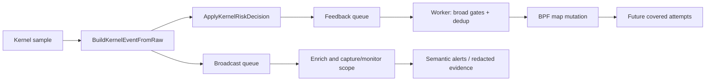

# 公理设计深度验证：源码依赖、模式分解与验证门禁

基线：`86357e5a912b3a4b294c9cf4b94474fbc3481bd7`（PR #172 的 master 基线）。本报告补充并修订 [一级公理设计分析](mit-axiomatic-design.md) 的现状矩阵，不将结构依赖、运行时灵敏度或安全效果混为一谈。

## 1. 已完成的验证及可复现性

- 从固定 commit 读取 13 个 Go 源文件（含一个测试文件），逐项核对调用顺序与依赖注入；16/16 文本锚点检查通过。
- 对三套定性矩阵各枚举 6! = 720 个共同 FR/DP 排列，并计算非对角图的强连通分量。这里是精确的**模型计算**，并非从系统测量得到的数值 Jacobian。
- 负向对照：在内存中删除 builder 调用 KernelRisk 的锚点，检查器成功报告失败。
- 检查器：[scripts/verify_axiomatic_design.mjs](../../scripts/verify_axiomatic_design.mjs)，Node/Bun 无第三方依赖。相同 audit 函数已在连接器取得的固定版本源文本上执行。文本搜索不是 Go AST、完整控制流或数据流分析；锚点迁移需人工复审。
- PR 初始提交的 Documentation / GitHub Pages、Repository integrity workflow 已成功；新提交检查状态另行读取，不能继承初始提交的成功状态。
- 本次环境无法通过 DNS clone GitHub，安装的 Go 版本 1.23.2 低于仓库声明的 1.27.3；没有执行完整 Go、race、BPF 加载、真实 syscall 或性能实验，也没有编造运行时结果。

从仓库根目录：

```sh
node scripts/verify_axiomatic_design.mjs
# 或 bun scripts/verify_axiomatic_design.mjs
```

## 2. 核心证据链

以下行号固定于基线 commit，源码链接相对当前文档位置。检查结果是存在相应结构和顺序，而不是功能正确性已经通过。

| 编号 | 源码锚点 | 结论 |
| --- | --- | --- |
| E01 | [jobs_background.go](../../backend/app/jobs_background.go) L90；[events_kernel_builder.go](../../backend/app/events/events_kernel_builder.go) L310–311 | reader 先构造并执行风险评分，再尝试入广播队列；借用 raw view 的同步生命周期不能随意异步化。 |
| E02 | [networkflowsbridge.go](../../backend/app/networkflowsbridge.go) L113–140；[kernelriskbridge.go](../../backend/app/kernelriskbridge.go) L100–102；[kernel_risk.go](../../backend/app/events/kernel_risk.go) L110–125 | 评分不是空回调：生产注入实际评分函数，并更新事件字段、提交反馈。 |
| E03 | [kernel_risk_feedback.go](../../backend/app/events/kernel_risk_feedback.go) L187–261、L87–101、L267–289；[sandboxbridge.go](../../backend/app/sandboxbridge.go) L26–41；[cgroup_ops.go](../../backend/app/sandbox/cgroup_ops.go) L80–104、L133–146 | 启用反馈及 policy gate、达到阈值且目标匹配时，队列动作可触发实际 BlockIP/BlockPort，并调用 BPF map Put；LSM 分支也经具体 enforcer 转发。是否实际拒绝仍受宿主能力、作用域及 map apply 成功影响。 |
| E04 | [ws_api.go](../../backend/app/ws_api.go) L150–177 | broadcaster 中 enrich → captureAgentEvent → monitorAgentEvent → semantic alerts → record。上述内核风险反馈提交早于这组 capture/monitor 判断。 |
| E05 | [statepersistence_events.go](../../backend/app/statepersistence_events.go) L376–410；[redaction_engine.go](../../backend/app/redaction_engine.go) L31–34、L63–70、L140–143 | 常规记录路径先原地脱敏，再桌面摘要、内存归档、持久化、recording、OTLP；monitor gate 控制后续部分分析队列。nil engine 会跳过脱敏，因此仍应验证启动/重配置不变量；不能仅凭顺序证明每种字段、每个出口无泄露。 |
| E06 | [helpers_auth.go](../../backend/app/helpers_auth.go) L32–34；[http_security_test.go](../../backend/app/http_security_test.go) L221–230 | authEnforced 由 DISABLE_AUTH 决定，Gin Debug/Release/Test mode 不是认证开关；存在对应回归测试，尚未在本轮执行。 |
| E07 | [broadcast_queue.go](../../backend/app/broadcast_queue.go) L11–18；[ws_api.go](../../backend/app/ws_api.go) L146–155 | 入队有接受/失败指标；取消时 flush 已批处理数据后退出，不等于 drain 所有队列。需区分预期过滤、ringbuf 丢失、解码失败、广播拒绝、退出时在途及落盘失败。 |

## 3. 新增高风险发现

### F1 — 风险反馈确实改变策略，且依赖早于语义范围过滤（高）



这推翻前一版 A43 仅为疑似的判断：**反馈开启的适用模式中存在 DP3 → FR4 的实际实现路径**。同样 DP1 提供反馈的输入，DP4 可以改变未来操作及观测结果。内核 risk pass 本身不等于 ML 推理，不能把此链泛化到所有 ML 模型。

另一个待明确的产品语义是：capture/monitor scope 与自动执行权限是否应独立。源码已确认其先后关系，但若产品有意令反馈使用单独的宿主级范围，则不是当然的越权；若承诺“未监控 Agent 不影响自动阻断”，当前结构没有由 broadcaster gate 提供该保证。需要显式 feedback scope，禁止使用 UI 过滤作为唯一授权边界。

### F2 — 在途反馈动作与配置代际（高，待复现）

kernelRiskFeedbackAction 只含 Kind、Target、Score、Decision、Reason（L18–24）；候选生成时检查 min score 和 EnforceNetwork/FileNames/Exec（L208–260），worker 出队时检查两个总开关和 dedup/rate limit（L87–101）。在该 worker 路径未见重新核验动作种类、当期阈值或配置代际。推论：保持两个总开关打开，仅提高阈值或关闭某类反馈时，旧候选仍可能被执行。并发修改、实际 map 结果与其他保护尚未做端到端验证。

建议增加 policy generation、action expiry、当前范围/种类/阈值重验、串行授权与应用边界；在审查前不改变现有行为。不要只添加第二次 snapshot 就宣称解决 check-then-apply 窗口。明确 disable 的语义：停止新增自动规则还是同时撤销旧规则；后者必须分辨规则来源，不能误删手工策略。

### F3 — 审计记录与反馈动作不是事务（高，结构事实 + 运行时待测）

反馈先于普通广播入队；反馈队列与事件广播队列不同。广播失败不会从该调用顺序自动回滚反馈；同样反馈队列饱和不会自动否决普通事件。需为每次候选、拒绝、apply error/success 和已观察生效状态提供可追溯 action ID，且关联到最小必要的脱敏证据。不能将 Event.Decision 的风险注释解释成内核 syscall 已拒绝。

### F4 — 数据保护需验证所有发布分支（中高）

普通 record 路径 E05 支持“先脱敏后发布”的结构主张，但 TLS 专用流、网络聚合、插件、自定义记录、历史数据、错误日志等未在本轮逐出口验证。数据范围策略改变也不能污染已授权控制。针对 nil engine、热更新、字段新增与历史存储建立 synthetic canary 验证；若缺少可信脱敏器，敏感外部输出应停止或明确失败。

## 4. 分模式矩阵与精确图计算

FR、DP 编号沿用主文。X 是限定模式的结构依赖，? 未决，. 是本图未纳入边（非已测零）。将每个 X 非对角项视为 DPj 对 FRi 的调节顺序约束 j→i；必须同时重排成对的 FR/DP。

| 模式 | 矩阵（逐行 FR1–FR6；列 DP1–DP6） | 非平凡强连通分量 | 可行三角排列数 |
| --- | --- | --- | ---: |
| feedback off | X?X?.? / XX..?. / XXX??. / ..?X?. / ???.X? / XXX?XX | {1,2,3} | 0 / 720 |
| feedback on（适用且授权） | X?XX.? / XX..?. / XXX??. / X?XX?. / ???.X? / XXX?XX | {1,2,3,4} | 0 / 720 |
| target static（待实现） | X..X.. / XX.... / XXX... / ...X.. / XXX.X. / XXX.XX | 无 | 1 / 720 |

目标唯一排列：FR/DP4 → 1 → 2 → 3 → 5 → 6。当前关闭反馈仍有结构环 1→3→1；另有 1→2→3→1，因归属结果是下游检测输入。开启反馈增加 1→4、3→4 和 4→1。最后一条是动态策略改变后续真实操作的**因果链**；固定实际尝试动作下是否引起 FR1 性能/完整性超容差，仍需实验。不能因此声称已有测量证明 FR1 不独立。若剔除 A13 结构边，或在冻结 workload 下将 A14 视为零，图结果会改变，应公开这类假设而非人为填满矩阵。

独立公理适用的是可调 DP 对 FR 的实际影响。上面的枚举只证明给定图不能拓扑排序，既不计算耦合强度也不代替受控干预。将 FR4 分为静态执行正确性 FR4a 与有界动态反馈 FR4b，再将 FR1 分为 raw capture FR1a 与 scoped published coverage FR1b，可以避免把所有动态闭环都判为设计缺陷。目标矩阵只适用于静态控制/建议分离的配置；保留现有明确启用反馈的兼容性，另设闭环 FR/DP 验证。

## 5. 可执行实验清单（尚未运行）

| 实验 | 干预/对照 | 断言、测量 |
| --- | --- | --- |
| V01 热路径 | 相同采集输入与速率，固定 kernel attach、buffer、scope；可控增加评分成本 | 分别测原始采集召回、每段延迟、ring reserve failure 与广播拒绝；重复稳态及饱和场景 |
| V02 范围边界 | 合成同一事件分别置于 capture/monitor allow/deny；反馈 off/on 与明确 feedback scope 做全因子 | 普通记录与自动动作分别断言，不用 UI 是否出现判断实际策略 |
| V03 stale action | mock enforcer，入队后以同步屏障暂停 worker；改阈值、种类、gate、策略 generation，再恢复 | 区分 queued、rejected、attempted、applied；在明确撤销语义后，旧代动作必须按当前规则拒绝或显式保留 |
| V04 队列与关闭 | 独立饱和广播和反馈队列，注入 shutdown/restart | 两类 drop 和在途动作独立对账；关闭/重启后无未经审计的 apply |
| V05 授权/内核 | 固定策略与合成目标；认证、gate、compile feature、host capability 组合 | rootless mock 验证拒绝和 no mutation；隔离特权 VM 验证真实 syscall 返回、作用域及 map 状态 |
| V06 数据保护 | 合成 secret 在事件各字段、TLS 单独流、archive、OTLP、错误路径 | 每出口 canary 统计，证据关联键和策略版本不泄露 |
| V07 归属/识别 | 独立标注 run，乱序/PID reuse/缺失 Hook，固定训练与 holdout 划分 | coverage、unknown、误归属、recall、FPR 与证据来源一致 |
| V08 故障隔离 | slow WebSocket、磁盘故障、OTLP unavailable、模型停止 | 静态授权不扩大；收集和控制指标在预算范围内；分别报告故障范围 |

复用已存在但本次未运行的源码测试：

```sh
cd backend
go test ./app -run 'TestDecodeBPFEventRecord|TestKernelRisk|TestCollectorMetricsTrackDecodeAndKernelRisk|TestAuthenticationIndependentOfGinMode' -count=1
go test -race ./app/events -run TestKernelRiskFeedbackWorkerShutdownAndRestart -count=1
go test -race ./internal/agentscope ./internal/agentidentity ./internal/eventnoise ./internal/eventqueue ./internal/componentipc
```

这些用例覆盖局部行为，不足以替代 V01–V08。V03 新测试应采用 mock 和同步屏障，避免靠 sleep 制造竞态；真实内核实验禁止在日常宿主上修改生产 map。

## 6. 信息公理的样本约束与结论反转

实验以独立运行（run）为统计单元，统一 workload 和模式；每个方案报告六项 FR 的联合成功、支持范围、完整失败列表、未运行和置信区间。unsupported 不允许悄悄从失败中删掉，也不能计入成功；事前分层。安全硬门禁失败时不参与 I 排名。

若 n 个独立运行零失败，单侧 95% 精确上界为 1 − 0.05^(1/n)。例如要在零观测失败时把失败概率上界压到 1%，需至少 299 个独立运行；100 次零失败的上界约 2.95%。这只是样本计划，不是本项目的实际概率。低频、相关或非平稳失败需按 workload/host 分层，不可用单一事件计数替代。

优先级：先厘清反馈授权/作用域/代际及审计，再做热路径隔离。单进程模块化优先，是较可逆的对照实验，而非经信息公理证明最优。如果单进程资源与权限隔离在冻结负载下确实无法达到指标、且 IPC 设计经过可靠投递和权限验证，则可转向独立进程。反之若排队增加丢失或影响已有控制语义，应停止迁移。当前没有联合成功率，不能宣布哪种架构信息量更小。
