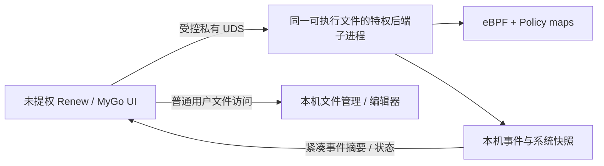

# 明镜高悬（Renew）：原生桌面使用指南

> **源码技术手册权威入口（2026-10-15）**：本页保留专题讲解与既有链接；有关当前函数、数据流、功能门控及平台可用性的实现事实，请优先核对 [技术手册：desktop-transport](../technical/desktop-transport.md) 和链接的源码与测试。旧示意图不表示其所绘功能已在默认部署中启用。

> **察微知著 · 守护 Agent 边界**
>
> 本页基于 `desktop/renew`（MyGo v0.4.8，Go 1.27.1）及 2026-10-15 的代码。Renew 是**纯原生 Go/MyGo 桌面**，不是 Vue Web 页，更不是基于 WebView 的壳。原 Web `/renew` 客户端已移除；`agent-ebpf-renew` 命令继续保留兼容。

## 快速启动

在项目根目录：

```bash
make predev
make renew-desktop-dev
# 或构建原生应用
make renew-desktop-build
```

`renew-desktop-dev` 先生成后端 protobuf / eBPF 对象，再调用 `go tool mygo dev`。打包走 `desktop/renew` 的独立 Go module；不会把 MyGo UI 依赖导入特权 backend 模块。

::: tip 开发与打包区别
桌面内置后端是**与 UI 链接在同一个 Renew 可执行文件**里的库，并在需要时通过内部后端模式重启自身、经 `pkexec` 或 `sudo -A` 获得加载 eBPF 所需权限。只有内部子进程需要特权，窗口与本地文件管理保持普通用户权限。已经运行的后端可被复用；退出 Renew 只清理由它自己启动的后端。
:::

## 1. 我的设备：从「健康」而不是「告警数」开始

打开首页时，优先看采集器状态、事件/系统流是否连通、丢弃数据及近期活动。**正常**仅代表目前有健康证据且当前可见窗口内未发现待处理项，不是全盘恶意软件扫描结果。

- **优先核查**分离高风险和策略告警；点击条目定位到实际事件。
- **暂停事件**只暂停摘要展示，不关停后台 eBPF 或现有阻断；健康仍可刷新。
- 如果事件流失联、系统状态过期、回退或未初始化完成，先到 **系统诊断**；没有事件时不得自动显示「安全」。
- 事件风险分滑块（`Slider`）与事件数滑块（`StepSlider`）在客户端筛选已加载数据，不修改采集或安全策略。

## 2. 事件研判与跨页面追踪

原生工作区提供 **事件、会话、网络、进程、系统、风险研判** 等入口。可以从一条事件跳转到同 PID、父 PID、root Agent、Agent session、精确网络/文件目标；修改查询范围时清理不兼容的旧筛选，避免把两个对象混淆。

- **紧凑摘要**：浏览表格默认不拉取完整 payload；只有明确请求详情才访问受鉴权 API，关闭详情会释放敏感内容。
- **历史进程**：事件中记录的 PID/PPID 与当前系统快照分别显示；退出进程不会被历史事件「复活」，同 PID 被新进程复用时拒绝错误归因。
- **文件写入**：文件相关 syscall 与对套接字的 `write` 不混为一谈；通过 bash/python 等子进程间接写文件仍显示实际执行者与有证据的 root Agent。
- **有界视图**：本机持有约 1200 条摘要的近期窗口，旧数据需通过现有历史 API 分页。过滤不是对无限完整历史的查询。

## 3. Agent 域名监控

该页聚合后端已经采集的 Agent 外联摘要，并展示 **域名或 IP-only** 目标，可按 Agent/目标搜索、只看风险或隐藏 IP-only。点选具体目标后能跳转到匹配的事件，不通过模糊字符串匹配其它域名。

| 有证据时可显示 | 不能据此推定 |
| --- | --- |
| Agent root/run、主机名线索、IP、近期活动、风险事件、估计流量摘要 | 每个 HTTP 请求、API token 消耗、完整请求内容、实际计费 |
| DNS/SNI/Host 等采集到的目标信息 | ECH、DoH、缓存及缺失捕获下的真实主机名 |
| 同一 Agent 和目标的事件关联 | 该 Agent 成功访问/调用了相应 API |

**配置识别**需要用户手动点击「读取本机配置」：Claude Code 与 Codex 的本地 JSON/TOML 文件仅投影有限字段，拒绝敏感凭据及符号链接；不同配置层的合并预览不能证明真实 CLI 当前选择了哪个 Profile 或最终生效权限。

## 4. Agent → SubAgent 派生图（当前新增）

原生 **Agent 派生** 页拥有两个切换视图：

| 视图 | 展现的事实 | 特别注意 |
| --- | --- | --- |
| 放射图 | 实时进程的 PID/PPID 后代关系，按层级展开 | 黄色「子 Agent 候选」意味着后代自身被识别为 Agent 程序，非已验证逻辑调用 |
| 瀑布图 | 各进程从已记录的创建时间到当前快照时刻的观察区间 | **不是**子任务耗时，不是进程的真实退出时间 |

共用根 Agent 选择、当前 PID 与跳转事件；图最多 **72 节点 / 6 层**。需要实时 `/ws/system` 进程快照；离线时不依据旧事件拼造父子图。PID 重用与时间冲突会被筛掉。进程树无法天然表达**同进程 SDK SubAgent、跨 RPC 或异机调用**。

### Claude Code 生命周期 Hook

在 Vue Web 工作台的 Hooks 管理中，可**分别**安装 `Claude Code · SubagentStart` 和 `Claude Code · SubagentStop`。它们彼此独立，也不覆盖原有的 `PreToolUse` 或手工 Hook。安装后重新启动 Claude Code 会话以加载设置。

- 上报通过独立 Hook secret 校验，最多利用 Hook 调用进程的父 PID 作为尽力线索。
- 原始 `agent_id` 和 prompt 不作为可读内容存入摘要；保留受限类型/摘要信号。
- 可以展示观察到的开始/结束，但没有可靠的父跨度与逻辑调用 ID 时，不拼接成貌似精确的跨进程任务时长或完整调用图。

## 5. 工具：文件管理、编辑器与终端

**文件管理 / 原生编辑器**无需后台已连接。可浏览目录、按名称过滤、创建/重命名普通文件、二次确认非递归删除。双击 UTF-8 文本进入 MyGo editor，提供标签、语法高亮、查找、多光标与未保存提醒。

- 单文件文本大小上限 **8 MiB**；大目录单次最多展示 **5000 项**。
- 本机文件 I/O **按当前桌面用户权限执行**，不走 root 后端/特权 Shell，也不从远端 API 绕过文件权限。
- 拒绝编辑符号链接、特殊设备；保存时检测文件身份与外部修改，出现冲突时拒绝覆盖。
- **终端标签分离**：可用按钮把已有 PTY 标签移动到独立原生窗口或收回；不会重启 shell 或启动第二套采集。
- **只读监控页分离**：概览、事件、网络、进程等页可独立开窗；主窗口继续管理有副作用的策略操作。Wayland/niri 下使用正常顶层窗口，不依赖控制跨屏幕绝对坐标。

## 6. 跟踪范围 ≠ 降噪 ≠ 内核读写保护

| 功能 | 效果 | 关键限制 |
| --- | --- | --- |
| 命令 / 文件 / 目录跟踪 | 选择观测对象；文件精确路径或递归前缀 | 「文件夹内文件」仅枚举当前一级普通文件，是一次性快照 |
| 忽略低风险路径噪声 | 降低 UI 和事件普通噪声 | 新配置默认忽略部分 `/proc`、`/tmp`；不吞掉 DENY/BLOCK/ALERT |
| 路径权限 | 经授权请求 BPF LSM 精确文件的读/写限制 | 全系统生效，需 `policy_management`、内核 BPF LSM、明确确认；不可视作递归目录沙箱 |

关键系统文件的阻断可能使登录或服务失效；建议只用隔离主机上的临时普通文件试验。[具体路径保护边界](/security/mingjing-path-access)。

## 7. 本地 IPC 与安全模型



在内置模式中，桌面创建私有 `0700` socket 目录；**事件/状态**与**授权 API**采用分离的 Unix Socket，不默认打开 TCP 8080。连接预先存在的后端时，则复用该后端的 REST/WebSocket 连接方式，不擅自改变它的监听配置。

`componentipc` 的分角色消息认证、Collector–Engine 试验子进程与 memfd/ACK 测试属于另一个**显式 opt-in 的组件化实验路径**，不是 Renew 原生数据流默认使用的通道。见 [组件 IPC](/architecture/component-ipc)。

## 8. 构建、测试与排查

```bash
# 仓库根目录
make renew-desktop-build

# 原生 module 的 rootless 单元测试
cd desktop/renew
go test ./...
go tool mygo vet .
```

- **界面没有告警**：先检查 collector 与事件流健康及注册/降噪规则，不要认定系统「干净」。
- **离线**：仍可使用文件与编辑器；监控页会提示旧数据或连接状态。
- **OS enforcement 不工作**：先验证 cgroup v2 / BPF LSM / runtime gate / 已附着状态，避免把 UI 保存成功当作内核生效。

[演示导览](/guide/demo-tour) · [Web 工作台](/frontend/workbench) · [源码详细 README](https://github.com/stevessr/agent-ebpf-filter/blob/master/desktop/renew/README.md) · [安全模型](/security/model)。
