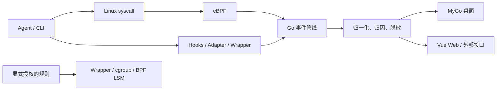

# 项目是什么

**Agent eBPF Filter** 是面向 Linux 的 AI Agent 行为观测和安全控制平面。它回答一个比「Agent 说自己做了什么」更具体的问题：**进程、文件、网络与策略在操作系统里实际发生了什么，能否归到某次 Agent 运行？**

项目拥有两类互补的用户入口：

- **明镜高悬（Renew）**：Go + MyGo **原生桌面**，服务日常监控、风险事件、Agent 域名、会话派生和本地文件操作；位于 `desktop/renew/`，不依赖浏览器/WebView。
- **Vue Web 工作台**：服务分析、Hook 集成、配置、Network/Execution Graph、ML、插件与高级诊断；位于 `frontend/`。原有 Web `/renew` 页面已移除。

## 从一次 Agent 行为开始

### 事实、语义、控制分别是什么？

| 层面 | 能证明 | 不能据此直接证明 |
| --- | --- | --- |
| eBPF 进程/文件/网络事件 | 采集范围内发生了特定 OS 操作 | Agent 的意图、请求正文、全部未采集历史 |
| 受验证的 root PID/run 与原生 Hook | 事件有可用的 Agent 语义线索 | 所有后代都是 Agent、内部 SubAgent 的完整因果关系 |
| Agent 派生进程图 | 当前快照里的 PID/PPID 和进程启动时刻 | RPC 调用树或子任务准确耗时 |
| Wrapper / cgroup / BPF LSM | 规则范围内由相应执行点控制的行为 | 完整容器隔离、防 root 或任意路径/CIDR 策略 |
| 桌面仪表盘 | 当前已加载、经脱敏的有界摘要与链路状态 | 无告警即系统安全、完整取证历史 |

## 为什么有两套前端？

日常用户需要**低噪声、可解释、可钻取**的状态，而不是一直面对调试面板。Renew 将「我的设备 → 风险研判 → Agent 联网目标 → 会话/派生 → 文件操作」组合成一条短路径。桌面自己启动的授权后端可只开放受控私有 Unix Socket；桌面进程继续保持普通用户权限。

Web 工作台保留更复杂的科研和管理功能：详细采集、图谱、Hook 配置、系统策略、Replay 与开放接口。两者可以使用同一后端，但不会自动共享每个 UI 窗口的筛选、暂停和临时选择状态。

## 项目明确不做的承诺

- **不是**通用 MITM 代理，也不会默认截获 TLS 明文；域名线索不能替代逐 API 请求记录。
- **不是**完整容器沙箱或 SELinux/AppArmor 替代品；OS 策略须逐项验证加载与命中情况。
- **不是**凭进程名推断所有 Agent 的语义：普通子进程仍是普通子进程，SubAgent 证据要结合原生 Hook / SDK 事件。
- **不是**默认完成了 Collector、Engine 与 Controller 的完整多进程部署：组件拆分、认证 IPC、共享内存等存在分阶段的实验实现。

## 三条阅读路线

1. **快速体验**：[演示导览](/guide/demo-tour) → [快速开始](/guide/quick-start) → [Renew 详解](/frontend/renew)。
2. **操作系统与架构**：[总体架构](/architecture/overview) → [事件管线](/backend/event-pipeline) → [组件边界](/architecture/independent-components) → [组件 IPC](/architecture/component-ipc)。
3. **策略与运维**：[安全模型](/security/model) → [路径权限](/security/mingjing-path-access) → [验证与 Benchmark](/operations/verification-benchmark)。

::: tip 代码对齐
此页以 `master` 的 2026-10-15 提交 `10e9766` 为基线。有关某项能力是否真正可用，请查看当前构建、Runtime Gate、内核 preflight 和事件/策略计数器。
:::
