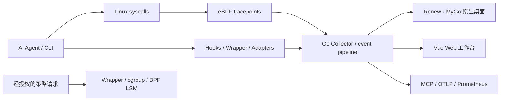

## 两个界面，各有职责

| 入口 | 适合谁 | 主要任务 | 代码位置 |
| --- | --- | --- | --- |
| **明镜高悬（Renew）** | Linux 个人用户、Agent 开发者 | 日常状态、风险事件、Agent 域名、会话、进程派生、文件与编辑器 | [`desktop/renew/`](https://github.com/stevessr/agent-ebpf-filter/tree/master/desktop/renew) |
| **Web 工作台** | 研发、运维、安全与评测人员 | Dashboard、网络分析、执行图谱、Hook 管理、配置、实验与高级诊断 | [`frontend/`](https://github.com/stevessr/agent-ebpf-filter/tree/master/frontend) |

Renew 的 **Web 版 `/renew` 已移除**。桌面由 MyGo 原生组件绘制；既有 Vue Web 工作台继续独立存在。桌面独立启动时可通过私有 Unix Socket 使用其启动的授权后端，不必暴露本地 TCP API 端口；连接已经运行的后端则沿用该后端的配置。

## 三分钟了解数据流

**注意**：观察数据与策略执行是两个不同的路径。展现某个异常、路径或网络目标，不代表已自动对其执行阻断。cgroup/BPF LSM 的可用性取决于内核、附着状态和运行时门控。

## 从哪里开始

- 想实际体验：按 [演示导览](/guide/demo-tour) 的顺序，从桌面健康状态 → Agent 域名 → 进程派生 → 文件事件逐步查看。
- 想部署：先读 [快速开始](/guide/quick-start)，再读 [构建与运行](/operations/build-and-run)。
- 想理解技术：读 [架构总览](/architecture/overview)、[组件边界](/architecture/independent-components) 与 [安全模型](/security/model)。
- 想做答辩：参考 [现场演示脚本](/delivery/demo-script) 和 [验证与 Benchmark](/operations/verification-benchmark)。

::: tip 文档版本口径
本轮演示文档按仓库 `master` **2026-10-15** 的提交 `10e9766` 核对。页面描述的是**代码具备的能力及其前提**，不是对任意安装环境的运行结果保证。最新功能以源码、运行时状态与实际测试为准。
:::

## 来源与致谢

项目受到 [AgentSight](https://github.com/eunomia-bpf/agentsight) 启发，在其 Agent 系统追踪方向上扩展 Go 后端、策略控制与本地桌面体验。详见 [项目致谢](/reference/agentsight-acknowledgment)。
