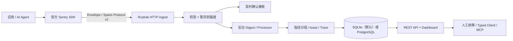
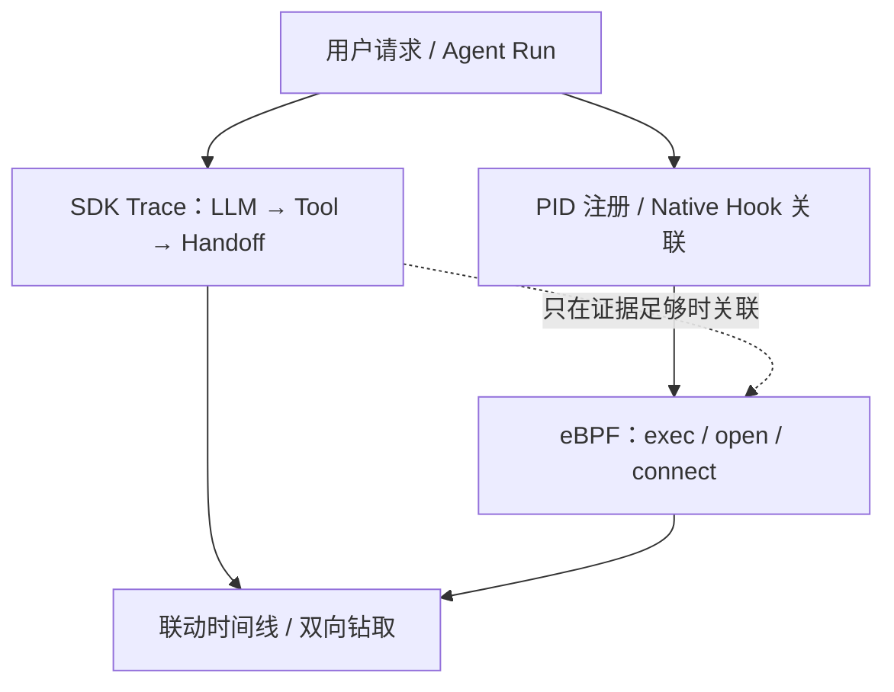

# Rustrak 项目解读：Sentry 兼容错误追踪与 AI Agent Trace

> 研究对象：[rustrak/rustrak](https://github.com/rustrak/rustrak)；核对日期：**2026-10-15**。本页是第三方架构研究与集成可行性评估，**不代表 Agent eBPF Filter 已集成 Rustrak**。功能说明以 Rustrak 仓库当前 `README.md` 与源码为主要依据；其网站内个别旧页面仍沿用“必须 PostgreSQL、前后端分离、仅支持错误”的过期表述。

## 1. 定位与边界

**Rustrak** 是 Rust 编写的轻量级、自托管、**兼容 Sentry SDK / Sentry Envelope 协议**的应用级观测服务。通过替换 SDK 的 DSN，开发者可以上报异常、结构化日志、事务与 Span、Release Health、AI Agent Trace，并在 Web UI 中检索、分组与处理事件。

它**不是 eBPF 采集器，也不是内核沙箱或策略引擎**：不主动捕获系统调用、跨进程文件/网络行为，不具备 cgroup / BPF LSM 强制阻断能力；无 SDK/埋点的程序也不会凭空提供可关联的 LLM/工具 Span。它解决的是“应用**主动报告**了什么”，而 Agent eBPF Filter 要回答“Agent 在**操作系统中实际做了什么**”。

## 2. 数据通路和架构取舍

### 两阶段摄取：先确认接收，后做重处理

1. **Ingest（同步阶段）**：解析 Sentry Envelope、校验与暂存原始事件；其 `apps/server/src/ingest/storage.rs` 实现了按项目保存的 pending 记录、临时文件发布与 `sync_all` 等机制。
2. **Digest（异步阶段）**：后台进行处理器分类、错误指纹聚合、Issue/Span 数据入库与查询索引维护。接收请求不必等待全部分析和数据库操作完成。
3. **工程意义**：隔离短时上报突发与后台存储压力；但仍须评估磁盘写入、pending 队列上限、磁盘耗尽、重启恢复、重复事件和消费者落后。**异步不等于零开销，也不等于端到端不丢事件**。

Rustrak 当前 README 介绍 **SQLite 默认单容器部署**，另有 PostgreSQL 镜像；Dashboard 可由服务端一并提供静态文件，也能单独部署。这与旧架构页“UI 必须独立运行、默认 PostgreSQL”的描述不完全一致，应以具体版本、镜像及源代码为准。

### 协议复用与事件语义

- **Sentry SDK 兼容**：SDK 保持不变，修改 DSN 即可复用原有捕获逻辑；兼容范围仍须按 SDK 类型、Sentry 协议功能和 Rustrak 版本验证。
- **错误指纹聚合**：优先使用 SDK 提供的 fingerprint，否则按异常类型、消息及 transaction 等构造确定性分组，避免海量相似错误变成独立待办。
- **AI Agent Trace**：以 Sentry **Spans Protocol v2** 等输入观察 LLM 调用、工具调用、handoff、模型调用量与 token、耗时分布和 Trace 瀑布；支持文档所述无父事务的 OTel 风格 Span。**这不等价于任意 OTLP Collector 可直连其入口**。
- **运维能力**：结构化日志、事务与 p95、Release Health（crash-free sessions/users）、规则告警、项目权限和数据保留管理；Typed TypeScript Client 与 MCP 服务可辅助故障分诊。
- **部署与隐私**：默认 SQLite、可选 PostgreSQL；官方发布镜像存在匿名使用遥测说明，约每 6 小时上报一次，可用 `RUSTRAK_TELEMETRY=off` 或 `DO_NOT_TRACK=1` 关闭。涉及私有 Agent 数据时，应显式检查运行配置和遥测预览。

> 性能数字须按测试环境解读。Rustrak README 提供的约 5k events/s / 4 核 SQLite burst 与内存描述属于**上游自述场景**，不是本项目实测，也不可直接与 eBPF ringbuf 吞吐作等价比较。

## 3. 与 Agent eBPF Filter 对比

| 维度 | Rustrak | Agent eBPF Filter |
| --- | --- | --- |
| 观测起点 | 应用内部 Sentry SDK 主动上报 | Linux eBPF 采集 OS 事实，辅以 Hooks / Wrapper / Adapters |
| 关键对象 | Exception、Issue、Transaction、Span、Agent run、Token | PID/进程树、syscall、文件与网络、Agent/tool 关联证据 |
| 部署与特权 | 一般不要求内核跟踪特权 | eBPF 与 BPF LSM/cgroup 能力依赖内核及权限 |
| 事件入口 | Sentry Envelope / Spans 等 | ringbuf → Go 事件管线 → Protobuf / WS / API / 可选导出 |
| 查询与存储 | SQLite 或 PostgreSQL；Issue/Trace 历史管理 | 实时事件及可选归档、研究工作台与外部观测接口 |
| 响应措施 | Issue 状态、告警、协作排障 | Wrapper 策略、cgroup 网络阻断、BPF LSM 文件/执行控制（需门控） |
| 无插桩覆盖面 | 依赖 SDK 或外部上报 | 可观察到受监测的系统行为，但不自动获得所有应用语义 |
| 分析重点 | 应用异常归因与运行级 Span 瀑布 | OS 行为证据链、Agent 归属、运行时风险与策略执行 |

**两者是正交互补的观测面，不是“Rust 版 eBPF 与 Go 版 eBPF”的性能竞品。** Rustrak 的 SDK trace 能解释“Agent 想做什么及哪个调用失败”；本项目的 OS 事件能证实“进程实际访问了哪些系统资源”。任一单侧都不能单独证明完整因果关系。

## 4. 对本项目最有价值的可借鉴设计

### A. 将接收确认与重型分析分离

对 `backend/app` 的高频事件管线，可参考“有界接收缓冲 → 持久化/确认边界 → 后台归并”的职责分离；但 eBPF ringbuf、WebSocket 实时展示与异步错误上报的丢失语义不同。若未来引入磁盘缓冲，须明确 ack 对象（内核→后端，或后端→外部 Sink）、容量上限、重放幂等键、磁盘故障路径及 p99 延迟预算。**本节是设计建议，不是已实现的磁盘队列。**

### B. 错误去重与“证据保留”并行

对同类高频 OS 告警可建立稳定 fingerprint 与计数、趋势、首次/末次出现时间；但是**不能以 Issue 去重代替原始审计记录**。应可回查事件、PID 及进程启动标识、时间窗口、规则版本与脱敏状态，避免错误归并不同进程的风险事件。

### C. Agent Trace × OS 事实双时间线

建议在 Agent/工具事件上保留 `trace_id`、`span_id`、`agent_run_id`、`tool_call_id`、`pid`、进程启动时间、单调时钟/墙上时钟与观测来源：

特别注意：`trace_id` 单独相同不能保证进程归属可信；Fork、PID 复用、丢失 Hook、时钟漂移、采样和重试都会导致误关联。UI 应明确“确定关联 / 推断关联 / 未关联”，保留原始来源字段。

### D. 优先“并排集成”，暂不内嵌 Rustrak

可选集成路线：

1. **应用主动上报**：已有 Sentry SDK 的 Agent 直接把 DSN 指向独立 Rustrak 实例；本项目继续通过 eBPF 捕获 OS 行为。
2. **统一跳转与关联**：在本项目 Web / Renew 展示 Rustrak Trace/Issue 深链接或相关 ID（前提是相关 ID 可安全验证）。
3. **自建适配器（可选）**：将经显式授权、最小化脱敏后的本项目事件映射为受支持的 Sentry 事件/Span，再推送到 Rustrak；需要独立定义 schema、重试、速率、幂等、认证与背压。**现有 OTLP exporter 不应被描述为可以不经转换直接推送到 Rustrak。**

没有必要为了接入它改造内核探针，或用它替代本项目的原始审计、实时 WS、策略引擎。

## 5. 风险、许可证与验证清单

- **保密与最小化**：进程参数、文件名、网络目标、Agent prompt、tool 参数和 stack breadcrumb 可能携带秘密；禁止默认全量双写。外发前执行现有脱敏等级与接收方授权，默认关闭可选外部推送。
- **鉴权和暴露面**：DSN 是上报凭证而非管理密钥；Web API/管理员凭据需独立保护。检查速率限制、反向代理 TLS、数据保留时间与访问控制。
- **协议演进**：对 Sentry SDK 的 envelope、log、transaction、spans v2 逐项做兼容测试；OTel-style Span 不代表原生 OTLP HTTP/gRPC。
- **背压**：压测 pending 文件、SQLite 写入争用、PostgreSQL 并发、突发错误风暴、断电恢复与重复消费；持续记录 dropped、pending backlog、p50/p95/p99、CPU/RSS/disk。
- **许可**：Rustrak 上游声明 **GPL-3.0**。阅读思想/做架构比较不等于复制代码；若未来移植代码或混合分发，须单独进行版权、著作权归属和许可证合规审查。
- **状态**：截至本文编辑，此处**没有宣称实现或部署 Rustrak 集成**，也没有 Rustrak 对比性能实测；功能建议应进入独立需求评审与测试。

## 6. 核验入口（优先阅读当前仓库）

- [Rustrak 主仓库 README（当前能力、单容器、SDK、Agent traces）](https://github.com/rustrak/rustrak/blob/main/README.md)
- [Rustrak Ingest 存储实现（pending 文件、原子发布、同步写入）](https://github.com/rustrak/rustrak/blob/main/apps/server/src/ingest/storage.rs)
- [Rustrak Digest Processor 目录](https://github.com/rustrak/rustrak/tree/main/apps/server/src/digest/processors)
- [Rustrak MCP 组件](https://github.com/rustrak/rustrak/tree/main/packages/mcp)
- [上游遥测说明](https://rustrak.github.io/rustrak/configuration/telemetry)
- [上游许可证](https://github.com/rustrak/rustrak/blob/main/LICENSE)
- 本项目：[架构概览](../architecture/overview.md)、[事件管线](../backend/event-pipeline.md)、[外部接口/OTLP](../integrations/mcp-external-otlp.md)、[技术对比](technical-comparison.md)

