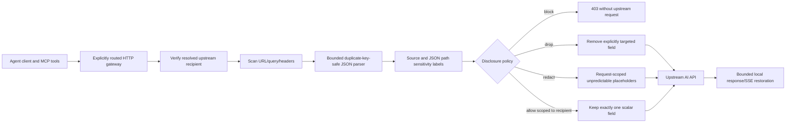

# Agent eBPF Filter: privacy-preserving Agent middleware literature review (2025–2026)

Research cut-off: **2026-10-15**. This is an engineering translation of public papers, not a claim that the repository implements their trained models, their formal guarantees, or reproduces published metrics.

## Threat model and intervention points

Unlike ordinary event-log redaction, an Agent security gateway must protect **what a tool reads, what a model receives, and what an outbound tool/API request discloses**. A keyword/PII regex on the prompt alone does not protect against context laundering, memory-parasite fields, hidden metadata channels, or disclosure to a different recipient.

The gateway runs **outside the LLM prompt context**. The untrusted model or MCP tool cannot directly edit the operator's policy, and an allow action is checked against the actual resolved upstream hostname, not the client's Host header.

### Papers and implementable consequences

| Source | Published evidence | Engineering consequence | Current implementation |
| --- | --- | --- | --- |
| [FLOWSEAL: Confuse the Model, Control the Flow (2026, arXiv:2609.14003)](https://arxiv.org/abs/2609.14003) | Tool-side interception, provenance and information-flow lattice, controlled declassification; reported near-zero disclosure for its evaluated attacks | Perform protection in the trusted proxy, require recipient-scoped explicit allow, never rely solely on an LLM-generated privacy instruction | **Partially implemented:** external enforcement point and exact recipient checks; **not** the paper's cross-tool provenance lattice |
| [MINIM: Privacy-Aware Minimal View for Agents via Trusted Local Sanitization (ICML 2026)](https://proceedings.mlr.press/v306/yu26bq.html) | Sensitivity/necessity scores determine keep/abstract/remove for task-irrelevant UI context | Apply operator-configured field-level keep(redact exemption), abstract(redact), remove(drop) decisions; preserve essential non-sensitive task fields | **Rule-based approximation**; no trained sensitivity/necessity scorer |
| [Contextualized Privacy Defense for LLM Agents (ICML 2026)](https://proceedings.mlr.press/v306/wen26k.html) | Step-specific privacy instruction trained by RL achieves a better helpfulness/privacy balance in the paper's evaluation | Future context-aware policy agent can recommend rules, but enforcement must remain separate and deterministic | **Not implemented**: no RL policy model or step advisor |
| [SOPE: Situation-Aware and Statistically Indistinguishable Privacy Exfiltration for MCP-enabled Agents (ICML 2026)](https://proceedings.mlr.press/v306/lin26r.html) | Scenario-dependent zero-click privacy exfiltration through MCP tool ecosystems, including covert transfer via tool modifications | Deny known full-memory JSON parameter names, check query/header metadata, do not treat successful tool calls as proof of safety | **Partial** HTTP-mediated fields; **not** full MCP client/server tool verification |
| [PrivacyPeek: Auditing What LLM-Based Agents Acquire, Not Just What They Say (2026, arXiv:2606.00152)](https://arxiv.org/abs/2606.00152) | 1,182 cases, 7 acquisition behaviors, 16 domains; acquisition-stage leakage largely survives prompting | Minimize data *before* it enters a remotely hosted model or third-party tool | **Partial**: outbound message minimization; inbound tool acquisition still needs an interception hook |
| [Privacy in Action / PrivacyChecker (EMNLP Findings 2025)](https://aclanthology.org/2025.findings-emnlp.925/) | Contextual integrity in live MCP and A2A workflows; reports leakage reduction in tested models | Include recipient and path in policy decision; verify at execution boundary rather than relying on model judgment alone | **Partial** deterministic policy with no LLM-based contextual reasoner |
| [PII-Bench (2025, arXiv:2502.18545)](https://arxiv.org/abs/2502.18545) | 2,842 samples, 55 PII categories and challenging multi-subject query relevance | Build multilingual/multi-subject tests and explicitly measure task utility, false positives and false negatives | **Early** synthetic fixtures only; not benchmark reproduction |
| [ALSA: Context-Sensitive Prompt Privacy Preservation (KDD 2025)](https://doi.org/10.1145/3711896.3736840) | Balances privacy leakage risk, contextual importance and task relevance | Prefer preserving non-sensitive functional fields and minimizing named sensitive fields instead of globally deleting text | **Heuristic** keep/abstract/drop; no ALSA scoring mechanism |

## Version 2 implementation specifics

1. **Format-aware classification:** bounded JSON token decoding with depth/node limits; duplicate object names are rejected, including equivalent decoded Unicode member names. Unlike a whole-body regex, classified JSON member names label nested values. The original field name never appears in an audit finding.
2. **Context integrity:** strict mode denies high-risk memory-export fields, even when the global policy is `warn`; it handles common aliases such as `taskHistory`, `task_history`, and `Task-History`. Broad generic keys (`messages`, `history`, `context`) are *not* denied by default to limit task disruption.
3. **Field-level control:** exact RFC 6901 JSON pointers support `block`, `drop`, `redact`, and recipient-scoped `allow`. An allow rule must contain a real upstream hostname, and a missing/invalid policy rejects traffic. Operator rules are configured via local authenticated runtime settings, never from untrusted model output.
4. **PII detectors:** the original secret/email/telephone patterns remain; payment-card candidates now require plausible issuer digits and a valid Luhn checksum. Unformatted 12–15-digit numeric runs are not classified as phones by default, reducing telemetry false positives.
5. **Non-body egress:** query strings, paths, and non-auth headers are inspected. Double-encoded query strings are decoded for inspection only. Policy never silently alters signed URL/header semantics; in `block` or `redact` mode these outbound paths are denied rather than rewritten.
6. **Controlled restore:** random request-scoped placeholder mappings remain in memory only, with optional HTTP/SSE local response rehydration. Oversized, malformed, signed, unsupported, or uninspectable HTTP bodies do not pass through when protection is enabled.
7. **Separation of privileges:** this gateway does not switch on eBPF TLS interception, install certificates or enable transparent TPROXY by itself. AstrLink remains an optional read-only external integration.

### Known limitations and missing research capabilities

- **Not proven information-flow control.** There is no complete source/recipient lattice, provenance propagation across MCP servers, or browser/UI acquisition-stage pruning. HTTP-bound JSON path classifications are a pragmatic subset.
- **Not model-semantic.** New aliases for memory exfiltration or indirect leakage inside seemingly harmless prose can evade deterministic rules. Consider an offline, measurable small model as an *adviser* and retain deterministic outbound enforcement.
- **Not full-traffic protection.** TLS not explicitly routed through the gateway, WebSockets when policy is enabled (rejected), arbitrary binary uploads, non-HTTP MCP transports, and cross-process channels require separate enforcement.
- **Metadata exceptions:** provider authorization headers are not scanned, because LLM authentication depends on them. Strictly scoped routes, upstream TLS, and explicit trust decisions are needed.
- **Utility trade-offs:** `drop` and forced redaction can degrade legitimate tool API arguments, while typed sensitive numeric fields are blocked to avoid silent schema changes.
- **Restoration:** split placeholders across separate SSE events cannot be reliably rejoined by the current event-local restorer.
- **Privacy allowlist:** literal allowlist entries are stored in runtime configuration. Never put real credentials there; future implementation should use salted local fingerprints/hardware-backed secrets.

## Evaluation protocol (planned, no published metric reproduced)

Run all suites with **synthetic secrets only**. For a test corpus with ground truth, record:
- `leakage rate = exposed restricted items / all restricted items`, broken out by body, metadata, recipient, and tool parameters.
- `precision = true positives / all flagged findings`, `recall = true positives / all marked sensitive items`, with confidence intervals over multi-party scenarios.
- `utility pass rate`: fraction of non-sensitive AI/tool calls that preserve expected JSON schema, required arguments, and allowed requests.
- `latency p50/p95/p99`, allocations per request, throughput (MiB/s), rejection rates for malformed/oversized/duplicate-key requests.
- `cross-session isolation`: test that restoration tokens from one request cannot restore any item from another request.

Current automated fixtures provide synthetic memory-parameter denials, nested values, payments with valid/invalid checksum, signed/uninspectable bodies, metadata, JSON pointer rules, duplicate keys, recipient scopes, SSE restoration, fuzz seeds and microbenchmarks. **No actual PII-Bench, PrivacyPeek, PrivacyLens-Live or SOPE reproduction is claimed.**

## Guardrail design principles

The agent may suggest which data are necessary; it must not *self-authorize* an egress recipient or lower a deny rule. The local policy decides. In ambiguous cases prefer deny-and-explain over fabricated protection, especially when a filter cannot inspect compressed, streamed or encoded payloads safely.

Do not write detected plaintext to logs, files, telemetry, error messages or UI tooltips. A diagnostic report may expose category names and counters only.
