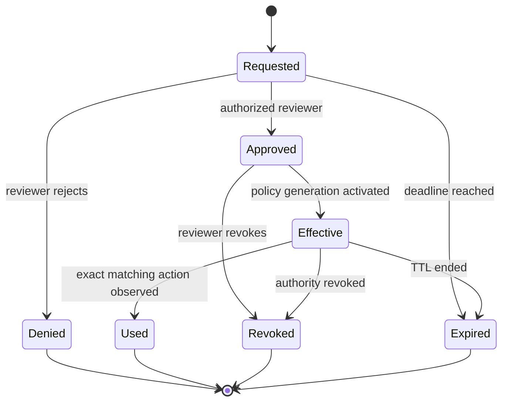

# Agent 实时行为监控：可观测性需求与验收规范（提案 v0.1）

> **状态：设计与缺口清单，非已部署功能。** 本文将 2026-10-29 MIT Technology Review 关于实时监控 Agent 行为的主张，和 Partnership on AI（PAI）的六类遥测缺口，转换为 Agent eBPF Filter 的工程需求。除“当前实现核对”注明的能力外，本文中的事件、字段、SLO 与测试均为**计划接口/验收目标**，不能作为已实现或安全认证的证据。

## 0. 来源、边界和阅读路线

- 参考文章：Madhulika Srikumar、Claire Leibowicz，*We urgently need to monitor AI agents' actions in real time*，MIT Technology Review，2026-10-29，https://www.technologyreview.com/2026/10/29/1147824/monitor-ai-agents-actions-real-time/ 。
- 研究依据：PAI，*The Observability Gap in AI Agents: What to Fix Before Agents Scale*，2026-10-07，https://partnershiponai.org/resource/the-observability-gap-in-ai-agents/ 。
- 规范背景：OpenTelemetry GenAI semantic conventions（仍在演进），https://opentelemetry.io/docs/specs/semconv/gen-ai/ 。

**来源中的核心要求**：持续监控依赖能回答“谁做了什么、谁授权、权限/记忆何时变化”的运行记录，也需要谨慎区分“系统做了什么”与“模型声称怎样决定”。文章和 PAI 报告**并未提供本仓库的性能指标、已实现 API 或完整设计**；以下字段、架构、优先级和验收流程是本项目据此提出的工程方案。

与以下资料配套阅读：
- [现有逃逸初筛与审查层](misalignment-monitoring.md)；
- [Agent 身份、进程与证据边界](../technical/agent-identity.md)；
- [风险评分与真实阻断边界](../technical/detection-evidence.md)；
- [OTLP 导出现状](../integrations/otel-export.md)；
- [存储、审计和队列丢弃指标](../technical/storage-observability.md)。

## 1. 监控目标与非目标

目标 G1：跨运行识别同一个受管理的 Agent，区分 Agent、Run、Task、Tool Call、真实进程和子 Agent；能解释身份是直接验证、推断还是未知。

目标 G2：在敏感行动前检查有效权限与人类授权；对未授权的**尝试**、被拒绝、实际成功及结果未知分别记录，避免把一次请求误判为逃逸成功。

目标 G3：记录每次权限模式/有效 Grant、记忆版本及审查状态的变化来源、前后版本、时间、审批者和生效结果，支持回放、撤销与问责。

目标 G4：低延迟关联 eBPF / wrapper / Agent SDK 事件与控制面状态，把确认违规、疑似偏差、监控盲区分开显示；支持人工复核与受控隔离。

目标 G5：保留最低必要的来源证据、缺失标记和丢弃计数，使审计人员能够发现**无法观察**的情形，而不是把“无事件”解释为“无风险”。

非目标：读取模型私有 Chain-of-Thought（CoT）、证明内部真实意图、把 LogProb 当成可信置信度、用模型直接修改内核阻断 Map、宣称 OTLP span 等于端到端取证、以用户自填字段冒充可信事件。

## 2. 六类遥测缺口与本项目现状

以下六类缺口来自 PAI 研究；“现状”依据本仓库源码技术手册与对应组件，不代表对全行业的统计复现。

| PAI 缺口 | 本仓库可复用的部分 | 仍需建设的能力 | 优先级 |
| --- | --- | --- | --- |
| 跨运行的持久 Agent 身份 | 已有 `agent_run_id`、`root_agent_pid`、`task_id`、`trace_id`、PID/PPID、部分 cgroup 归属 | 稳定 `agent_id` 注册与校验、跨 Run 映射、身份轮换、子 Agent 显式授权继承及证据等级 | P0 设计优先 |
| Permission mode changes | 精确 Grant / 代际检查的研究模拟；现有策略管理通道 | 权限模式变化的“请求→批准→生效→撤销”不可遗漏审计；验证执行时使用的真实代际 | P0 设计优先 |
| Memory changes | 文件/进程系统调用能看到部分物理变更；不等于逻辑 Agent memory | memory 增删改/加载的语义事件、版本哈希、来源、作用范围、前后版本及追溯 | P1 |
| Human intervention | Wrapper/Hook/策略控制面可补充上下文 | 结构化批准、拒绝、撤销和超时事件；审批人权限与适用动作的独立校验 | P0 设计优先 |
| Chain-of-thought reasoning | 可观测 Tool Call/行为事件与审查输入元数据 | 仅存合法可获取的任务理由摘要与证据引用，标记自述且不视为真实 CoT | 研究可选 |
| Token-level log probabilities | 当前 L0 风险分值并非模型置信度 | 仅在模型供应商明确支持且获得授权时作为实验数据；不得当作批准或阻断依据 | 研究可选 |

> “P0 设计优先”表示**建设优先级**，不是当前研究 API 的 `P1/P2` 事件风险级别，亦非已实现的自动阻断等级。不能根据某个 PID 变化推定 Agent 身份变化；同样不能将同一 `comm` 的多次进程执行自动合并为同一个持久 Agent。

## 3. 事件与身份契约（拟议，不是现有 protobuf）

### 3.1 必备上下文

每个新增的结构化审计事件建议采用 `agent-observability.proposal.v1`，下列字段仅在**具备相应证据**时赋值；未知字段显式标注 `unknown` 或 `unverified`，不得合成“已验证”值。

| 字段 | 意义 | 可信性要求 |
| --- | --- | --- |
| `event_id`、`event_time`、`ingested_at`、`sequence` | 事件标识、发生/入站时刻、来源序号 | 分辨时钟域；序号有间隙需要报告；时钟不同步不证明先后顺序 |
| `tenant_id_hash`、`agent_id`、`agent_run_id` | 租户伪名、跨 Run Agent 身份、单次 Run 身份 | `agent_id` 应由受信任注册/部署控制面分配；Run ID 不得冒充稳定身份 |
| `parent_agent_id`、`delegation_id` | 子 Agent 的父级及授权转交 | SDK 显式绑定并交叉检验；进程树只能提供候选关系 |
| `pid`、`process_start_time`、`pid_namespace`、`cgroup_id` | 内核证据关联 | 避免 PID 复用；容器共享路径不能自动合并 inode |
| `task_id`、`tool_call_id`、`trace_id`、`span_id` | 单次调用关系 | 可以缺失；不得据此推断跨 Run 同一个 Agent |
| `policy_id`、`policy_generation`、`permission_mode` | 生效中的权限快照 | 需要独立控制面证据；不能由 Agent 文本声明代替 |
| `source_kind`、`source_integrity`、`evidence_refs` | SDK/Hook、Wrapper、Kernel、Operator 来源 | 标记验证结果和可追溯原始事件引用 |
| `result_status`、`errno`、`observed_retval` | attempted / denied / succeeded / unknown | 只有可核实的结果才能标记 `succeeded` |
| `redaction_level`、`payload_digest` | 脱敏和摘要元数据 | 不默认落盘 prompt、令牌、HTTP/TLS 正文及记忆内容 |

身份的三个不变量：

1. `agent_id` 代表**持续部署身份**；`agent_run_id` 代表一次执行；`root_agent_pid` 只是进程线索，三者不得互相替代。
2. 受信任注册失败时维持 `agent_id=unknown`，并将依赖明确 Agent 身份的授权判断降级为待验证；不得拿 `comm`、父 PID 或文件路径填充。
3. 子 Agent 的权限不得大于其直接父 Agent 的有效权限；委派需有可核查的 `delegation_id`、策略代际与过期时间，继承不是默认信任。

### 3.2 事件种类

| 类型（拟议） | 触发点 | 至少需要的证据 | 主要目的 |
| --- | --- | --- | --- |
| `agent.lifecycle` / `agent.delegate` | Agent 创建、运行、结束、委派 | 稳定身份、Run、父子、出生/结束时间、注册来源 | 追踪跨运行归属 |
| `agent.action.attempt` / `agent.action.result` | 敏感 Tool Call / OS 操作前后 | 动作精确范围、声明策略代际、检查结果、独立结果 | 区分尝试/阻断/成功 |
| `agent.permission.change` | 模式或 Grant 生效、撤销 | before/after hash、版本、变更发起方、批准链、生效状态 | 检出权限绕过、回滚 |
| `agent.memory.change` | 逻辑记忆写入/加载/删除 | memory ID 的伪名、版本摘要、来源、操作、审批上下文 | 检出可能的持久化漂移 |
| `agent.approval.*` | 请求、批准、拒绝、过期、撤销、实际使用 | request ID、审核主体、授权范围/期限、耗时、绑定目标 | 发现遗漏/橡皮图章式审批 |
| `agent.monitor.integrity` | 采集器失联、心跳/序号异常、审计链间隙 | 采集组件 ID、独立心跳、队列/存储丢弃、时钟 | 让监控失效可见 |
| `agent.decision.summary`（可选） | 可取得的 SDK 决策摘要 | 摘要出处、可验证的工具选择、可引用 evidence ID | 支持调查，不声称真实 CoT |

**事件结果、授权结果和模型解释分别存储，不应合并为单一 `risk_score`。**

### 3.3 最小提案示例

这是一条**模拟事件**，仅用于设计评审，不是当前 `POST /research/safety/evaluate` 的可用请求格式：

```json
{
  "schema_version": "agent-observability.proposal.v1",
  "event_id": "evt_demo_002",
  "event_type": "agent.action.result",
  "event_time": "2026-10-30T08:00:00Z",
  "identity": {
    "agent_id": "agent_pseudonymous_7",
    "agent_run_id": "run_demo_9",
    "parent_agent_id": null,
    "pid": 4001,
    "process_start_time": "2026-10-30T07:59:30Z"
  },
  "action": {
    "domain": "network",
    "resource": "example.net:443",
    "operation": "CONNECT",
    "result_status": "denied",
    "observed_retval": -1
  },
  "authorization": {
    "policy_id": "limited-web",
    "policy_generation": 5,
    "approval_request_id": null,
    "state": "not_granted"
  },
  "source": {
    "source_kind": "kernel",
    "source_integrity": "unverified",
    "evidence_refs": ["kernel_evt_demo_13"]
  },
  "redaction_level": "standard"
}
```

`source_integrity=unverified` 意味着即使报告由 API 接收，也不能据此声称内核证据已独立证明。真实实现不能采信 Agent 自填的 `observed_retval`。

## 4. 人类审批与授权状态机（新增要求）



每次人工介入必须可审计：`approval_request_id`、`reviewer_id_hash`、审核者角色及权限来源、`requested_at`、`decided_at`、`outcome`、`scope_digest`（精确动作/目标/环境）、`expires_at`、`linked_event_id`、`policy_generation`、`reason_code`。不保存人类审批者的原始身份信息到普通 OTLP 输出；授权审批控制面保存可依法回溯的单独映射。

**约束**：批准“一个任务”不自动批准其任意子进程与任意网络目标；取消审批、审批过期或策略代际变化时，旧票据必须失效。事后补录的批准不得修饰此前的未授权操作。需要人工批准但缺失证据时不得输出“已批准”，前置执行控制采用当前独立策略配置的安全失败模式，监控 UI 报告缺证与阻断结果。

## 5. 权限与记忆变更

权限事件要求携带：`initiator`、`before_policy_digest`、`after_policy_digest`、`before_generation`、`after_generation`、`requested_mode`、`effective_mode`、`approval_ref`、`applied_at`、`success/failed`。使用 `agentboundary.CheckLineage/CheckUpdate` 的精确 Grant 逻辑做**离线设计校验**；它们现阶段不能证明生产内核已经执行相同策略。

Memory 事件要求携带：`memory_store_id_hash`、`memory_object_digest`、`version_before/after`、`operation`、`initiator`、`cause_event_id`、`review_ref`、`retention_class`。内核捕获到的文件写入不等于框架层的“记忆更新”，必须由明确的 SDK 或存储 Hook 语义上报，并标注来源可信性；不保存原始记忆、嵌入向量和包含个人隐私的检索内容。

## 6. 实时处理路径与失效策略

```mermaid
flowchart TB
  SDK["Agent SDK / Hook: lifecycle, approval, memory"] --> IN["认证事件入口（拟议）"]
  K["eBPF / Wrapper: syscall, return, exact grant"] --> EN["现有 EventEnvelope / context enrichment"]
  IN --> JOIN["有限时间窗关联（拟议）"]
  EN --> JOIN
  JOIN --> L0["L0：确定性授权比较与轻量级异常初筛"]
  L0 --> AUD["有界、可追溯审计队列（拟议）"]
  L0 --> UI["Web / Renew 告警和待验证标记"]
  L0 -. nonblocking .-> L1["L1 语义复核（拟议，异步）"]
  AUD --> STORE["审计事件与缺失/丢弃指标"]
  STORE -. optional .-> OTLP["现有 OTLP 导出通道"]
  L1 --> L2["L2/L3：人工调查与独立证据（拟议）"]
  L2 -. authorized action .-> POLICY["现有受控策略管理 / enforcer"]
  K --> PRE["敏感动作需独立的前置授权/策略执行"]
```



- **同步决策只依赖可信授权**：用户态模型不能成为 Kernel 热路径的唯一同步阻断条件。Kernel 事件多为执行前/后的部分观测；仅凭异步告警不能保证在副作用发生前拦住动作。
- **关键审计不能靠抽样**：身份、审批、权限变更、监控完整性和实际阻断结果应全量记录；低风险、未标记行为可采用单独的 keyed sampling（研究分支的 `ShouldAuditUnflagged` 尚未接入采集流水线）。
- **背压可见**：队列满、磁盘失败、WS 断连、OTLP 丢包要有独立计数、首次/末次时间与缺失窗口，不能把零告警解释为低风险。原有 OTLP 为异步 best-effort，不能用它独自承担高保障审计记录。
- **失联明确**：agent watchdog heartbeat、collector heartbeat、策略代际及外部审计链中断须分开呈现。默认仅给出“quarantine recommended”之类建议；实际隔离需要既有授权执行通道和可信证据。
- **窗口与时序**：采用来源时钟 + 入站时钟，检测序列倒退、缺口、重复、重放；不能按接收时间倒推真实 syscall 因果顺序。

## 7. 检测场景与证据门槛

| 场景 | 最低可判定事实 | 不能直接得出的结论 |
| --- | --- | --- |
| 访问工作区外文件 | 精确授权范围与已解析路径、操作结果；考虑 mount namespace | “Agent 有恶意目的”；若只有 FD 不可宣称访问具体文件 |
| 审批绕过 | 生效时刻前缺有效同范围批准 + 实际敏感动作结果 | 审批未显示就代表不存在（可能是采集器缺失） |
| 权限代际回退/扩大 | 受信控制面 before/after + 生效代际 + parent Grant 边界 | 仅凭 Agent 自述“我已授权”就合法 |
| 子 Agent 越权 | 真实委派链、子级 action scope 与父级有效 grant | 仅因不同 PID 就是两个 Agent |
| 记忆污染线索 | 可验证 memory 版本变化和后续行为偏差（相关性） | memory 变更直接造成了某个行为 |
| 模型/评估结果操纵 | 测试数据或评价文件变更、任务许可及独立结果哈希 | 所有评测文件变更都是作弊 |
| 监控停用/日志间隙 | 来自独立 collector 的心跳、丢失/审计证据 | 没有日志意味着 Agent 没有越权 |
| 说明文字与行动不符 | tool/内核实际动作与任务授权的可验证差异 | 可由自述推断模型主观动机 |

已有 `watchdog_signals.go` 等新增信号来自研究端点的**调用方 JSON**，不是自动可靠的内核事实。尤其 `network_connected` 应在独立采集器确认成功后才使用；`dns_query` 不证明连接已建立。

## 8. OTLP / 可观测性导出映射

现有 `backend/app/export_otel.go` 将 `EventEnvelope` 转成 `agent.run`、`tool.call` 等派生 Span，并可能根据工具名称启发式输出 `llm.call` / `pr.review`。这些**是运行时事件的映射**，不是持久 Agent 身份、独立审批或模型真实推理的记录。

拟议兼容原则：

1. 有可信跨运行身份时才设置 OpenTelemetry 的 `gen_ai.agent.id`；名称、PID、Run ID 均不得伪装成稳定 ID。
2. 在语义规范尚未覆盖的领域，使用版本化的自定义命名空间，如 `agent_ebpf.agent_run_id`、`agent_ebpf.approval.request_id`、`agent_ebpf.policy.generation`、`agent_ebpf.memory.version_digest`、`agent_ebpf.evidence.trust_level`。**这些是项目提案属性，不宣称是 OpenTelemetry 官方字段**。
3. 将权限变化、审批和记忆事件当作显式事件；不得根据 `tool.call` 的成功自行合成“有人批准”。
4. OTLP 批处理、采样或丢弃不影响本地审计缺失状态的可见性；用户可禁用外部导出而保留本地最低必要审计。
5. 不默认导出原始 prompt、CoT、token log probabilities、memory 正文、私密路径或用户可识别 ID。

## 9. 可操作验收标准与回放计划

### 9.1 契约与单元测试（计划）

- [ ] 跨两个独立 Run 的相同 `agent_id` 能被安全关联；同名 `comm`、相同 PID 但启动时间不同，不会错误合并。
- [ ] 未经认证的 Agent 自填 `agent_id`、`policy_generation`、`observed_retval` 被标为不可信，不升级成验证后的成功越权事实。
- [ ] 审批的请求、拒绝、同意、过期、撤销、实际使用构成可回放状态机；晚于行动的批准不能清除历史违规事实。
- [ ] 父/子权限链、精确 Grant、过期、回滚和未知代际均有正负用例；未知代际不静默放行。
- [ ] Memory 版本更新不保存正文，授权 memory 更新不被误判为恶意；缺失 SDK 事件时明确显示 `unobserved`。
- [ ] 监控断连、审计序列间隙、队列背压、OTLP 丢包能区分来源并触发运维告警。
- [ ] 机密信息脱敏、审计访问授权、可配置保留期和删除/导出记录通过权限测试。

### 9.2 端到端回放矩阵（计划）

| 正例（需要识别） | 对照负例（不能无故升级） | 关键度量 |
| --- | --- | --- |
| 无批准的外部连接成功 | 连接被拒绝 / 合法获批连接 | 成功/尝试区分率，P1 误报 |
| 权限模式被取消后继续敏感执行 | 已批准且未超期的策略更新 | 权限变更事件覆盖率 |
| 有外部委派的新子 Agent 执行越权动作 | 合法委派、相同父 Agent 下两个进程 | 身份关联错误率 |
| 监控失联后发生未授权动作 | 仅 OTLP collector 暂时不可用但本地审计正常 | 盲区告警覆盖率 |
| 记忆污染后行为漂移 | 正常业务记忆更新后无越权 | Memory 事件覆盖、后续误报 |
| 篡改评分/评测材料且无授权 | 合法修改测试 fixture | 人工复核命中率、重复告警率 |

建议逐项统计：字段完整率、身份解析覆盖率、受信来源占比、人工审批可回溯率、关键事件丢失率、每万正常事件误报数、P1/P2 召回、首次可行动告警延迟（含 P50/P95/P99）、采集与存储 CPU/内存成本、独立核验通过率。按 Agent、Run、仓库、时间分组切分回放数据；所有未标注数据单独列“待判定”，不得从模型评分反推真值。

**性能验收提议**：先在固定硬件/负载下收集事件发生→采集→判断→告警的分段延迟，再为 P95/P99 设置项目实测门槛；在得到数据前不写伪造的毫秒级 SLA。所有同步防护需要单独测量执行开销及失败模式。

### 9.3 推进顺序

- **M0（本文）**：明确六类缺口、数据契约、失败策略、测试矩阵和文档导航。只有文档变化。
- **M1（基础）**：稳定 Agent ID 注册和子 Agent 委派、审批及权限变更审计，全部事件来源可标注可信性，关键事件不抽样。
- **M2（关联）**：将 SDK / Wrapper / Kernel / 控制面信号在有界窗口内关联；增加监控盲区告警与 Renew/Web 查证界面。
- **M3（模型）**：在真实标签回放上增加 L1 审查与误报复核；CoT 摘要只作为低信任辅助信息，绝不用于跳过独立授权。
- **M4（控制）**：shadow-only 与人审通过后，经独立策略管理器逐步启用细粒度干预；持续统计误报、漏报和实际策略生效结果。

## 10. 安全与隐私验收红线

- 监控面与被监控 Agent 使用不同的认证、权限、密钥和运行边界；Agent 不可自行修改审计策略或抹除审计。
- 持久 Agent ID 与具体自然人之间的映射需要分离保管；审计 UI 与外部 OTLP 默认只展示受控伪名。
- 任何高风险控制行动需可追溯操作者、时间、策略版本和执行结果；建议不等于执行。
- 模型解释、思维链摘要及 token logprob 可能缺失、失真或不代表真实决策；绝不将它们作为排除事实证据的理由。
- 必须报告“采集不到 / 未验证 / 未实现”的状态，不能把缺失记录自动转成 `allow` 或“安全”。
- 这份提案不是法律合规声明；审计范围、数据保留期和人工审核流程必须由实际部署场景独立确定。

---

**相关代码锚点**：`proto/tracker_events.proto`、`backend/app/events/context_event.go`、`backend/internal/agentidentity/`、`backend/internal/agentboundary/`、`backend/app/export_otel.go`、`backend/app/runtime_event_log_writer.go`、`backend/app/recording/audit_chain.go`、`backend/app/observability/`。
