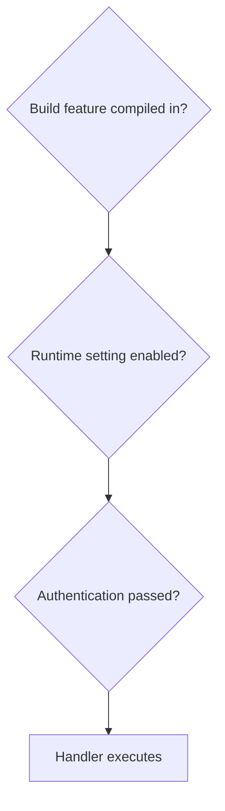

# Runtime Gates 与 Auth

本页解释 build feature、runtime gate 和 auth 的关系。

## 三层模型



任何一层不满足，都可能导致功能不可用。

## Build feature

由 `AGENT_BUILD_FEATURES` 和 Go build tags 控制。

示例：

```bash
AGENT_BUILD_FEATURES=all make backend
AGENT_BUILD_FEATURES=core make backend
AGENT_BUILD_FEATURES=tls_capture,ml make backend
```

## Runtime gate

由 `/config/runtime`、环境变量和 `runtime.json` 控制。

典型环境变量：

- `AGENT_RUNTIME_SHELL_SESSIONS_ENABLED`
- `AGENT_RUNTIME_SYSTEM_RUN_ENABLED`
- `AGENT_RUNTIME_HOOK_MANAGEMENT_ENABLED`
- `AGENT_RUNTIME_POLICY_MANAGEMENT_ENABLED`
- `AGENT_RUNTIME_TLS_CAPTURE_ENABLED`
- `AGENT_RUNTIME_OTLP_ENABLED`
- `AGENT_RUNTIME_DOMAIN_FORWARD_ENABLED`
- `AGENT_RUNTIME_KERNEL_RISK_FEEDBACK_ENABLED`
- `AGENT_RUNTIME_KERNEL_RISK_FEEDBACK_MIN_SCORE`
- `AGENT_RUNTIME_KERNEL_RISK_FEEDBACK_ENFORCE_NETWORK`
- `AGENT_RUNTIME_KERNEL_RISK_FEEDBACK_ENFORCE_FILE_NAMES`
- `AGENT_RUNTIME_KERNEL_RISK_FEEDBACK_ENFORCE_EXEC`
- `AGENT_RUNTIME_KERNEL_RISK_FEEDBACK_MAX_ACTIONS_PER_MINUTE`

常见 gate 与关联文档：

| Gate / setting | 控制面 | 相关文档 |
| --- | --- | --- |
| `ShellSessionsEnabled` | `/shell-sessions*`、`/ws/shell*` | [前端工作台](/frontend/workbench)、[路由与 API](/backend/routes-api) |
| `SystemRunEnabled` | `/system/run` | [安全模型](/security/model)、[路由与 API](/backend/routes-api) |
| `HookManagementEnabled` | hook install / raw hook writes | [Native Hooks](/integrations/native-hooks) |
| `PolicyManagementEnabled` | wrapper / cgroup / LSM policy mutation | [策略语义](/security/policy-semantics)、[eBPF 与 OS Enforcement](/backend/ebpf-os-enforcement) |
| `TlsCaptureEnabled` | TLS / Codex capture | [脱敏与隐私](/security/redaction-privacy)、[TLS Quickstart](../backend/TLS_QUICKSTART.md) |
| `OtlpEnabled` | OTLP export | [MCP、External API 与 OTLP](/integrations/mcp-external-otlp) |
| `DomainForwardProxy.Enabled` | 80/443 Host/SNI forwarder | [部署与安装](/operations/deployment)、[README](../../README.md) |
| `KernelRiskFeedback.Enabled` | 用户态风险评分写回 cgroup / LSM map | [ML、Plugins 与扩展能力](/backend/ml-plugins)、[安全模型](/security/model) |

::: warning 双 gate 能力
Kernel risk feedback 写内核策略时需要 `PolicyManagementEnabled=true` 且 `KernelRiskFeedback.Enabled=true`。只打开 ML 或只打开 policy management 都不应被描述为“自动写入内核阻断规则”。
:::

`TlsCaptureEnabled=false` 时，`/tls-capture/**`、`/codex/capture` 和 `/ws/tls-capture` 均返回 `403`，wrapper UDS 不会触发自动 TLS attach；从运行时配置将它切换为 `false` 还会关闭已启动的 probe manager。重新开启 gate 后，需通过 TLS Capture 页面或 `/tls-capture/start` / attach 端点重新启动捕获。

## Auth

所有 Gin 模式默认使用 runtime access token；`GIN_MODE=debug` 不再隐式关闭认证。token 存储：

```text
~/.config/agent-ebpf-filter/runtime.json
```

也可通过：

```text
AGENT_API_KEY
AGENT_ACCESS_TOKEN
```

覆盖。

认证方式：

- `X-API-KEY`；
- `Authorization: Bearer`；
- `?key=`。

敏感入口默认需要 token，包括：

- `/config/**`
- `/system/**`
- `/ws*`
- `/metrics`
- `/register` / `/unregister`
- `/agentsight/**`
- `/api/**` 与 `/api/v1/**`
- `/events/recent`、`/events/graph`
- `/sandbox/**`
- `/shell-sessions*`
- `/mcp`

修改这些范围时，同步 [路由与 API](/backend/routes-api)、[External API](../integrations/external-api.md)、[MCP、External API 与 OTLP](/integrations/mcp-external-otlp) 和 [文档地图](/reference/documentation-map)。

### 安全监听与升级迁移

独立后端 TCP 默认监听 `127.0.0.1`，不再监听所有网络地址。`AGENT_BACKEND_HOST`
仅接受 IPv4/IPv6 字面地址（例如 `127.0.0.1`、`::1`、`0.0.0.0`），不接受主机名或端口。
需要跨主机访问的现有部署必须显式配置监听地址，并通过 TLS 网关保护链路：

```bash
AGENT_BACKEND_HOST=0.0.0.0 DISABLE_AUTH=false GIN_MODE=release ./backend/agent-ebpf-filter
```

这是启动配置示例；认证仍使用现有 runtime token。不要把真实 token 写入 URL、日志或文档。
Kubernetes 示例显式设置 `AGENT_BACKEND_HOST=0.0.0.0`，继续从 Secret 获取 token。
本地 Renew 的私有 Unix socket 路径不受 TCP 监听地址变更影响。

只有显式设置 `DISABLE_AUTH=true` 才关闭认证，且非回环 TCP 地址会在启动时被拒绝。
`make dev` 已显式设置此变量；直接运行 `go run` 即使是 debug 模式也默认要求 token。
免认证开发实例及其 Vite/反向代理入口都只能供可信本机使用，不能将代理暴露到不可信网络。

### WebSocket 来源限制

- 默认允许 Origin 的 host:port 与 HTTP Host 相同；不信任任意客户端的 `X-Forwarded-Host`。
- 无 Origin 的原生客户端可以连接，但仍需要认证。
- 拒绝外部来源、`Origin: null`、多重 Origin、带 userinfo/path/query 的异常来源。
- 单独托管的 Web UI 可用 `AGENT_WS_ALLOWED_ORIGINS` 指定逗号分隔的完整来源，
  例如 `https://ui.example.com,http://localhost:5173`；不支持通配符，列表项不带尾部 `/`。
- 反向代理应保留公开 Host；若不能保留，显式配置可信 UI 来源。Vite 默认代理保留 Host。

Origin 检查同时覆盖本地升级入口与集群转发入口，但不是 token 的替代品。

### 日志与凭证兼容边界

内置 HTTP access logger 不记录 query、请求头及 handler error 内容；panic recovery 只记录
通用提示和调用栈，不转储请求及 panic 值。访问路径、状态码与耗时仍保留。
这不自动保护第三方代理、外部诊断包或业务模块自行输出的日志，部署时需要分别核查。

`?key=` 目前为兼容现有 WebSocket/MCP 客户端仍被接受，**尚未迁移为短期 ticket**。
普通 HTTP 和原生客户端应优先使用认证 header；已确认真实凭证曾写入旧日志时应安排轮换。

## Hooks 特例

`/hooks/event` 可使用：

- runtime token.
- per-hook `X-Agent-Hook-Secret`。

这允许 hook relay script 使用 provider-specific secret，而不是暴露全局 token。
