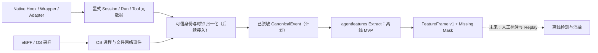
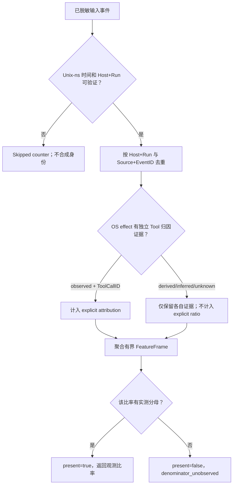

# Unified Agent Context & Harness Behavior：P0 基线与 FeatureFrame v1

> Tracking: [Issue #112](https://github.com/stevessr/agent-ebpf-filter/issues/112). 本页记录当前代码接口与**待验证的映射**，不构成跨 Harness 的完整兼容性保证。新的 `backend/internal/agentfeatures` 是**尚未接入实时采集或模型训练的离线 MVP**。平台、Runtime feature gate、hook 安装状态均需独立核验。

## 1. 范围与已实现能力

目标不是从零重新开发 eBPF 或覆盖旧模型，而是将 Agent Context / Harness lifecycle 的语义证据与已观测的 OS effects 组织成可回放、可审计、可版本化的特征帧。现有路径：

| 层 | 源码锚点 | 当前可提供 | 非能力/风险边界 |
| --- | --- | --- | --- |
| Kernel | `backend/ebpf/`、`backend/app/runtime_ebpf.go` | 进程/文件/网络等操作的观测与选定的 LSM/cgroup 控制 | 不理解 Prompt、模型意图、Tool ID；内核有采样损失 |
| Context join | `backend/app/events/context_event.go`、`backend/internal/agentidentity/` | PID/祖先/cgroup + 显式 run/task/turn/tool/trace 等字段 | 上下文由外部注入；PID 单独不是稳定身份；父进程关联不是直接的 Tool 调用证据 |
| Hooks | `backend/app/hooks.go`、`docs/integrations/native-hooks.md` | CLI 提供的 session/tool/lifecycle 元数据（能力依赖集成） | 不保证任一供应商全部 lifecycle 事件均可获取；Hook 旁路遥测不等于批准 |
| Wrapper | `wrapper/`、`backend/app/server_uds.go` | 进程命令与显式 Wrapper 策略决定 | 包裹覆盖范围有限；不代表整个 Agent 思考链 |
| Normalization | `proto/tracker_events.proto`、`backend/app/events/` | Event、EventEnvelope、typed payload、时间/审计字段 | schema 字段存在不代表每条事件均填充 |
| Old ML | `backend/app/features.go`、`backend/app/ml/feature_taxonomy.go` | 128 维命令、参数、LSH、Wrapper history、时间、网络审计 | 按 comm/args/pid 提取，不是统一 agent-run 特征；历史全局共享 |
| Research | `backend/app/research/training.go`、`backend/internal/detectionengineering/` | 研究数据集、基线规则回放、人工标签 | 风险分/规则输出不是真值；回放窗口不保证无丢失 |
| Observability | `backend/app/kernel_sequence_audit.go`、`docs/technical/collector-clock-audit.md` | per-CPU sequence、丢失审计、kernel clock 对齐 | 不能用 ingest timestamp 冒充发生时间 |

### P0-01 Harness 信号矩阵（仓库集成层；非上游协议稳定性承诺）

标记：**native** 表示仓库提供 hook/plugin 入口；**wrapper** 只覆盖显式包裹的执行；**optional** 表示需安装/开关；**unknown** 表示没有该语义的已确认来源。具体字段取决于上游 CLI 版本和实际 payload。

| Harness | 已有连接方式 | 仓库可核查的信号 | 不可直接断言 |
| --- | --- | --- | --- |
| Claude Code | native optional | tool hook；可选 SubagentStart/Stop 生命周期，且 agent ID 仅摘要 | 没有完整 span 时不能重建精确 parent-child |
| Gemini CLI | native optional | tool/hook 元数据经 relay | 不保证完整推理、压缩及 token 细节 |
| Codex | native optional（feature flag） | `hooks.json` relay 的 hook 事件 | 不能把旧/新版本 hook 语义假定相同 |
| Pi / Oh My Pi | TypeScript extension optional | `session_start`、`tool_call`、`tool_result` | 并非所有操作都能映射 OS 进程 |
| DeepSeek Harness (dsh) | Cordis plugin optional；独立 dsh-exec optional | session/created、session/event；显式 subprocess 可走 Wrapper | inspector / TLS 默认不启用；插件不执行审批 |
| GitHub Copilot CLI | native optional | CLI hook relay metadata | 不假定提供跨 Agent 因果图 |
| Kiro CLI | managed-agent hook optional | hook relay metadata | 修改默认 Agent 有安装副作用，不能静默配置 |
| Augment / Auggie | native optional | hook relay metadata | 不保证 Session/Turn/Token 全覆盖 |
| Antigravity CLI | native plugin optional | hook metadata；特定 stdout protocol | stdout `decision: allow` 不是本项目执行强制控制的证明 |
| ZCode | native lifecycle optional | SessionStart、Prompt、PreToolUse、PermissionRequest、PostToolUse、Failure、Stop；SessionStart source 含 compact | Hook 不改变内部授权；需新 session 才稳定装载 |
| Cursor | wrapper alias | 经 shell alias 的 CLI execution | GUI/未经过 alias 的进程不因此得到 Tool 语义 |
| MiniMax Code | wrapper alias + PID tracing | `mcode`、`minimax-code` 进程事实与可选 wrapper | 不假定私有桌面端存在可用 native hook |

来源：[native-hooks](../integrations/native-hooks.md)、[agents](../integrations/agents.md)。该表是**集成方式清单**而不是实测覆盖率；要将某字段标为“可用”，应添加版本化 golden payload + CI 验收。

## 2. P0-02 字段血缘与审计结论

| 字段/特征 | 生产者 | 消费者 | 缺失 / 泄漏 / 隐私风险 |
| --- | --- | --- | --- |
| `agent_run_id`, `task_id`, `turn_id`, `tool_call_id` | adapter/register、wrapper、native hook（若实际给出） | ProcessContextStore、Event、Envelope、UI | 注册可能未发生；继承链属于推断，不能为缺失字段编造值 |
| `trace_id`, `span_id` | 上游显式 telemetry/context | event enrichment、Research | 缺失与重复 ID；OpenTelemetry 与 CLI 事件可能重复 |
| `pid`, `ppid`, `cgroup_id` | kernel/runtime | Agent identity、graph | PID reuse、reparenting、namespace/cgroup 变更；待增加 stable process key |
| `kernel_timestamp_ns`, `capture_timestamp_ns`, `ingest_timestamp_ns` | kernel/audit/backend | EventEnvelope、UI、metrics | 不同时钟域；未对齐或丢失必须标记 unknown |
| `comm`, `argv_digest`, `cwd` | kernel/wrapper/context | 旧 ML、UI、图 | `cwd` 可能敏感；digest 非匿名化且可能用于关联 |
| 旧 128 维 `[96:112]` | 共享 `RecentHistoryBuffer` | command ML | 混合多个 run / 用户的最近事件；含既有 alert、block、anomaly score，若用于相同任务标签有泄漏风险 |
| 旧 128 维 `[112:120]` | `time.Now()` + history | command ML | 用处理时间而非 event time，不保证回放确定性 |
| `risk_score`, `decision` | Wrapper/policy/ML | audit、alerts、enforcer | 禁止当成新检测器独立攻击真值；若使用历史决策特征需独立时序实验 |
| `prompt_digest`, `prompt_len` | metadata-only hook/optional TLS | UI / Research（依配置） | 摘要可跨事件关联；默认避免训练 prompt 内容或持久化明文 |
| capture drop / sequence audit | ring buffer / kernel audit | health/metrics | `no event` 不证明不存在行为；过滤丢弃与采集丢失必须分开 |

上述审计是静态代码路径核对，并非已经完成线上数据集测量、race audit 或各 Hook 版本实测。

## 3. P0-03 术语和关联语义

- **Harness**：执行 Agent 调度和工具调用的 CLI / runtime；**model provider**：响应模型 API 的供应方。二者独立，不能以 URL/API 协议判断发起方。
- **Session / Run / Task / Turn / Tool Call**：不同时间粒度的逻辑身份。ID 必须由对应可验证上游产生；一个 OS process 可承载多个 run。
- **Process identity**：理想上包含 host boot ID、PID namespace、PID/TGID、process start time。裸 PID 只是瞬时局部编号。
- **Observed**：源事件有可核实直接证据。**Derived**：从已验证输入按确定性规则派生。**Inferred**：启发式关联。**Unknown**：缺少可归因证据。
- **OS observed ≠ Tool explicitly observed**：内核直接观测 exec 不会证明从某个 Tool 调用触发，继承来的 tool id 需独立标注其关联级别。
- **Source lineage**：source + event ID 用于去重同一来源的传输重放；不同来源是否代表同一工具调用需额外匹配/冲突规则，不可粗暴折叠。
- **MCP**：客户端请求、服务端处理和后续 OS effect 是不同事件；默认不把这些事件各算成一个独立 Tool call。

## 4. P0-04 威胁边界和对照组

考虑间接 Prompt Injection、权限提升/越界工具、MCP 工具描述与执行差异、memory/context contamination、无限重试、跨工具文件读取→出站网络、subagent fan-out、重放与时间错配。必须建立正常对照：`git`、编译器、包管理器、shell 管道、下载依赖和并行测试也可能产生大量进程、文件、网络操作。

没有上游可信指令文本/工具审批证据时只能提示行为线索，**不得凭 OS syscall 宣称证实 Prompt Injection 或数据外泄**。检测建议优先进入 read-only replay / shadow mode，不能通过特征提取器直接安装封禁规则。

## 5. P0-05 隐私与版本原则

默认采集已脱敏元数据；不在新 FeatureFrame 储存命令参数、任意绝对路径、Prompt/Response/Thinking、MCP tool inputs/results、Cookie、密钥或 TLS 明文。Opaque ID 仍可能是敏感关联标识：API/export 应鉴权、限制保留和基数，并按既有隐私策略进一步脱敏。**零值不是缺失值**，比率必须显式携带 `present=false`、缺失原因。

- 旧 `FeatureExtractor` 128 维 **保持语义/索引不变**。
- 新 `backend/internal/agentfeatures` 输出 `agent-context-harness.v1` 特征定义，stateless event-time window，按 host + run 隔离；缺失 host/run 时跳过计数，不创建假 run。
- 该离线 MVP 只包含 metadata count / ratio / explicit-attribution guard / missing masks；**尚无线上生产接入、实时窗口、Hook 协议映射、模型迁移、Windows ETW 或 macOS Endpoint Security 采集**。
- Golden test 覆盖窗口左右边界、跨 host/run、Source 作用域去重、未知上下文、mask、重复输入及批次限制。
- 定量基线、跨 Harness 矩阵验证、p95 overhead 和训练/测试消融需后续真实样本完成。

## 6. 开发顺序 / DoD

1. P0：扩充 signal matrix 为含 CLI 版本、真实样例字段、状态、负载测试与数据血缘的 machine-readable fixture。
2. P1：在版本化 proto/Envelope 中增加 stable process key、独立 attribution evidence、source/coverage/time metadata；转换层严格校验、脱敏，不丢弃未知字段造成的告警假象。
3. P2：把确定性离线 FeatureFrame 接入 Research session 的**显式 opt-in** 回放，完成不同来源的 Tool 去重策略、per-run 状态清理和事件时间窗口。
4. P3/P4：独立 truth labels、held-out & benign、跨 Harness 消融，统计 mask coverage / FPR / FP-per-run / p95 overhead 后再评估模型。
5. P5：Renew 与 Web 仅显示**证据等级和观测事实**，不把推断链渲染成已证实 Agent 因果。

参考：OpenTelemetry GenAI semconv、OpenInference、MCP（作为对照，并非该代码已完全符合）；[Agent-Warden 文献分析](../reference/agent-warden-analysis.md)、[Detection Engineering replay](../security/nvidia-validation-first-detection.md)。

## 7. 统一上下文证据与离线特征帧的数据流

**图的实线和虚线区分**：本 PR 已提供独立离线 Extract，但 B/C→D/E 的实时 Adapter 尚未实现；该图为目标数据流，不表示整个链路已上线。

## 8. 证据与缺失值决策

这两张图仅描述协议边界和本 PR 的纯函数处理；不能以它们宣称已获得完整 Harness 生命周期数据。
