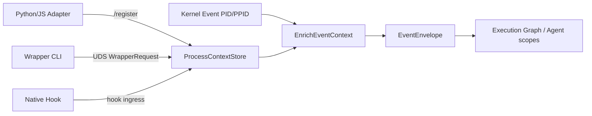
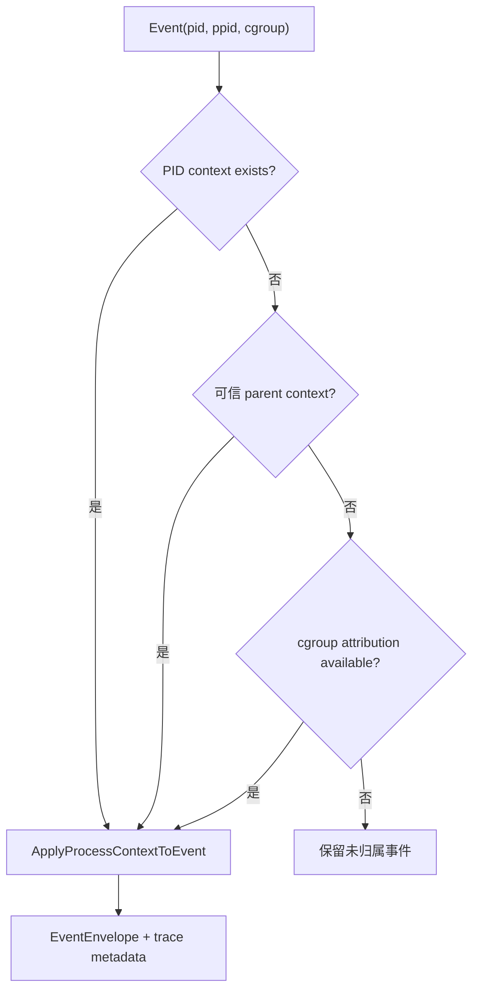
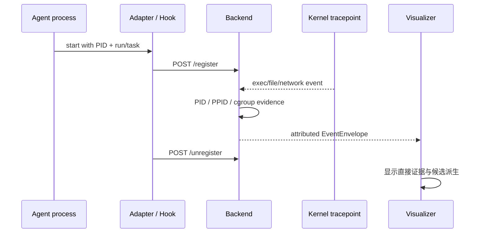

# Agent 归属、注册与执行图谱

**代码锚点**：`backend/app/events/context_event.go`、`backend/app/agent_scope_root.go`、`backend/internal/agentidentity/root_store.go`、`backend/internal/agentscope/policy.go`、`backend/app/graphbridge.go`、`backend/internal/executiongraph/`、`adapters/`、`wrapper/`。

## 证据如何进入系统

`adapters/python/agent_tracker.py` 和 `adapters/js/agentTracker.js` 以 HTTP `POST /register` 注册当前 PID，上报上下文，并在结束时 `POST /unregister`。Wrapper 使用私有 UDS `/tmp/agent-ebpf.sock` 传递 `pb.WrapperRequest`，后端在 `server_uds.go` 校验本地 peer credentials 后作同步策略决策。Native Hook 还可补充 tool 级上下文。它们都是**外部提供语义**，不是内核自动理解 Agent 推理过程。

## 上下文关联算法

`events.EnrichEventContext` 先看当前 PID 的上下文，还可以尝试父 PID 或 cgroup 归属信息；`ApplyProcessContextToEvent` 将 run/task/conversation/turn/tool/trace 等字段填入 `pb.Event`。相同 comm 名称和一次普通 shell exec 不足以确认 Agent 身份。上下文写入与缓存均有生命周期边界。

## Agent 进程树不等于 Agent 因果图

`desktop/renew/native_agent_lineage_model.go` 显式声明其图是 **OS process snapshot, not a causal Agent SDK span graph**；它用进程创建时间约束 PID 复用，用 PID/PPID 和 Hook 信号划分 `agent`、`subagent-candidate`、`process`。`backend/internal/executiongraph/` 对归档事件构图。两者均应在 UI 解释证据来源，不能把候选节点写成确定的 SubAgent。

## 边界与测试

- 使用源字段 `agent_run_id`、`task_id`、`trace_id` 等时，应验证上游确实有传入，不能凭标签填充。
- 注册后如果进程退出、PID 复用或重启，旧状态不应永久归属于新进程。
- 根 Agent 的归属策略位于 `agentidentity` 与 `agentscope`，可查看 `backend/app/agent_scope_root_test.go`、`backend/app/events/attribution_ancestry_test.go` 以及 Renew 的 `native_agent_lineage_test.go`。

## 与持久 Agent 身份规范的关系（后续需求）

当前实现中的 `agent_run_id`、`root_agent_pid` 和 `trace_id` 分别代表运行、进程归属线索及链路关系；**都不能自动证明跨 Run 的稳定 Agent 身份**。受信注册、持续身份与运行身份分离、子 Agent 显式委派、人工批准及策略/记忆变更的提案契约，见 [实时 Agent 可观测性需求与验收规范](../security/real-time-agent-observability.md)。该契约目前尚未落实为注册 API、存储表或稳定的 OTel 属性输出。
