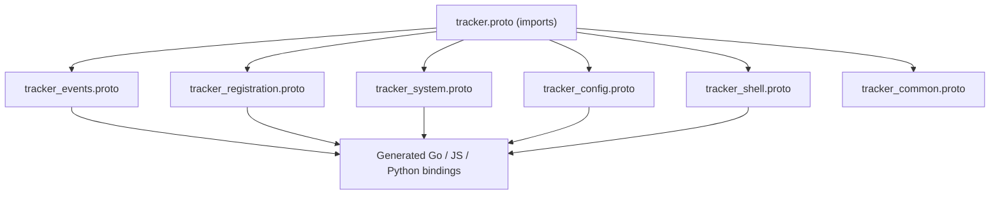
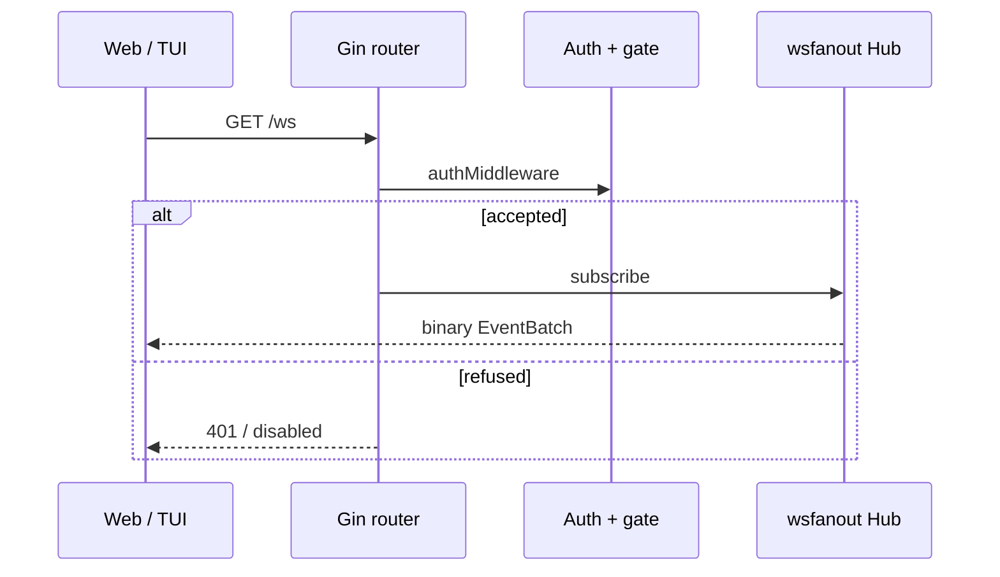
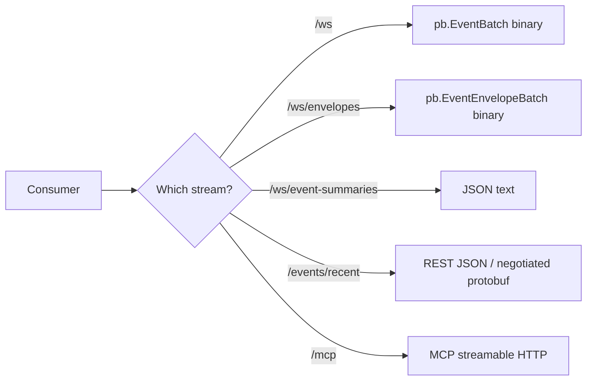

# Proto、REST / WebSocket / MCP 的准确边界

**代码锚点**：`proto/tracker.proto`、`proto/tracker_*.proto`、`backend/app/routes.go`、`backend/app/ws_api.go`、`backend/app/server_mcp.go`、`backend/app/handlers/api_external.go`、`frontend/src/services/http.ts`。

## 1. Schema 组织

`proto/tracker.proto` 现在只是聚合导入文件，领域拆分为 `tracker_common.proto`、`tracker_events.proto`、`tracker_registration.proto`、`tracker_system.proto`、`tracker_config.proto`、`tracker_shell.proto`。协议新增字段应先修改领域源，再运行 `make proto`，不要手工维护生成的 Go、JS、Python binding。

## 2. 真实接口分组

`registerRoutes` 把 WS、Shell、Events、Network、Sandbox、Utility、Authenticated、Compatibility、Docs、Static 路由显式拆开；具体可用性受编译 feature 和 runtime gate 影响。

| 业务 | 代码路由（样例） | 消费方式 |
| --- | --- | --- |
| 事件 | `GET /events/recent`、`/events/detail/:id`、`/events/graph` | REST |
| 记录与回放 | `POST /events/recording/start`、`stop`、`replay` | REST |
| 原始事件 | `GET /ws` | WS binary `pb.EventBatch` |
| 封装事件 | `GET /ws/envelopes` | WS binary `pb.EventEnvelopeBatch` |
| 日常摘要 | `GET /ws/event-summaries` | WS JSON text |
| 执行图 | `GET /ws/events/graph` | WS JSON |
| 系统信息 | `GET /ws/system` | WS |
| 网络 | `GET /network/flows`、`/network/dns-cache` | REST |
| Shell | `POST /shell-sessions`、`GET /ws/shell` | 可选 |
| TLS | `GET /ws/tls-capture` | 可选 |
| 策略 | `/sandbox/cgroup/*`、`/sandbox/lsm/*` | 可选，具管理门控 |

## 3. 协议格式不一致时如何处理

`handlers.HandleConfigRuntimeGet` 在客户端偏好 Protobuf 时返回 `pb.RuntimeConfigResponse`，否则为 JSON；事件 WS binary 与摘要 WS text 不应混淆。`frontend/src/services/http.ts` 统一注入请求认证头；终端客户端也需显式传递 Token。

## 4. 外部接口

`server_mcp.go` 通过 `mcp.NewStreamableHTTPHandler` 提供 MCP 能力（例如 tail events、配置快照、flow 查询、健康、部分政策动作）；External API OpenAPI spec 来源于 `handlers.BuildExternalOpenAPISpec`。对外 API 的证据应由 `routes.go` 与各 handler 同时确认，不能仅凭 OpenAPI 文本保证存在相同的非别名 URL。

## 5. 修改协议的检查顺序

修改 `proto` → `make proto` → 编译 `backend`、`frontend` 与 `desktop/renew` → 用二进制 WebSocket 客户端读帧 → 验证 JSON fallback 与权限。事件兼容字段 `LegacyEvent` 的迁移逻辑在 `events/envelope_event.go`，升级时保持兼容或明确破坏性变更。
