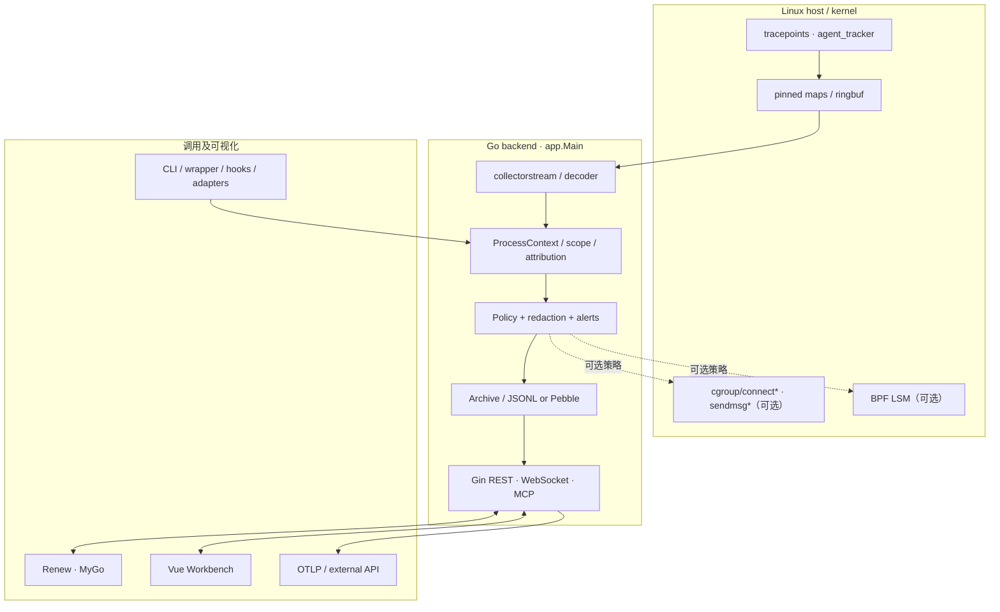
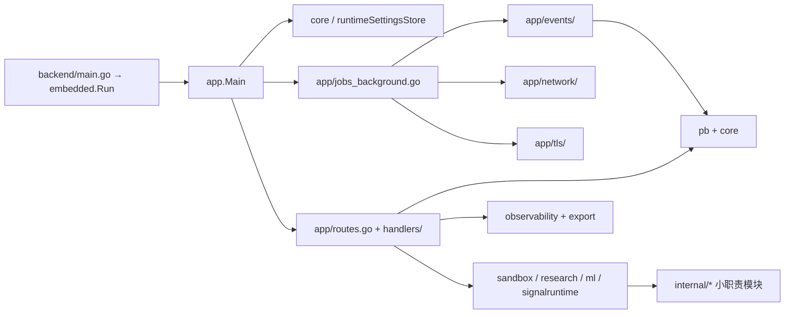
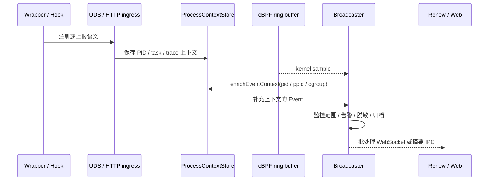

# 总体架构：边界、依赖与数据所有权

**源代码**：`backend/main.go`、`backend/embedded/embedded.go`、`backend/app/main.go`、`backend/app/appcontext.go`、`backend/app/events/`、`backend/internal/`、`frontend/src/`、`desktop/renew/`。

## 1. 物理部署与逻辑层次

实际部署存在 **Linux 后端进程** 与两个不同 UI。Renew 是 Go/MyGo 原生程序，Web 是 Vue 3/Vite 应用；后端 API 可经 TCP HTTP 服务，或由 Renew 管理的私有 Unix Socket 承载。`componentipc` 并未整体替代当前单体事件主链路。

## 2. 代码分层图

当前 `backend/app/` 仍负责组合、依赖注入与生命周期；`backend/app/events/` 等子包承担更专门的实现。`backend/internal/componentipc/` 是单独的版本化 IPC 边界，**不能**将图解读为所有子模块已经是独立系统服务。

## 3. 事实层与推断层分离

| 事实来源 | 可直接说明 | 不保证 |
| --- | --- | --- |
| 内核 eBPF tracepoints | 内核采集到的进程、文件、网络操作和时间线索 | 发起操作的 Agent 语义、动作意图 |
| Wrapper | 被包装命令、参数摘要、同步决策 | 所有未被包装的进程均受其控制 |
| Adapter、Native Hook | 注册的 PID、Agent run/task/tool 上下文 | 不依赖外部集成就能识别一切 Agent |
| 关联器与执行图 | 基于 PID/PPID/时间/注册证据重建的关系 | 跨进程 RPC 因果、完整的 SDK Span |
| ML / 语义告警 | 对已知样本或规则的评分与提示 | 已经通过独立验证的检出率 |

## 4. 典型读写边界

## 5. 主机能力边界

`backend/ebpf/*.c` 使用 Linux BPF maps、tracepoint、cgroup hooks 与 BPF LSM。`desktop/renew/main.go` 中有面向平台的窗口素材分支，但 `desktop/renew/backend_embedded_other.go` 对非 Linux **拒绝嵌入式 eBPF 后端**；不能由跨平台桌面代码推导出 Windows 内核监控已实现。详见 [平台验证](./build-verify.md)。
