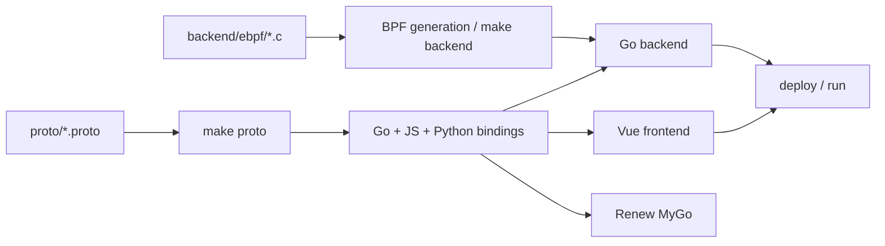
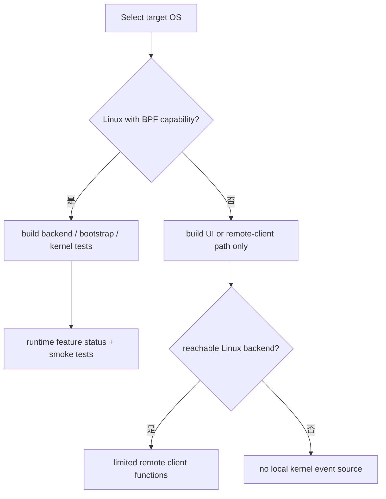
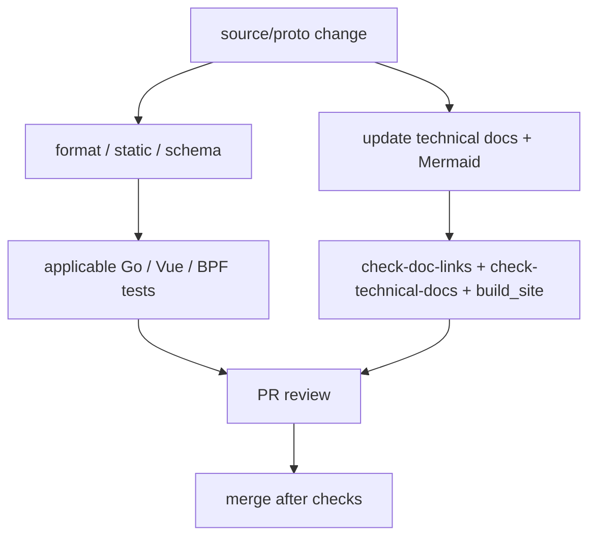

# 构建、平台矩阵与文档验证

**代码锚点**：`Makefile`、`go.work`、`backend/go.mod`、`desktop/renew/go.mod`、`package.json`、`docs/mkdocs.yml`、`.github/workflows/`。

## 1. 依赖事实

升级至 Go 1.27.3 后，运行 `python3 scripts/check-go-version.py` 检查
五个模块、工作区、Dev Container 和 CI 引用一致性。后端运行
`cd backend && go mod verify && go mod tidy -diff`，桌面端及各模块
依赖现有 GitHub Actions 完成编译与测试。升级 Go 补丁版本不等于
更新所有第三方模块，也不意味着修改 `go.sum`。


本仓库 `go.work` 覆盖五个 Go module：`backend`、`desktop/renew`、`tools/agent-tui`、`tools/dev-env-tui`、`wrapper`，要求 Go `1.27.3`。文档使用 MkDocs Material（Python），Web 前端使用 Vue 与 Bun；eBPF 编译需要 clang/LLVM、对应 kernel BTF 与 libbpf/bpf2go 生成流程。更新生成物以 `Makefile` 真实目标为准。



## 2. 不要混淆两个平台维度

| 能力 | Linux | Windows | macOS |
| --- | --- | --- | --- |
| `backend/ebpf` tracker + cgroup + LSM | 代码实现，需内核能力/权限 | 无对应 eBPF hooks | 无对应 eBPF hooks |
| 后端本地自动提权、Unix eBPF 启动 | Linux 路径存在 | `backend_embedded_other.go` 拒绝 | 同左 |
| Renew 原生窗口框架 | 实现 | 平台窗口分支存在，需实际构建/运行验证 | 平台窗口分支存在，需实际构建/运行验证 |
| Renew 连接外部 HTTP 后端 | API 客户端代码存在 | 客户端架构可复用，**不保证打包运行成功** | 同左 |
| ETW/WFP/Windows 原生事件采集 | 不适用 | **当前未见实现** | 不适用 |

表中“代码实现”不代表在本机已跑通。不得把 desktop build 或 `gopsutil` 等依赖视作 Windows 系统级 Agent 拦截的证据。



## 3. 代码验证命令

```bash
make proto-check
make backend
make frontend
make wrapper
make test
python3 scripts/check-doc-links.py
python3 scripts/check-technical-docs.py
python3 -m pip install -r docs/requirements.txt
python3 docs/build_site.py build
```

按需补充 `make os-enforcement-check`、`make os-enforcement-preflight`、`make os-enforcement-smoke`；后两者需要匹配的 Linux 权限与正在运行的后端。不要在无法获取系统依赖的开发环境中把未运行的构建称为“验证通过”。

## 4. CI 对照

`.github/workflows/docs-pages.yml` 检查源码锚点、本地 Markdown 链接并构建 MkDocs；由同一 workflow 在 master 推送后部署 GitHub Pages；`component-ipc.yml`、`collector-transport.yml`、`renew-desktop.yml`、`agent-boundary.yml`、`detection-engineering.yml` 等用于专题验证。



## 5. 内核真实采集 soak 与可选 OpenCode 集成

`.github/workflows/opencode-ebpf-soak.yml` 在 PR 和每周定时任务中执行 **registered 模式**：先通过 `make proto-go` 和 `make ebpf-bootstrap` 构建真实后端及 eBPF 对象，在已挂载 bpffs 的 Linux CI 上注册一个临时独立进程为 `Agent CLI`，由该进程先运行 `mkdir`，再执行两次独立的 `scripts/soak-file-openat.c` 小型测试工具，强制通过 Linux `SYS_openat` 完成文件创建（避免 `touch` 在不同 libc/coreutils 组合下选择不同系统调用）。验证器要求**控制 Bash 进程的标记和两个工具进程的标记**均在带类型的内核事件 `path` 字段中被观察到，然后检查 `/events/graph` 节点、边、进程以及引用完整性。仅创建文件但没有内核采集证据会使任务失败。

此测试无需 LLM 或外部 API，因此 CI 的内核事件验证不受第三方免费模型配额（包括 HTTP 429）的影响。**它只证明真实进程/内核采集和执行图谱，不证明真实 OpenCode 模型的工具调用已成功。** 后者保留在 `AGENT_SOAK_EXECUTOR=opencode` 模式，可在 GitHub Actions 手动运行时将 `executor` 选为 `opencode`。此模式固定使用 OpenCode v2 CLI，提示词与权限规则仅允许临时工作区的三条操作，以单次串行 Shell 调用执行；模型超限、拒绝调用或文件证据缺失均视为失败，不冒充通过。

两种模式都只绑定 loopback、生成短期 backend token、隔离工作目录与后端 home，并生成脱敏的 kernel health、capture 及 graph 诊断。测试发现 `/sys/fs/bpf/agent-ebpf` 已存在时拒绝运行，防止覆盖现有 eBPF pin；只有确认自己启动的后端已退出后，才清理自己创建的 pin。GitHub Actions 日志与证据产物保留 14 天，不应包含原始 prompt、请求正文或凭据。

本地内核回归（需要 Go、protobuf、C 编译器、Linux BTF、bpffs 和 root 或免交互 sudo）：

```bash
make proto-go && make ebpf-bootstrap
AGENT_SOAK_EXECUTOR=registered scripts/opencode-ebpf-soak.sh
```

可选的真实模型集成回归（另外需要 Node.js/npm 与有效的 OpenCode 免费模型额度或已连接的对应提供商）：

```bash
npm install --global @opencode/cli@2.1.3
AGENT_SOAK_EXECUTOR=opencode scripts/opencode-ebpf-soak.sh
```

内核 soak 与 AgentSight 的 MCP/工具因果关系单元及浏览器回归互补；不能将任一测试单独解释为生产环境的全部 eBPF tracepoint 均已成功附加，也不能将模拟的注册进程声称为真实 LLM 行为。

## 6. 图表维护约定

- Mermaid 使用 `flowchart`、`sequenceDiagram`、`stateDiagram-v2` 与 `classDiagram`；站点导航和 Mermaid 渲染配置位于 `docs/mkdocs.yml`，静态构建入口是 `docs/build_site.py`（`pymdownx.superfences`）。
- 实线画实际调用 / 数据写入，可选能力标明 `opt-in`、`experimental` 或 runtime gate。
- 任何图中节点更名后，直接更新对应源码路径；**不能**凭旧幻灯片、旧 README 或历史完成汇报推导实现。
- 本目录的页面统一标注代码路径，并可使用 `scripts/check-doc-links.py` 检查 Markdown 本地页面导航；所有安全相关改动以实际测试为准。
