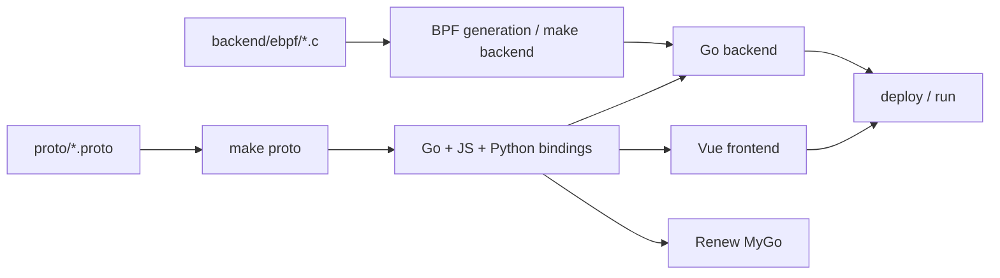
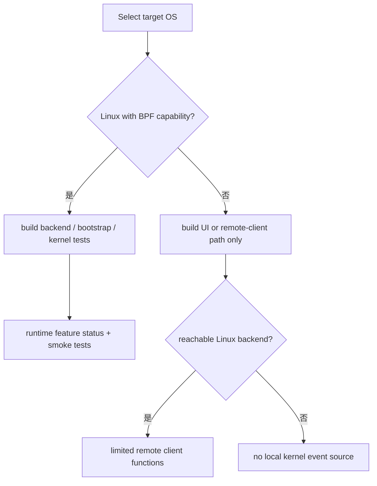
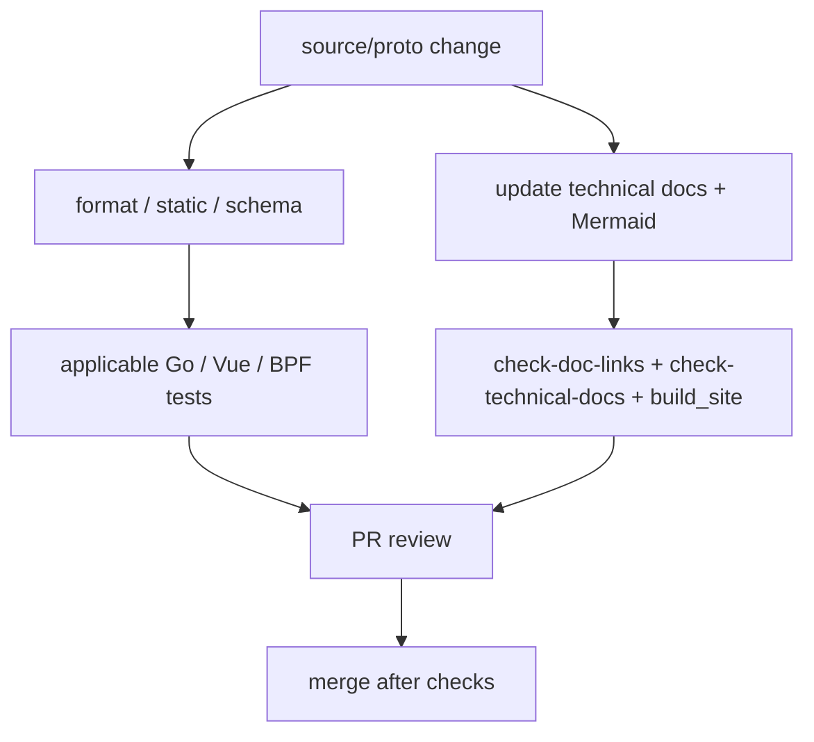

# 构建、平台矩阵与文档验证

**代码锚点**：`Makefile`、`go.work`、`backend/go.mod`、`desktop/renew/go.mod`、`package.json`、`docs/mkdocs.yml`、`.github/workflows/`。

## 1. 依赖事实

本仓库 `go.work` 覆盖五个 Go module：`backend`、`desktop/renew`、`tools/agent-tui`、`tools/dev-env-tui`、`wrapper`，要求 Go `1.27.1`。文档使用 MkDocs Material（Python），Web 前端使用 Vue 与 Bun；eBPF 编译需要 clang/LLVM、对应 kernel BTF 与 libbpf/bpf2go 生成流程。更新生成物以 `Makefile` 真实目标为准。



## 2. 不要混淆两个平台维度

| 能力 | Linux | Windows | macOS |
| --- | --- | --- | --- |
| `backend/ebpf` tracker + cgroup + LSM | 代码实现，需内核能力/权限 | 无对应 eBPF hooks | 无对应 eBPF hooks |
| 后端本地自动提权、Unix eBPF 启动 | Linux 路径存在 | `backend_embedded_other.go` 拒绝 | 同左 |
| Renew 原生窗口框架 | 实现 | 平台窗口分支存在，需实际构建/运行验证 | 平台窗口分支存在，需实际构建/运行验证 |
| Renew 连接外部 HTTP 后端 | API 客户端代码存在 | 客户端架构可复用，**不保证打包运行成功** | 同左 |
| ETW/WFP/Windows 原生事件采集 | 不适用 | **当前未见实现** | 不适用 |

表中“代码实现”不代表在本机已跑通。不得把 desktop build 或 `gopsutil` 等依赖视作 Windows 系统级 Agent 拦截的证据。



## 3. 代码验证命令

```bash
make proto-check
make backend
make frontend
make wrapper
make test
python3 scripts/check-doc-links.py
python3 scripts/check-technical-docs.py
python3 -m pip install -r docs/requirements.txt
python3 docs/build_site.py build
```

按需补充 `make os-enforcement-check`、`make os-enforcement-preflight`、`make os-enforcement-smoke`；后两者需要匹配的 Linux 权限与正在运行的后端。不要在无法获取系统依赖的开发环境中把未运行的构建称为“验证通过”。

## 4. CI 对照

`.github/workflows/docs-pages.yml` 检查源码锚点、本地 Markdown 链接并构建 MkDocs；由同一 workflow 在 master 推送后部署 GitHub Pages；`component-ipc.yml`、`collector-transport.yml`、`renew-desktop.yml`、`agent-boundary.yml`、`detection-engineering.yml` 等用于专题验证。



## 5. 图表维护约定

- Mermaid 使用 `flowchart`、`sequenceDiagram`、`stateDiagram-v2` 与 `classDiagram`；站点导航和 Mermaid 渲染配置位于 `docs/mkdocs.yml`，静态构建入口是 `docs/build_site.py`（`pymdownx.superfences`）。
- 实线画实际调用 / 数据写入，可选能力标明 `opt-in`、`experimental` 或 runtime gate。
- 任何图中节点更名后，直接更新对应源码路径；**不能**凭旧幻灯片、旧 README 或历史完成汇报推导实现。
- 本目录的页面统一标注代码路径，并可使用 `scripts/check-doc-links.py` 检查 Markdown 本地页面导航；所有安全相关改动以实际测试为准。
