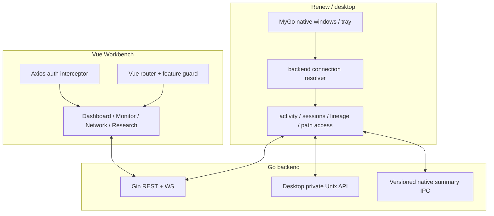
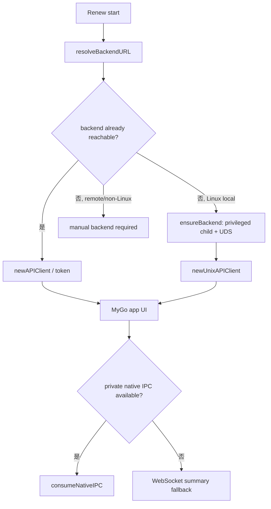
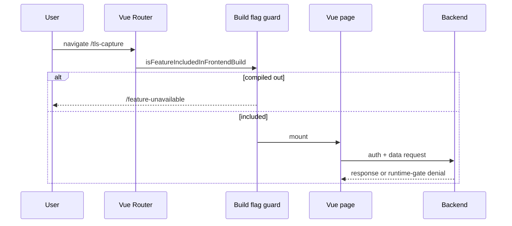
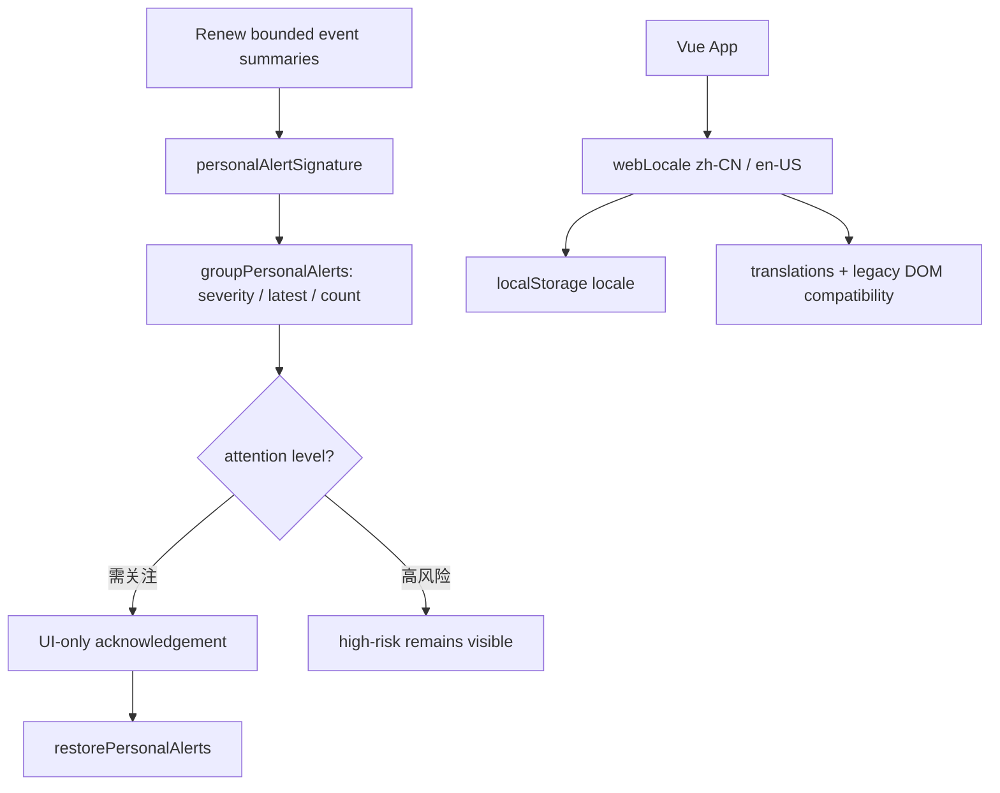

# Renew 原生桌面与 Vue Web 工作台

**代码锚点**：`desktop/renew/main.go`、`desktop/renew/backend.go`、`desktop/renew/native_ipc.go`、`desktop/renew/native_event_stream.go`、`desktop/renew/native_agent_lineage_model.go`、`frontend/src/router/index.ts`、`frontend/src/services/http.ts`。

## 1. 明确是两个客户端

Renew 使用 `github.com/egoist/mygo` 和原生 Go UI，不使用 WebView 承载旧 `/renew` 页面；Vue 3 Web 工作台保留研究、可配置运维、实验与图谱功能。它们通过同一个 Go 后端暴露的业务接口获取数据，职责和启动方式不同。

## 2. Renew 引导流程与降级

`runDesktop` 解析 `-backend` / `AGENT_BACKEND_URL`；`bootstrap` 调用 `ensureBackend`。本地无服务时，Linux 会通过同一 Renew 二进制的内部模式尝试提升后端权限，分配仅当前用户可访问的私有 session 目录与 API socket；如果后端已在运行，则可按给定 URL 连接。`native_ipc.go` 优先私有摘要 IPC，发生断连时采用兼容摘要流路径，状态会在 UI 标识。

## 3. Agent lineage 视图的可信度

`native_agent_lineage_model.go` 通过进程 PID/PPID、创建时间、Hook 语义证据绘制树，不把没有证据的后代直接命名为 SubAgent；不同于后端基于事件归档的 `ExecutionGraph`。

## 4. Vue 路由与 Feature Guard

`frontend/src/router/index.ts` 注册 `/dashboard/:tab?`、`/monitor/...`、`/observe/...`、`/network`、`/execution-graph/:tab?`、`/research/:tab?`、`/executor/...`、`/hooks`、`/ml/...`、`/plugins/...`、`/config/...` 等。前端通过 `isFeatureIncludedInFrontendBuild` 拦截编译时不可用页面，后端仍需独立做鉴权和 runtime gate。

## 5. Windows / macOS 当前边界

`desktop/renew/main.go` 为 Windows/Mac 存在窗口材质逻辑，且 `backend_embedded_other.go`、`backend_process_other.go` 存在 `!linux` 构建替代实现；但 **非 Linux 不能用当前二进制自动启动嵌入式 eBPF 后端**，也未见同等 Windows ETW / WFP 捕获链路。应把非 Linux 桌面理解为可以设计用于连接支持的后端，而不是本机内核监控已完成。跨平台构建成功还需相应 runner 与 GUI 验证。

## 6. 本次主线新增的日常交互能力

最新主线增加 `desktop/renew/native_personal_alerts.go` 的**本地告警归组**：`groupPersonalAlerts` 仅在当前有限摘要窗口内按签名聚合事件，`mutePersonalAlert` 只处理“需关注”组且可通过 `restorePersonalAlerts` 撤销。源码明确表示此确认仅改变 Renew 当前 UI，**不是内核阻断、后端风险改写或长期持久化**。

`desktop/renew/native_harness_updates_core.go` 会按照安装来源生成可选 CLI / 桌面更新建议；代码明确禁止直接执行不可信的远程安装脚本，识别来源失败时提示按原渠道手工更新。

Web 新增 `frontend/src/i18n/index.ts` 的 `zh-CN`、`en-US` 响应式切换，以 localStorage 的 `agent.webui.locale.v1` 记住用户选择；旧组件还有受限 DOM 兼容翻译路径。不能由此推导任意外部插件界面都已翻译。

