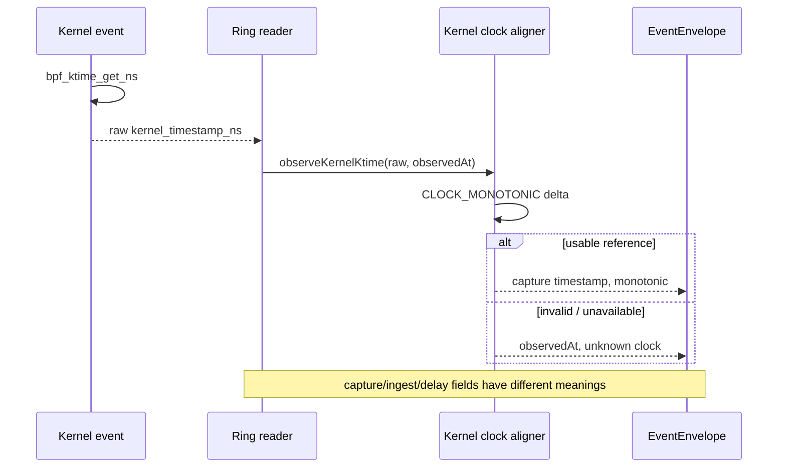
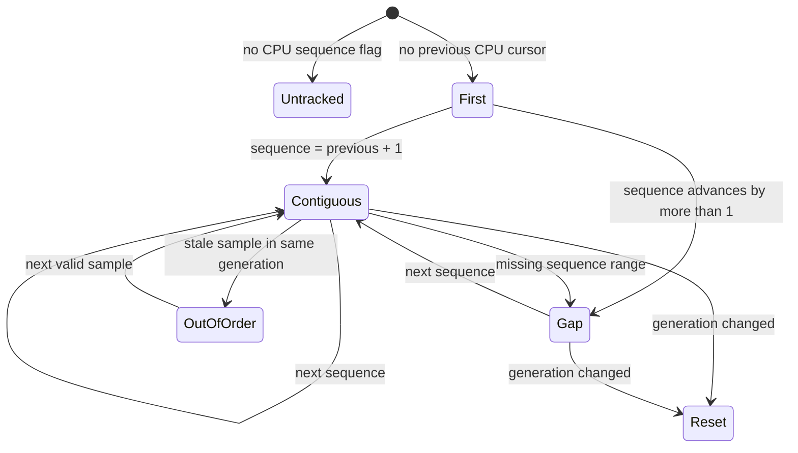
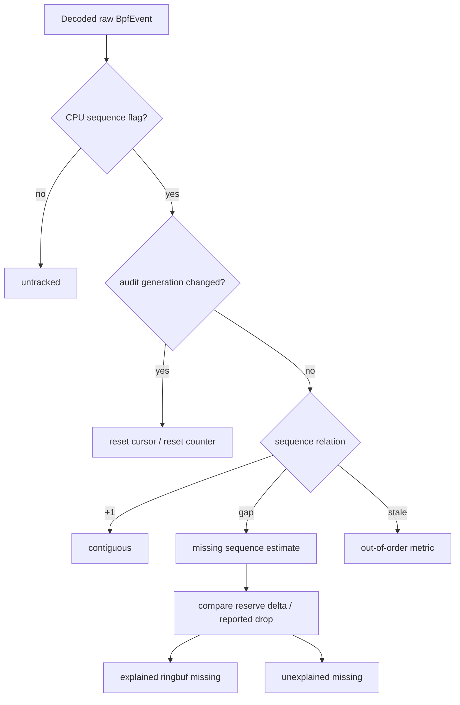
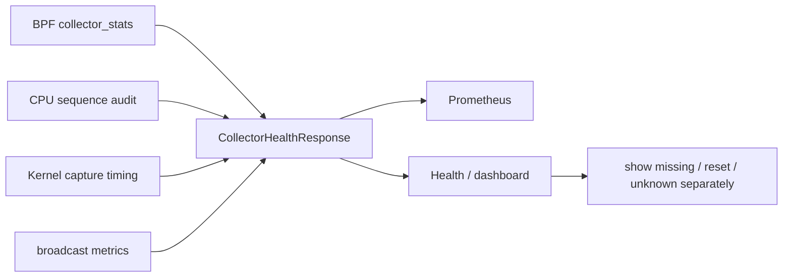

# 内核时钟、序号与采集完整性审计

> 对应：`backend/app/kernel_audit_clock.go`、`backend/app/kernel_sequence_audit.go`、`backend/app/runtime_ebpf.go`、`backend/app/observability/metrics_collector.go`、`backend/app/observability/metrics_prometheus.go`；测试：`backend/app/kernel_audit_clock_test.go`、`backend/app/kernel_audit_timing_test.go`、`backend/app/kernel_sequence_audit_test.go`（若测试文件随重构更名，以同名功能测试为准）。

## 1. 为什么要区分多个时间戳

内核 `bpf_ktime_get_ns()` 是单调时钟领域的时间；Go 端需要把它和 `time.Time` 相联系。`alignKernelKtime(rawNS, observedAt, monotonicNowNS)` 使用观测时刻及单调时钟差值生成 `kernelCaptureObservation`，无法建立有效估算时，保留 `observedAt` 并标识 `unknown`。即使发生丢失或延迟，显示层也不能把接收时间冒充内核事件发生时间。

## 2. 序号判定不是“每 PID 一条序列”

`kernelSequenceAuditState` 维护 `byCPU` cursor，`Observe` 检查 `AuditFlags` 是否包含 CPU sequence，读取 `KernelCPU`、`KernelSequence`、`KernelTimestampNs`、`KernelAuditGeneration`、`KernelReserveFailuresTotal`。第一条为 First，连续递增为 Contiguous，跳号为 Gap；同 generation 下倒序不能错误地回退 cursor；generation 变化为 Reset。

## 3. “缺失事件”与 “reserve failure” 不能双重计数

`recordKernelSequenceObservation` 同时分析内核 `dropped_since_last`、`reserveFailuresTotal` 的增量和 CPU sequence gap。它记录解释得了的缺失数量与无法解释的缺失数量；初始序号之前的丢失会单独累计。`KernelAuditGeneration` 明确指定 reload 边界，避免把重新挂载造成的序号回绕误认为普通队列丢失。

## 4. 证据仪表盘应该呈现什么

| 指标或字段 | 提供的证据 | 不能直接推断 |
| --- | --- | --- |
| `kernel_sequence_missing_events` | 已观察到的 CPU sequence 缺口 | 所有未被跟踪的 syscall 数 |
| `kernel_sequence_resets` | 审计 generation 发生变化 | 程序异常必然导致丢失 |
| `kernel_sequence_unexplained_missing_events` | 无法由 reserve 状态解释的缺口 | 唯一根因一定是 Ring Buffer |
| `kernel_sequence_out_of_order` | 非连续顺序读取 | 原始时钟倒流 |
| `CaptureDelayNs` | 关联时钟条件下的捕获延迟估算 | 一定等于总体 UI 响应延迟 |

## 5. 维护与复现检查

- 不能合并 CPU 序号和全局总序号来计算 gap；使用 `byCPU` 状态。
- 时间审计需要覆盖 CLOCK_MONOTONIC 不可用、未来时间、generation 重置、乱序、先于 baseline 的丢失。
- 改变内核 `BpfEvent` 结构时检查 `backend/core/` ABI、`collectorcodec` 和 `runtime_ebpf.go`；对照 [事件管线](./events.md)。
- **严格限定**：指标描述的是“可观察到的采样完整性”；过滤策略主动忽略的操作不属于 ringbuf drop。
