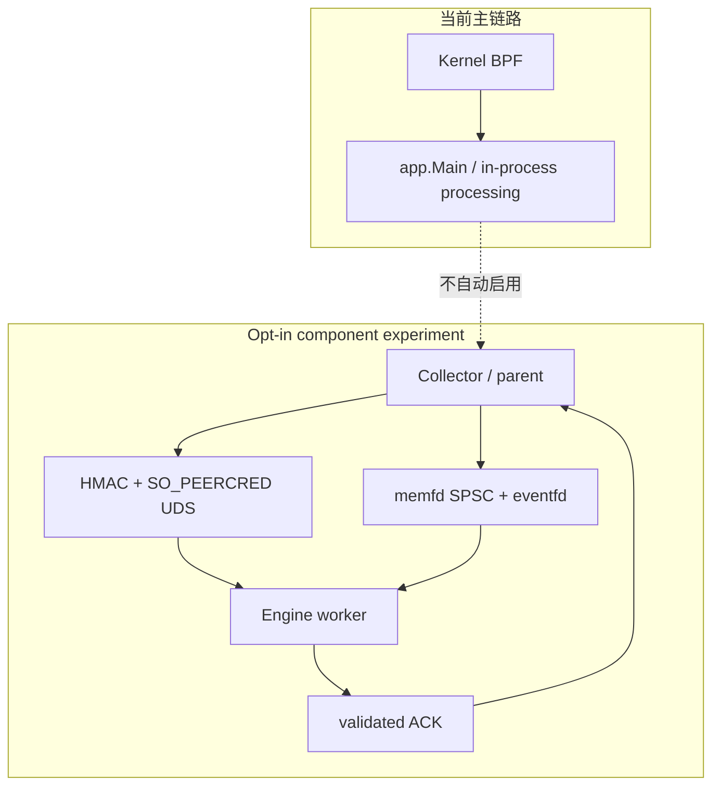
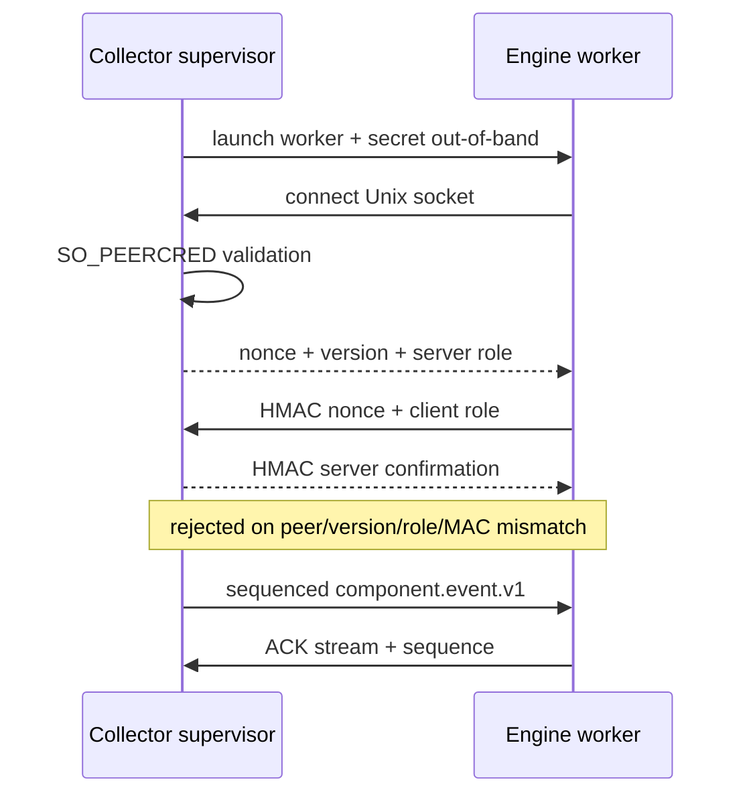
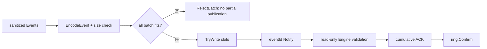

# 可拆分组件、鉴权 IPC 与共享内存实验

**代码锚点**：`backend/internal/componentipc/`、`backend/internal/componentwire/event.go`、`backend/internal/componentproc/`、`backend/internal/componentshm/ring_linux.go`、`backend/cmd/component-engine-worker/`、`backend/cmd/component-ipc-doctor/`。

## 1. 状态声明（非常重要）

`componentipc/protocol.go` 的包注释明确它是 **opt-in** 的组件边界，**不改变现有单体事件主链路**。`componentproc/privileged_linux.go` 的 `RunEngineSharedAsUID` 明确是默认关闭的 privileged launch experiment，**不会由 app.Main 或 Renew 自动运行**。文档中的 Collector / Engine 分离是可测试的实现路径，不应被宣传为部署默认拓扑。

## 2. 身份与消息边界

`componentipc.HandshakeServer` 强制非空 OS peer verifier、至少 32 字节 session secret、版本与角色检查；HMAC challenge 绑定 nonce、roles 和 protocol version。`componentwire.Event` 仅包含白名单字段（schema、event ID、source、timestamp、type、PID、decision、risk），明确拒绝 raw argv、prompt、secret、payload、路径等。

## 3. Shared ring 行为

`componentshm.Create` 创建 `memfd`、`eventfd`；Writer 建立 RW 映射并使用 Linux sealing 限制新增 writable 映射，Engine 只读映射。`TryWrite` 为单生产者/单消费者、有界队列，不阻塞；`Notify` 每个调用批次发出 eventfd 通知；ACK 确认批次中序号。读/写顺序与提交确认分离，是防止“写 socket 成功 = 已处理成功”的错误假设。

## 4. 可信执行隔离约束

`RunEngineSharedAsUID` 要求 root supervisor、显式非 root UID/GID、受信的 root-owned Engine 可执行文件；使用抽象 Unix socket 和 FD3 secret / FD4 memfd / FD5 eventfd 交付。缺一项都不能认为已实现权限隔离。仍需单独测试子进程异常退出、磁盘/网络权限、指标、限流以及安全恢复。

## 5. 验证

- `backend/internal/componentipc/*_test.go`：握手、顺序、超长帧、错误 ACK、生命周期。
- `backend/internal/componentshm/ring_linux_test.go` 与 `backend/internal/componentproc/shared_bench_linux_test.go`：bounded ring 与压测。
- `.github/workflows/component-ipc.yml`、`component-boundaries.yml`：独立实验验证；通过测试不表示主进程已经迁移到多进程。
