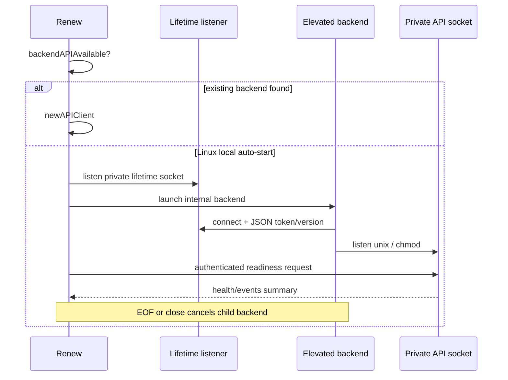
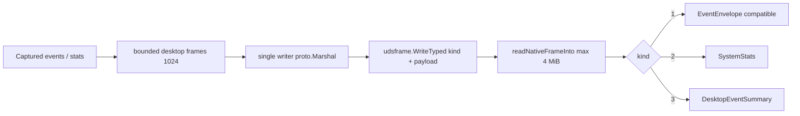
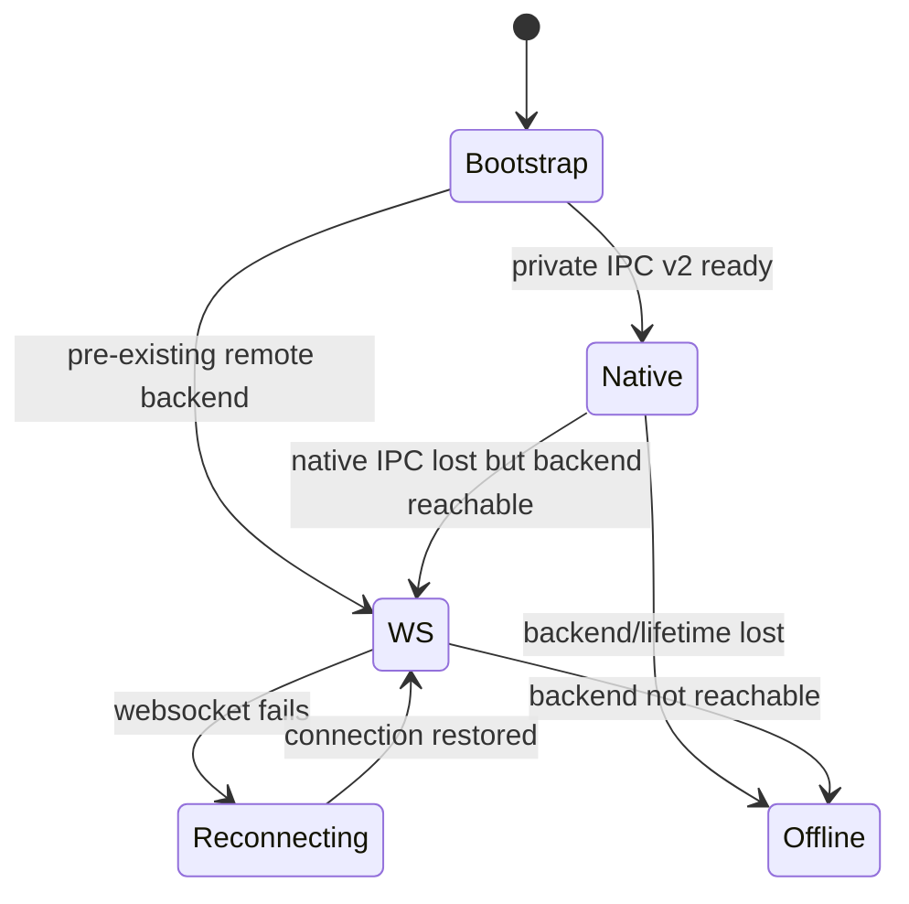

# Renew 私有后端：生命周期 Socket、二进制帧与回退

> 对应：`desktop/renew/main.go`、`desktop/renew/backend.go`、`desktop/renew/native_ipc.go`、`desktop/renew/native_event_stream.go`、`backend/app/desktop_session.go`、`backend/app/startup_server.go`、`backend/app/ws_api.go`。

## 1. 两个 Unix Socket 职责不同

Renew 私有启动时：`lifetime.sock` 用于父子生命周期、初始 Token 握手和二进制摘要数据帧；`api.sock` 由后端承载经 Token 鉴权的 Gin API。`ConfigureDesktopFlags` 强制二者路径不同且位于同一私有目录，桌面 API socket 不能与 TCP port 同时配置。Wrapper 的 `/tmp/agent-ebpf.sock` 是第三个完全独立的入口，不能混用。

```mermaid
flowchart TB
  subgraph Desktop["Renew (ordinary user)"]
    UI["MyGo native UI"]
    LIFE["lifetime.sock listener"]
    HTTP["Unix HTTP client"]
  end
  subgraph Backend["Elevated backend child (Linux)"]
    DS["desktopSession"]
    GIN["Gin API over unix"]
    B["event summary / system metrics"]
  end
  LIFE <-->|"token handshake + typed frames"| DS
  HTTP <-->|"auth REST requests"| GIN
  DS <-- B
  HTTP <-- UI
  LIFE <-- UI
  Wrapper["Wrapper UDS /tmp/agent-ebpf.sock"] -. separate ingress .-> Backend
```

## 2. 分叉启动与清理

`desktop/renew/backend.go` 的 `ensureBackend` 先检测既有服务；Linux 本地端口不通时创建 mode 0700 的临时会话目录、授权启动后端子进程，并通过 lifetime handshake 等待私有 API 就绪。`desktopSessionContext` 将父连接 EOF 与后端 context cancellation 绑定：桌面崩溃关闭连接后端也能退出，避免再提权去 kill root PID。



## 3. 版本与帧内数据结构

`backend/app/desktop_session.go` 当前协议版本 `desktopNativeIPCVersion = 2`，`desktopFrameEventEnvelope=1`（兼容旧版）、`desktopFrameSystemStats=2`、`desktopFrameEventSummary=3`。`native_ipc.go` 的客户端 version check 保证只有支持的私有会话才进入二进制读取循环；`readNativeFrameInto` 有 `4 MiB` 帧上限并可复用 buffer。`desktopNativeQueueSize=1024`、`desktopNativeWriteTimeout=750ms`：生产者 `publishProto` 非阻塞，慢 UI 不会拖死内核事件线程。



## 4. 故障回退的精确含义

`runNativeIPC` 优先私有二进制通道；当私有链路中断而 API 后端还可用时，`runEventSummaryStream` 可以走 `/ws/event-summaries` 的 WebSocket JSON 摘要。此处的 fallback 是**桌面视图事件传输**回退，不是 eBPF 采集栈切换，更不是后端自动变为 Windows 内核 collector。



## 5. 建议排障顺序

1. 是否在 Linux 本地私有启动模式，或显式指定远程 `AGENT_BACKEND_URL`？
2. 后端 Token 与 `AGENT_API_TOKEN` / local runtime settings 是否匹配？
3. lifetime handshake、api.sock 权限、reader 帧版本与大小是否正确？
4. 只有摘要流回退时，应检查 WebSocket 鉴权和 `/ws/event-summaries`，不要先怀疑内核 ringbuf。

测试：`desktop/renew/backend_test.go`、`desktop/renew/native_ipc_test.go`、`backend/app/desktop_session_test.go`、`backend/app/startup_server_test.go`。
