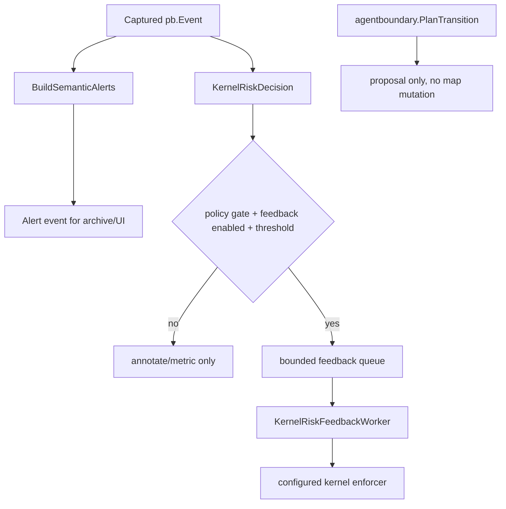
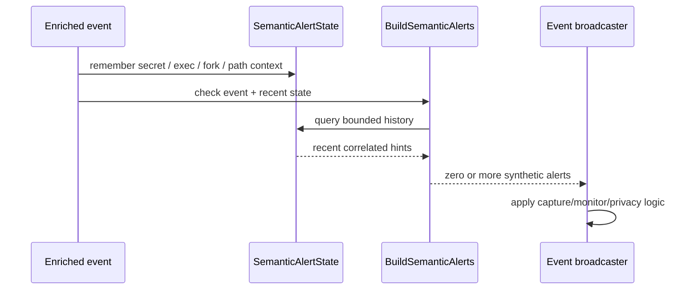
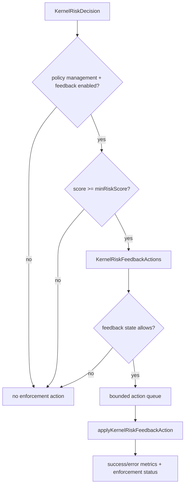
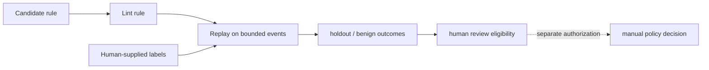

# 风险决策、语义告警、反馈执行与证据等级

**代码入口**：`backend/app/events/alerts_semantic.go`、`backend/app/events/kernel_risk.go`、`backend/app/events/kernel_risk_feedback.go`、`backend/app/events/semantic_state_limits.go`、`backend/internal/detectionengineering/engine.go`、`backend/internal/agentboundary/transition.go`。

## 1. 观察、告警、策略执行是三条路径

`events.BuildSemanticAlerts` 生成合成告警事件；`kernel_risk.go` 提供 kernel risk 分类/评分；`kernel_risk_feedback.go` 是一个**单独受控**的可能写入 kernel enforcer 的异步 worker。`agentboundary.PlanTransition` 仅为非变更式策略提案，它的源代码写明 **不更改 BPF Maps，不运行 sandbox，不激活 policy generation**。因此，“风险高”不自动等于“已阻断”。

## 2. 语义告警不是完整攻击证明

`SemanticAlertState` 保留短期密钥路径访问、可执行文件、fork 计数、agentic resource loop 和多 Agent 文件改动线索。`ObserveMultiAgentFileContention` 明确只检测 distinct Agent context 对**已验证路径名**的交错改动，不证明操作在时间上真的重叠，也不证明跨 mount namespace 是同一个 inode。高风险分值是实现中的触发阈值，不是统计显著性或真实概率。

## 3. 内核反馈的实际门槛

`queueKernelRiskFeedback` 读取 `KernelRiskFeedbackGate`，先检查 `PolicyManagementEnabled`、`KernelRiskFeedback.Enabled` 和最小 risk，再由 worker 检查当前设置、执行 `applyKernelRiskFeedbackAction` 并记录成功/失败指标。某些高分网络事件可能生成 IP/port 动作，文件/执行事件可能生成 LSM name/path 动作；是否真能阻断还依赖 enforcer 已配置和成功附加。

## 4. 回放标签必须来源可靠

`internal/detectionengineering.Replay` 使用 `trace` 或 `pid` scope 与人工提供的 `authoring_attack`、`holdout_attack`、`benign` 标签；无时间戳或无可归属 scope 的事件会跳过。不能把 `RiskScore` 或现存告警反向用作标注真值，从而“证明”模型精度。详见 [研究与回放](./research-replay.md)。

## 5. 必须分开陈述的结论

| 输出 | 可以宣称 | 不应宣称 |
| --- | --- | --- |
| `SemanticAlertState` | 观察到时间相关的行为线索 | 已证实真实数据泄露或多进程竞争 |
| `KernelRiskDecision` | 当前实现计算了分值或动作候选 | 分值就是校准的恶意概率 |
| Feedback enqueue | 尝试将候选动作交给 worker | 动作已在内核成功生效 |
| `PlanTransition` | 纯函数形式计算过渡建议 | 自动向 BPF 下发策略 |
| Detection Replay | 按人类标签在回放集上计算结果 | 无独立基准就可推广生产效果 |

**测试入口**：`backend/app/alertssemantic_test.go`、`backend/app/events/kernel_risk_feedback_lifecycle_test.go`、`backend/internal/agentboundary/transition_test.go`、`backend/internal/detectionengineering/engine_test.go`。
