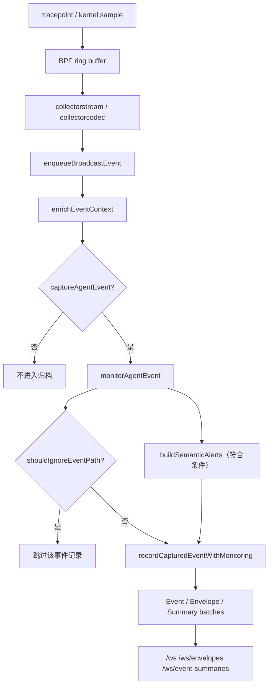
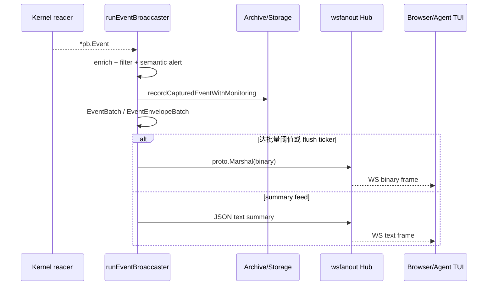
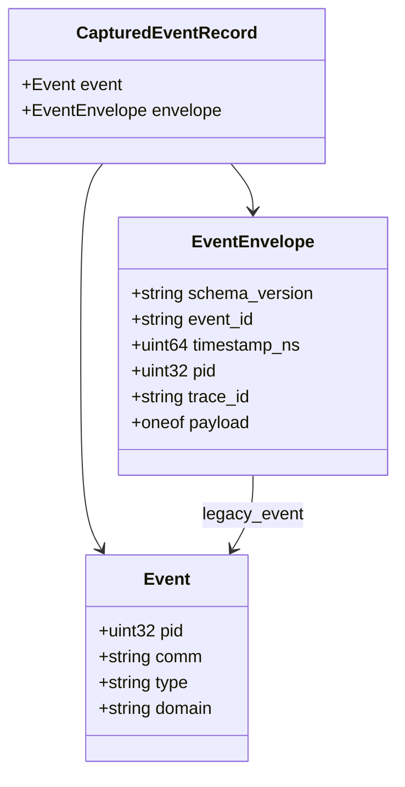
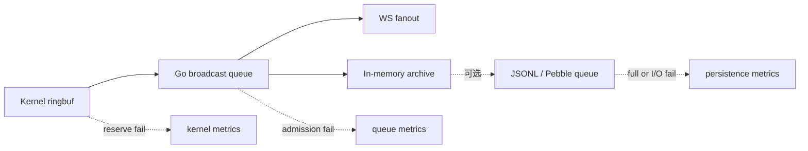

# 事件管线、背压、语义富化与客户端投递

**源代码**：`backend/ebpf/agent_tracker_*.h`、`backend/app/jobs_background.go`、`backend/internal/collectorcodec/decode.go`、`backend/internal/collectorstream/pump.go`、`backend/app/ws_api.go`、`backend/app/events/`。

## 1. Kernel → protobuf → EventEnvelope

BPF 数据由 `trackerMaps.Events` ringbuf 发出；`startKernelEventReader` 读取二进制 sample、解码事件并 `enqueueBroadcastEvent`。`runEventBroadcaster` 是广播扇出入口，按顺序完成 context enrich、采集条件、监控范围、语义告警、path ignore、`recordCapturedEventWithMonitoring`。历史记录归一化为 `CapturedEventRecord` 并构建 `EventEnvelope`。

## 2. 广播与格式

`ws_api.go` 把常规原始事件封装为 `pb.EventBatch`、封装事件为 `pb.EventEnvelopeBatch`，通过 WebSocket **二进制 Protobuf 帧**发送；`/ws/event-summaries` 是 JSON text summaries。`broadcastBatchSize=50` 且有定时 flush。不同 feed 的消费类型不同，不能统一按 JSON 解释。

## 3. 数据的分类

| 类型 | 代码 | 用途 |
| --- | --- | --- |
| `pb.Event` | `proto/tracker_events.proto` | 历史兼容且仍被主链路使用的事件结构 |
| `pb.EventEnvelope` | `proto/tracker_events.proto` | `envelope.v1` 包含 typed payload、进程上下文、内核审计字段 |
| `CapturedEventRecord` | `proto/tracker_events.proto` | 记录事件及封装信息供归档/回放 |
| `DesktopEventSummary` | `proto/tracker_events.proto` | 减少桌面日常视图的数据负担 |
| `ProcessContext` | `backend/app/events/context_event.go` | PID 与 run/task/trace 的关联上下文 |

## 4. 背压不是无损保证

WebSocket fanout、事件队列、持久化队列各自有界；接入方缓慢、归档落盘失败和 ring reserve 失败需要分别观察。`runtime_event_log_writer.go` 的持久化事件队列额定容量 `4096`，flush batch `128`、flush interval `250ms`，满队列返回错误并增加 dropped 计数。后端还汇总 kernel dropped 与采集时序。没有观察到事件不等于没有发生。

## 5. 回放与执行图

`backend/app/graphbridge.go` 的 `buildExecutionGraphFromRequest` 根据请求读取近期存储或录制文件，调用 `events.BuildExecutionGraphContext`；`/events/graph` 与 `/ws/events/graph` 不意味着图谱已经还原所有跨进程/跨 Agent 因果。

建议回归：`backend/app/broadcast_pipeline_bench_test.go`、`backend/app/events/envelopeevent_test.go`、`backend/app/kernel_event_reader_lifecycle_test.go` 与 `backend/app/runtime_event_log_writer_test.go`。
