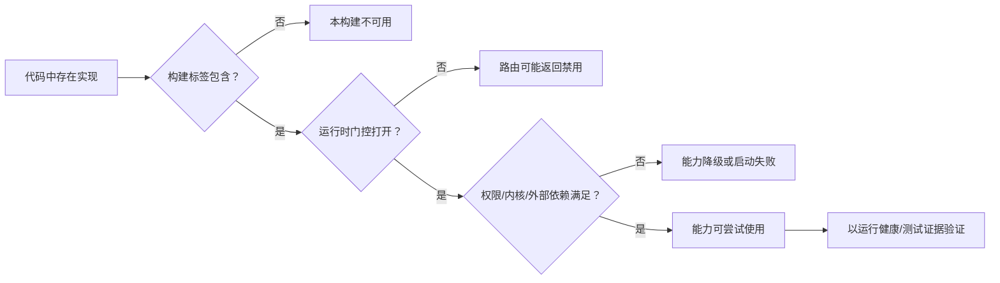
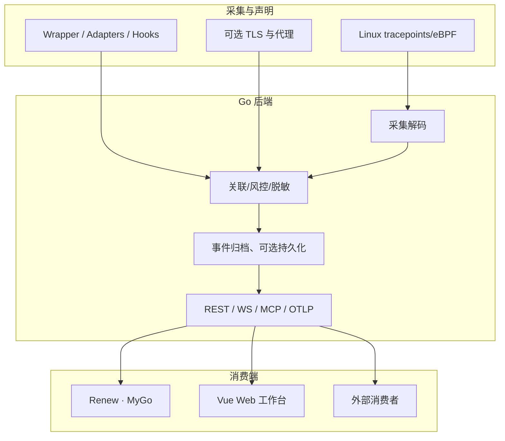

# 技术手册（代码基线）

> **代码基线**：`master@95410d5982a2f4ec0f48c9380fac0e6288db9b81`，2026-10-15。此目录以仓库中的可执行代码、Proto、构建入口与测试为依据。历史答辩、研究设想与外部对比不作为「已实现功能」的证据。

## 按代码域阅读（25 篇）

本手册把概览与深入实现分离，每篇用真实的源路径、操作入口和 Mermaid 图建立“源码 → 数据流 → 功能门控 → 测试”的联系。*规划中的能力*只能以明确标记的虚线或说明出现。

### 整体理解

| 章节 | 主要事实来源 |
| --- | --- |
| [基线与阅读导引](./index.md) | `backend/app/main.go` · `docs/technical/index.md` |
| [总体架构](./architecture.md) | `backend/app/main.go` · `backend/internal/` |
| [启动、关闭和服务绑定](./startup.md) | `backend/app/startup_server.go` · `backend/app/jobs_background.go` |
| [事件主链与广播](./events.md) | `backend/app/ws_api.go` · `backend/app/events/` |
| [内核 eBPF 与 enforcement](./kernel.md) | `backend/ebpf/` · `backend/app/runtime_ebpf.go` |

### 采集与事件证据

| 章节 | 主要事实来源 |
| --- | --- |
| [内核时间及丢失审计](./collector-clock-audit.md) | `backend/app/kernel_sequence_audit.go` |
| [追踪模式、作用域和 Capture Profiles](./tracking-selection.md) | `backend/app/captureprofile/profile.go` · `backend/app/agent_scope_policy.go` |
| [Agent 归属与执行图](./agent-identity.md) | `backend/app/events/context_event.go` |
| [网络、TLS 与转发代理](./network-tls.md) | `backend/app/tls/` · `backend/internal/domainforwardproxy/` |
| [信号处理与 TTL](./signal-runtime.md) | `backend/app/signalruntime/runtime.go` |
| [告警、风险反馈与证据等级](./detection-evidence.md) | `backend/app/events/kernel_risk_feedback.go` |

### 控制面与协议

| 章节 | 主要事实来源 |
| --- | --- |
| [运行时设置与热更新](./runtime-settings.md) | `backend/app/statepersistenceruntime.go` |
| [认证、门控与隐私](./security.md) | `backend/app/helpers_auth.go` |
| [REST、Protobuf、WebSocket、MCP](./api-protocol.md) | `proto/tracker.proto` · `backend/app/routes.go` |
| [分离组件 IPC 与共享内存](./components-ipc.md) | `backend/internal/componentipc/` |

### 用户端与平台

| 章节 | 主要事实来源 |
| --- | --- |
| [Renew 与 Web 职责](./clients.md) | `desktop/renew/main.go` · `frontend/src/router/index.ts` |
| [Renew 传输、二进制 IPC 与回退](./desktop-transport.md) | `backend/app/desktop_session.go` · `desktop/renew/native_ipc.go` |
| [Vue 路由与国际化](./web-workbench-internals.md) | `frontend/src/router/index.ts` · `frontend/src/i18n/index.ts` |
| [Linux/Windows/macOS 能力矩阵](./platform-capabilities.md) | `desktop/renew/backend_embedded_other.go` |

### 存储、研究与部署

| 章节 | 主要事实来源 |
| --- | --- |
| [归档、指标与遥测](./storage-observability.md) | `backend/app/runtime_event_log_writer.go` |
| [JSONL/Pebble 内部协议](./storage-internals.md) | `backend/app/runtime_event_store_pebble.go` |
| [Research 与规则回放](./research-replay.md) | `backend/app/research/processing_runtime.go` |
| [ML、插件与实验引擎](./optional-engines.md) | `backend/app/ml/` |
| [Agent Context / Harness 特征工程 P0 基线](./agent-context-feature-engineering.md) | `backend/internal/agentfeatures/` · `backend/app/events/context_event.go` |
| [构建与验证](./build-verify.md) | `Makefile` · `go.work` |
| [运行故障排查手册](./operations-debug.md) | `backend/app/observability/metrics_collector.go` |

## 能力状态如何判定

`存在源文件`、`编译进二进制`、`RuntimeEnabled=true`、`内核/权限满足`、`集成端成功连通` 是五个不同的判断。`FeatureManifest` 只能说明编译与运行开关，不等同于宿主机 eBPF/LSM 支持或线上功能已成功运行。

## 证据规则

1. **每页有代码锚点**；类名、路径、路由、开关以源代码现状为准。涉及可选功能必须区分「代码路径」和「实际被启用」。
2. **图中实线**表示实际实现的依赖或数据流；标记「可选 / 实验」的组件不能默认视作生产主链路。
3. **有争议或未验证的信息**不写成完成结论，例如 Windows 的内核级 API 拦截、全量 TLS 透明解密、Agent 语义必然成立、任何性能百分比等。
4. 既有 `docs/guide/`、`docs/delivery/`、`docs/reference/` 为操作说明、研究背景和历史资料；涉及实现细节时优先查看本手册与对应代码。
5. 修改功能时同步改源代码锚点、图和测试；重构文件路径应更新本手册链接。

## 全局数据地图

