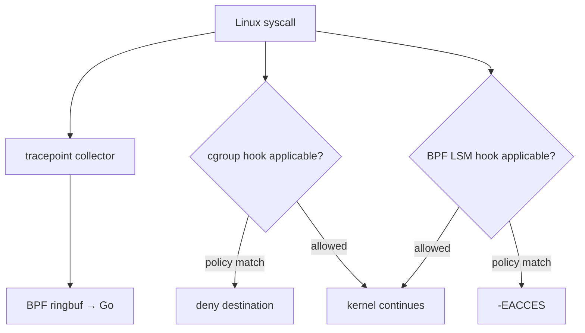
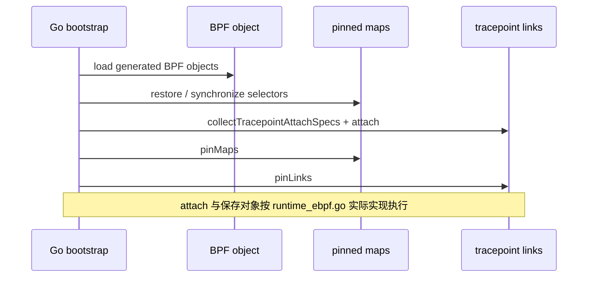
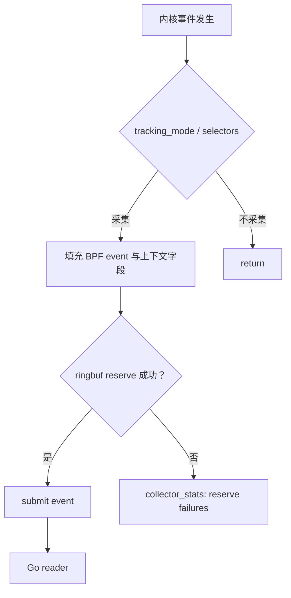
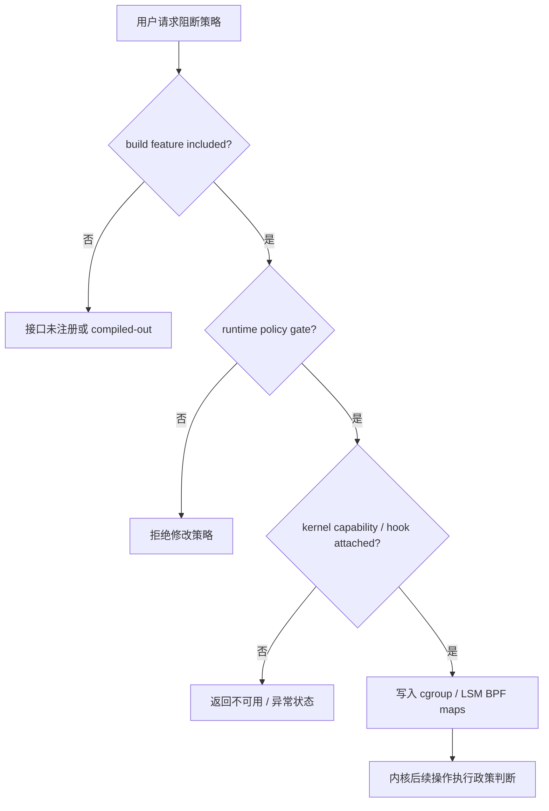

# Linux eBPF 与内核侧 Enforcement

**源代码**：`backend/ebpf/agent_tracker.c`、`backend/ebpf/agent_tracker_syscalls.h`、`backend/ebpf/agent_tracker_tail.h`、`backend/ebpf/cgroup_sandbox.c`、`backend/ebpf/lsm_enforcer.c`、`backend/app/runtime_ebpf.go`、`backend/app/sandbox/`。

## 1. 三套不同职责的 BPF 程序

| 组件 | Attach / 核心内容 | 操作 |
| --- | --- | --- |
| Tracker | 由 `collectTracepointAttachSpecs` 从生成对象中枚举 tracepoint | 异步收集 syscall/process/file/network 事实 |
| cgroup sandbox | `cgroup/connect4`、`connect6`、`sendmsg4`、`sendmsg6` | 对匹配 cgroup/IP/port 的连接或发送决策 |
| BPF LSM | `bprm_check_security`、`file_open`、`file_permission`、`mmap_file`、`file_mprotect` 与 inode hooks | 文件、执行、内存映射及 inode 操作的拒绝控制 |

**注意**：Tracker 只观察；阻断来自额外的策略挂载点，不能把监控信号当作系统调用阻断。

## 2. Bootstrap 与 pinning

`runtime_ebpf.go` 中 `bootstrapTrackerMaps`、`doBootstrap`、`pinMaps`、`pinLinks` 控制映射与链接生命周期。`mapNames` 明确包含 `agent_pids`、`events`、`collector_stats`、`tracked_comms`、`tracked_paths`、`tracked_prefixes`、`tracking_mode` 等；`syncTrackingModeMap` 确保追踪模式与规则同步。创建/恢复 maps 与 attach 顺序不能随意倒置。

## 3. eBPF 数据路径与选择器

追踪既有 `comm` 匹配，也有 exact path / prefix 选择器，以及 PID 注册；具体过滤组合以 `agent_tracker_common.h`、`agent_tracker_syscalls.h` 及 Go 的追踪模式同步为准。不能宣称「所有系统调用无条件全量采集」。

## 4. 阻断层级与可用性

cgroup 程序对连接和 UDP sendmsg 作限制；不是通用任意协议、任意方向、任意阶段网络代理。LSM 是否可用受内核配置、BTF、LSM 启用链及权限影响。状态检查接口：`/sandbox/cgroup/status`、`/sandbox/lsm/status`，策略接口受额外 `policyManagementEnabledMiddleware` 限制。

## 5. 验证清单

- `make ebpf-bootstrap`、`make os-enforcement-check`、`make os-enforcement-preflight`、`make os-enforcement-smoke`；在需要能力的 Linux 测试机上执行。
- 代码测试：`backend/ebpf/agent_tracker_test.go`、`backend/app/sandbox/ops_test.go`、`backend/app/kernel_capabilities_test.go`。
- Windows / macOS 不具备这些 Linux eBPF attach 点：平台桌面能力不代表已移植 BPF 内核模块。
