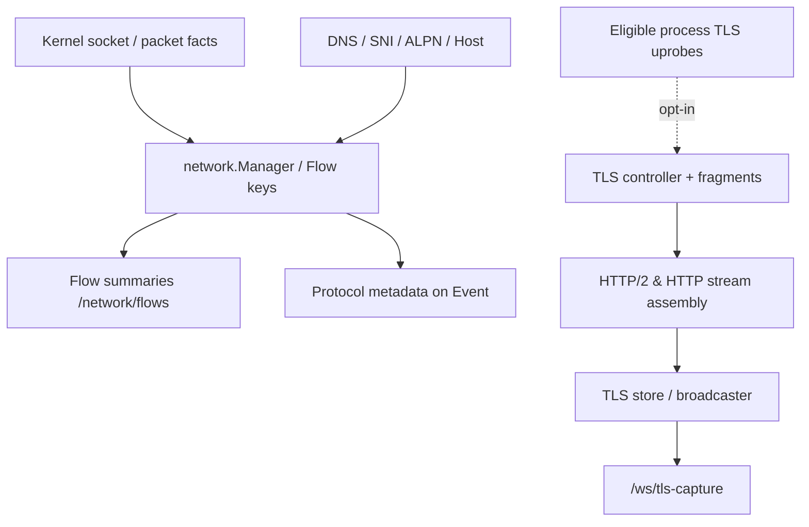
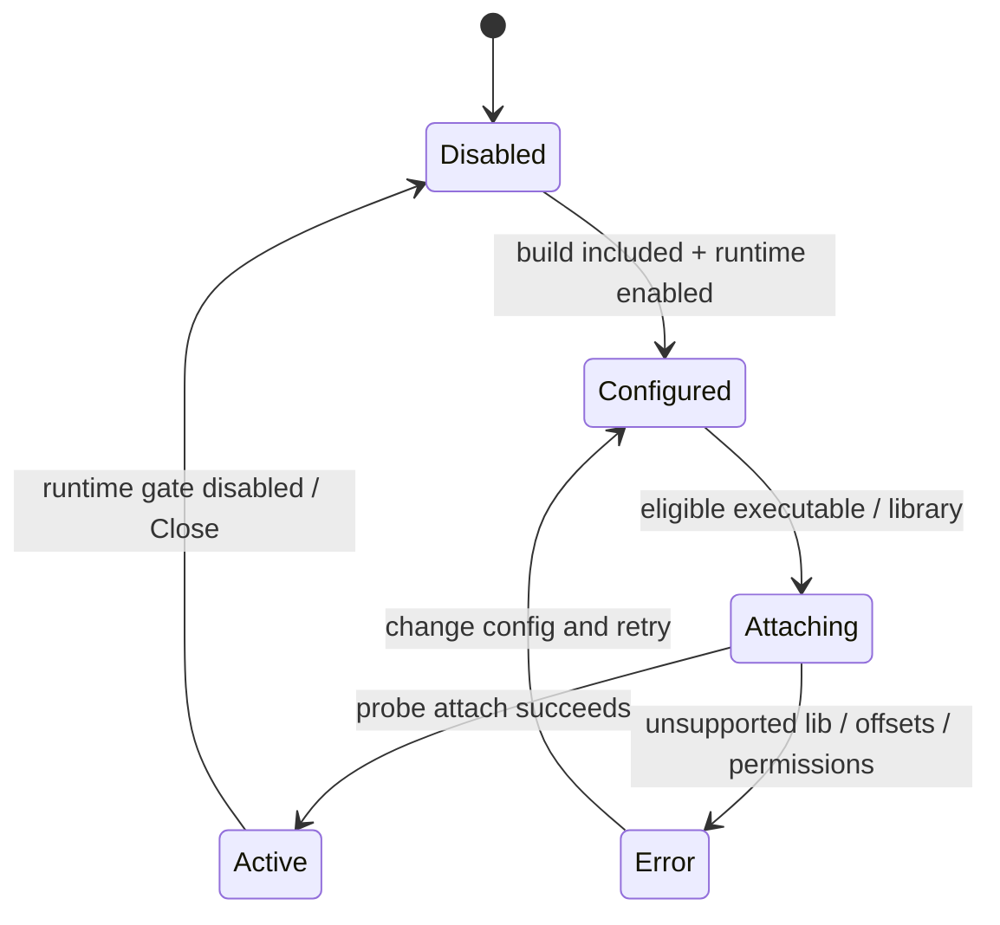
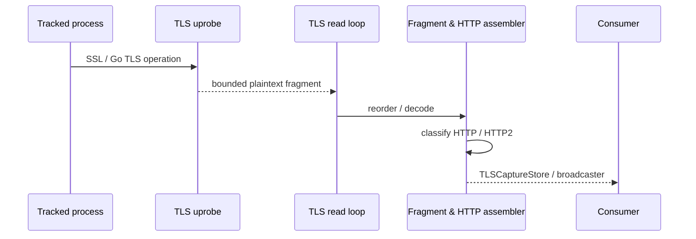
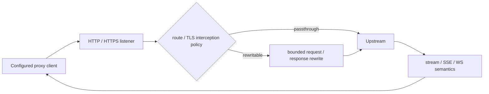

# 网络可观测、TLS Capture 与 Domain Forward

**代码锚点**：`backend/app/network/`、`backend/internal/network/`、`backend/internal/protocoldetect/`、`backend/app/tls/`、`backend/internal/domainforwardproxy/`、`backend/app/events/event_flows.go`。

## 1. 网络观测不是透明解密

内核事件与网络管理器提供 TCP/UDP flow、PID、端口、域名缓存、方向和字节数等信息。`events.PopulateEventFlowFields` 填充 `flow_id`、`src_ip`、`dst_ip`、`service_name`、`dns_name` 等，并通过 `protocoldetect` 富化应用协议。TLS plaintext 是另一条需要主动启用、匹配目标和附加 probes 的路径。

## 2. TLS 捕获控制器的状态

`tls.StartTLSCaptureRuntime` 创建 Store、Rules、Broadcaster 和 Controller；`TLSCaptureController.EnsureStarted` 检查运行开关；`AttachDefaults` 是路径范围的默认附加，不作系统范围的无条件探针。`StartBpfTSShadow` 和 `StartBpfTSOpenSSLBridge` 是互斥的可选路径，不能和主采集混用而重复汇报。

## 3. 明文片段到请求

`backend/app/tls/` 中有 fragment assembler、HTTP frame parser、HTTP/2 stream assembler、capture rules/store/broadcaster。它们处理的是已捕获的用户态明文片段，而不是对任意 TLS session 凭空解密。路径匹配、库版本、符号可见性、Go/rustls 特性和 capture mode 都影响覆盖范围。

## 4. Domain Forward 是独立代理链路

`domainforwardproxy.Runtime.Apply` 根据 `DomainForwardProxySettings` 启动可选 HTTP/HTTPS listener；`handler.go`、`rewrite.go`、`sse_rewrite.go`、`websocket.go`、`content_encoding.go` 处理请求与响应重写、SSE、WebSocket、编码语义。`mitm.go` 是显式配置下的 TLS Intercept 路径，不意味着所有进程默认透明经过该代理。

## 5. API 与失败模式

`/network/flows`、`/network/flows/:flowID`、`/network/dns-cache`、`/network/analyze`、`/network/capture-profiles` 属基础网络管理路由；`/network/export/jsonl`、`/network/export-pcap` 受编译功能保护。不要在 TLS 禁用、probe attach 失败或应用未使用代理时将“没有明文”解释为没有网络活动。对应测试：`tls/fragmentassemblertls_test.go`、`domainforwardproxy/sse_rewrite_test.go`、`domainforwardproxy/websocket_test.go`。
