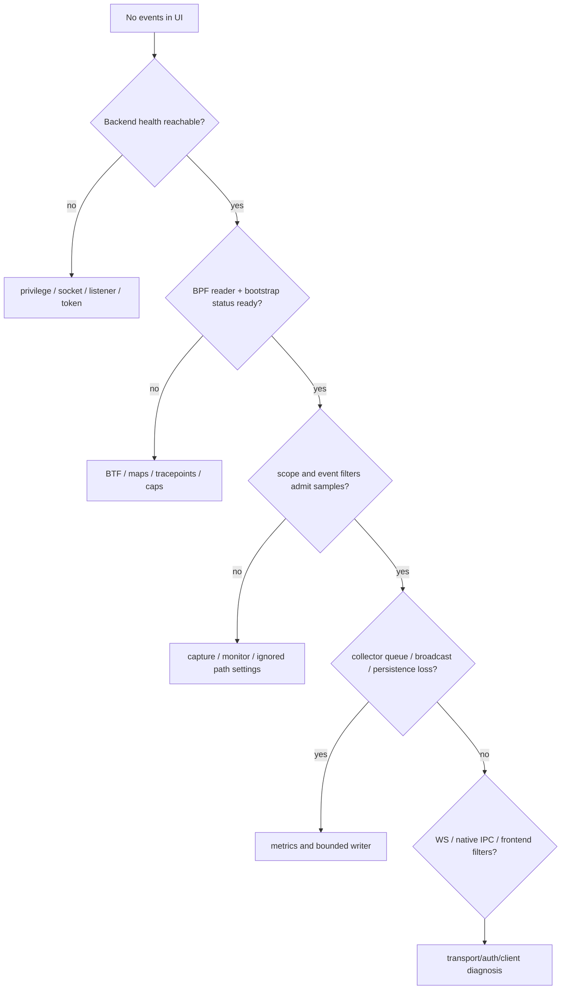
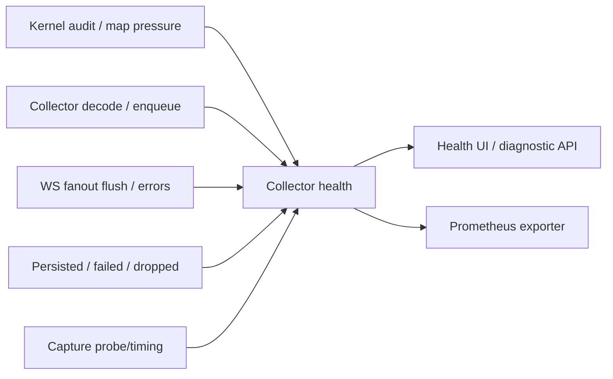
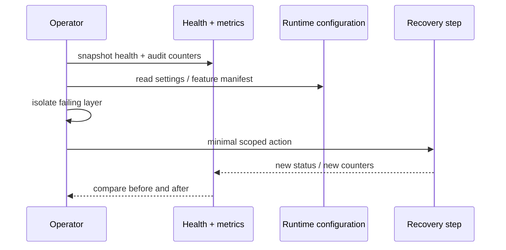
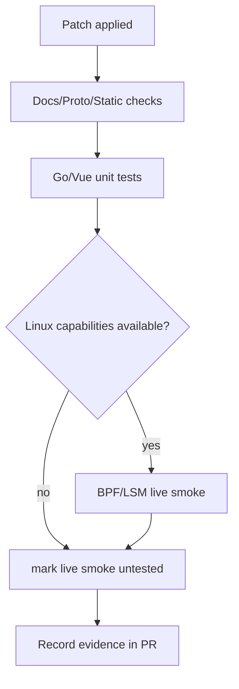

# 故障定位 Runbook：从内核采集到 UI 的分层诊断

**对应源码**：`backend/app/health_bootstrap.go`、`backend/app/runtime/health.go`、`backend/app/observability/metrics_collector.go`、`backend/app/observability/metrics_prometheus.go`、`backend/app/kernel_sequence_audit.go`、`backend/app/runtime_event_store_pebble.go`、`backend/app/ws_api.go`、`desktop/renew/native_ipc.go`。

## 1. 首先确定失败层级

“Renew 没有显示事件”可能是内核 probe 未附加、主动 Capture/Monitor scope 排除、事件队列丢弃、记录落盘错误、API 鉴权失败、私有 IPC 降级或前端筛选范围造成。排障必须由低到高沿证据追踪，不能仅凭 UI 空白就关闭风险功能。



## 2. 观测指标不可互相替代

`CollectorHealthResponse` 包括内核序号、Ringbuf 及上下文 map 压力、归档/持久化、广播 flush 等；其中 `kernel_sequence_missing_events`、`PersistWriterDroppedTotal` 与 WS write failure 代表不同失败阶段。`PrometheusMetrics` 暴露部分聚合指标，具体字段以当前 `CollectorHealthResponse` 和 metrics handler 为准。



## 3. 按症状定位源码

| 症状 | 优先检查 | 相关代码 |
| --- | --- | --- |
| 后端启动失败 | 提权、BPF pin 与 listener | `backend/app/main.go`、`backend/app/runtime_ebpf.go` |
| kernel gaps 突增 | 每 CPU generation、reserve total | `backend/app/kernel_sequence_audit.go` |
| 同 PID 归属错乱 | 注册生命周期、父子证据、PID 重用 | `backend/app/events/context_event.go` |
| API 401 | release mode、Token 更新 | `backend/app/helpers_auth.go` |
| WS 有数据却 UI 空白 | frame type、过滤条件、client scope | `backend/app/ws_api.go` |
| 存储事件少 | LogPersistenceEnabled、writer drop/flush | `backend/app/runtime_event_log_writer.go` |
| TLS 无内容 | runtime gate、probe attach、library path | `backend/app/tls/capturecontrollertls.go` |
| Renew 私有流降级 | native IPC version/typed frame | `desktop/renew/native_ipc.go` |

## 4. 恢复流程不要破坏证据

先读取健康与配置快照，再尝试改变采集 gate、scope 或重新 attach。清空事件存储、替换配置、重启内核附加程序可能丢失诊断证据。恢复后将采集完整性和业务侧数据数量分别对照。



## 5. 验证命令与运行约束

```bash
python3 scripts/check-doc-links.py
python3 scripts/check-technical-docs.py
make proto-check
make os-enforcement-check
```

内核挂载相关 live tests 需要真正满足权限的 Linux 环境；文档 CI 仅验证静态结构、链接和渲染，不意味着 eBPF 性能、对抗场景和 Windows 本机监控已经端到端验证。


