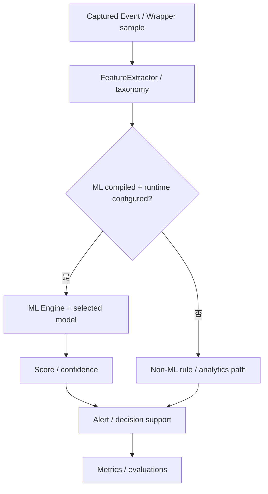
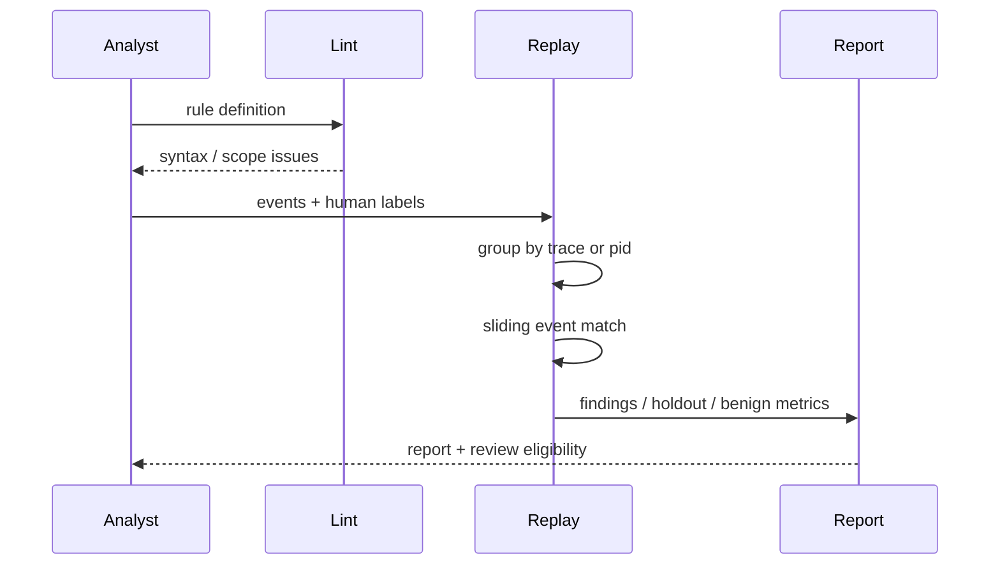
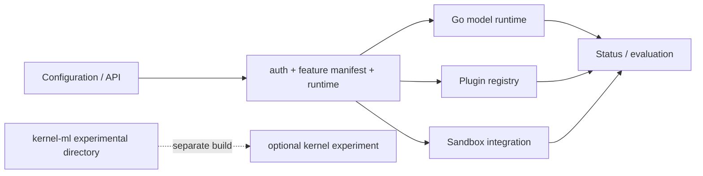

# 可选推理、检测工程、插件与沙箱集成

**代码锚点**：`backend/app/ml/`、`backend/app/integration_ml.go`、`backend/app/autotune_runtime.go`、`backend/internal/detectionengineering/engine.go`、`backend/app/plugins.go`、`backend/app/sandboxruntime/`、`kernel-ml/`。

## 1. 多模型目录不等于所有模型上线

`backend/app/ml/bridge.go` 将模型类型映射到 `core.ModelType`；目录包括森林、近邻、线性模型、attention 变体、RWKV、Mamba 等实现。`app.Main` 只在 `FeatureML` 编译时启动延后初始化；可用性还受 `MLConfig.Enabled`、数据加载状态、训练状态、模型格式和外部资源制约。

## 2. Detection Engineering 是可回放的规则验证

`detectionengineering.Lint` 校验规则；`Replay` 按 `trace` 或 `pid` scope 整理事件，要求带时间戳和有效身份，评估 human-supplied `authoring_attack`、`holdout_attack`、`benign` 标签。**不会**自动把模型预测的高风险当成 ground truth。`EligibleForHumanReview` 还要求 holdout 与 benign 样本条件。

## 3. Plugins 与内核模块是独立扩展边界

`backend/app/plugins.go` 与 plugin handlers 实现插件注册与操作；受编译特性和管理安全限制。`kernel-ml/` 是单独的可选 DKMS / C 实验目录，不等价于 Go 推理引擎部署的默认路径，也不意味着无需驱动即可在任何主机启用 GPU 内核推理。

## 4. 对外表达时的成熟度表

| 子系统 | 有实现依据 | 不能直接推出 |
| --- | --- | --- |
| ML model zoo | `app/ml/` 与 `core` 类型注册 | 在所有输入上达到某个准确率 |
| 检测工程 | `detectionengineering.Replay` | 没有人标注也能可靠评测 |
| 插件 | `app/plugins.go` 和 handlers | 任意第三方插件可安全执行 |
| sandbox runtime | `sandboxruntime/` 与 `internal/sandbox/` | 所有容器运行时均强制隔离 |
| kernel-ml | `kernel-ml/Makefile` 与 C 代码 | 主程序默认加载 DKMS 模块 |

## 5. 实验建议

分开报告延迟、吞吐、误报、误漏报、dataset 标签质量与运行开关。优先查看 `backend/app/ml/*_test.go`、`.github/workflows/ml-security.yml`、`.github/workflows/detection-engineering.yml`；历史比赛报告不能代替当前 commit 的复现数据。
