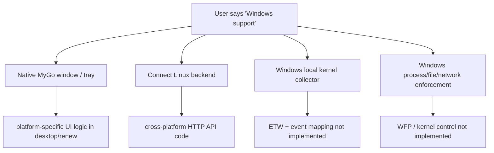
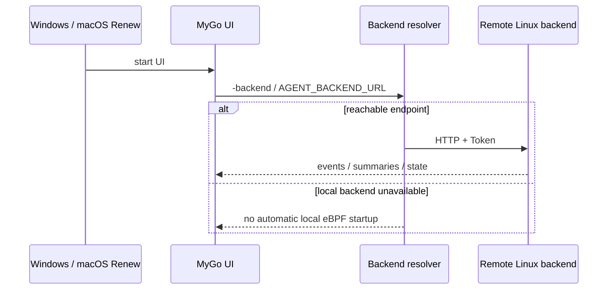
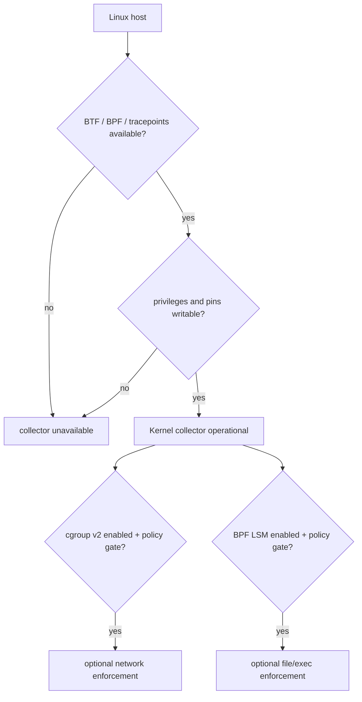
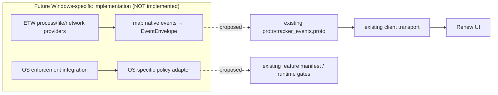

# 平台能力矩阵：Linux eBPF、Renew 跨平台外壳与 Windows 缺口

**代码入口**：`backend/ebpf/`、`backend/app/runtime_ebpf.go`、`backend/app/kernel_capabilities.go`、`desktop/renew/main.go`、`desktop/renew/backend_embedded_linux.go`、`desktop/renew/backend_embedded_other.go`、`desktop/renew/backend_process_linux.go`、`desktop/renew/backend_process_other.go`、`desktop/renew/native_harness_updates_core.go`。

## 1. “支持 Windows”至少是四个不同层级

Windows 原生桌面窗口（MyGo）、远程连接 Linux 后端的 HTTP 客户端、Windows 本地观测 Collector、Windows 原生安全阻断 Executor 是不同交付物。当前源码有跨平台 UI 和部分 Windows 安装来源辅助逻辑，**没有与 Linux eBPF tracker 等价的 Windows ETW/WFP 事件采集和系统安全控制主链路**。不能将桌面 UI 的 Windows 构建当作 Agent 内核监控的实现凭据。

## 2. 实际 OS 分支的边界

`runInternalBackendIfRequested` 的 `!linux` 实现明确返回「embedded eBPF backend mode is only available on Linux」。`ensureBackend` 则对非 Linux 本地自动提升启动直接报错。可以单独构建客户端和接远端服务，但若没有后端 endpoint，不能声称用户已获得系统调用数据。

## 3. Linux 后端的先决条件

Linux 的 BPF collector 需要可用的 BPF/BTF、tracepoints、权限与适当的挂载配置；阻断要另行满足 cgroup v2、BPF LSM 环境及管理开关。容器里能编译 BPF 对象，也不代表运行期有挂载或特权。评估部署应查询启动健康、collector audit 和 enforcement status。

## 4. Windows 新后端的工程拆分建议（尚未实现）

下图**仅作为设计方向，不表示代码已存在**：平台无关的 `EventEnvelope` 和 API 协议可以复用，但本机采集需 Windows 专门 collector、显式映射的原生时间戳/PID/文件/网络字段，策略执行需要 Windows 独立 security backend。仅用 Windows API 查询进程表不能与 Linux eBPF 完整度画等号。

## 5. 验收标准必须分别展示

| 交付范围 | 验证 |
| --- | --- |
| Renew GUI | 对应 Windows/macOS runner 构建、启动、窗口/托盘交互 |
| Remote backend | Token、重连、摘要流、Feature Manifest 正常 |
| Linux native collector | privileged bootstrap + BPF maps + ring events + drop metrics |
| Windows native collector | 实现后才用真实 ETW 源、PID 映射、丢失报告做验收 |
| OS enforcement | 真实阻断行为、撤销/恢复、最小权限回归 |

平台声明以现有代码为准；计划项始终单独标记，避免文档先于实现。
