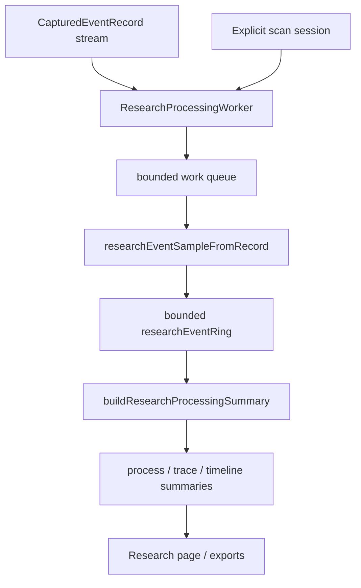
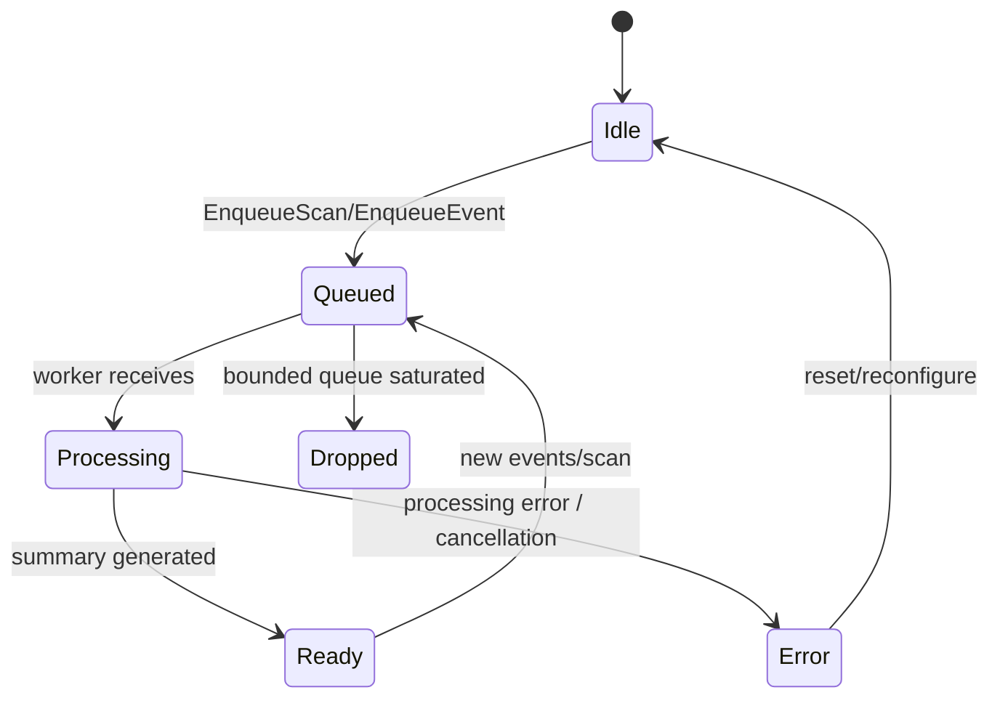
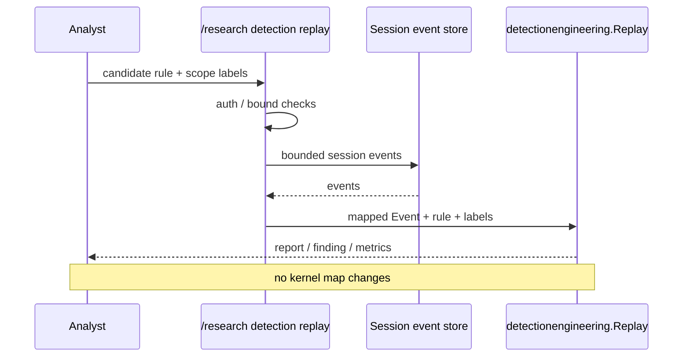
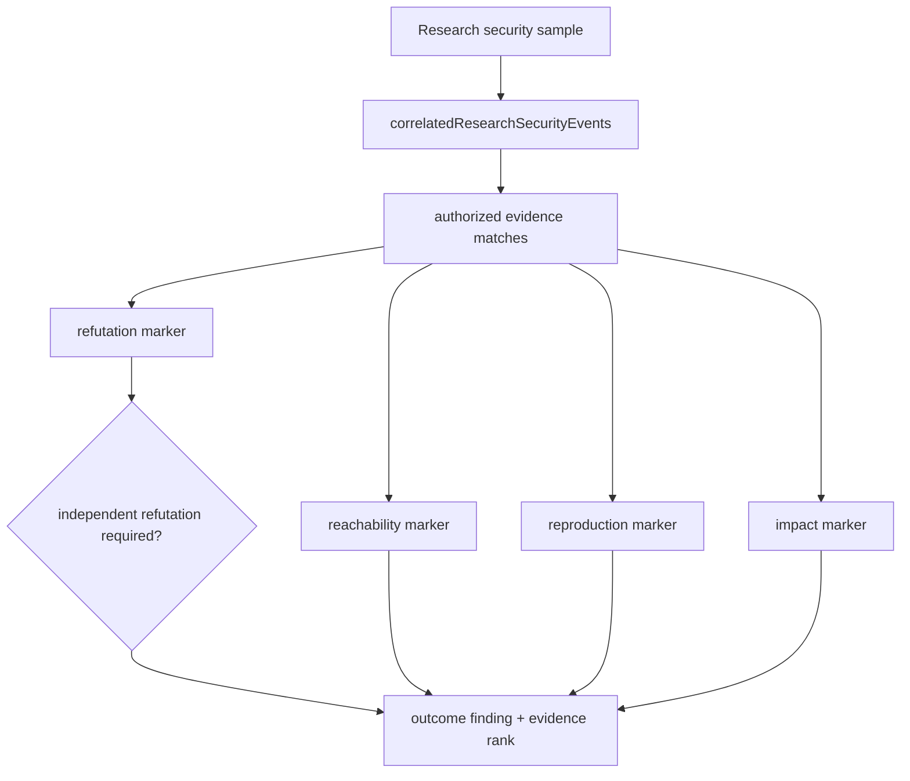

# 研究任务、数据集重放、安全结局验证

**代码入口**：`backend/app/research/processing_runtime.go`、`backend/app/research/detection_replay.go`、`backend/app/research/security_eval.go`、`backend/app/research/security_outcome_validation.go`、`backend/app/research/session_store.go`、`backend/app/research/session_files.go`、`backend/app/graphbridge.go`。

## 1. 日常监测与研究处理分开

日常 monitor 展示当前 bounded 事件摘要，研究 worker `researchProcessingWorker` 另行接收 record/scan/reset 工作项。`researchEventRing` 按插入顺序保存有限样本、满时覆盖最老项。`processRecordsContext` 按 `core.WorkerScanBatchSize` 分批生成 sample 和统计；`buildResearchProcessingSummary` 汇总进程、trace、timeline，避免 UI 从原始事件自行定义不一致的研究结果。

## 2. 研究任务与伪实时结果的区别

源代码区分 `EnqueueEvent`、`EnqueueScan`、`EnqueueReset`；`ResearchProcessingStatus` 含任务状态与丢弃统计。任务队列的入队成功不等于所有样本已成功处理；重放窗口受保留策略影响，不能把过去的全部系统活动当作完整训练集。

## 3. 可验证 Detection Replay 的调用链

`handleResearchDetectionReplay` 注册在认证的 `/research` 组下，解析 `rule`、`labels` 与 session events，严格校验 `detectionengineering.MaxLabels`、`MaxEvents`，最后转换成 `detectionengineering.Event` 再调用 `Replay`。注释写明候选规则只读，不会自动安装到 Wrapper、cgroup 或 LSM。

## 4. Outcome validation 不是单个告警字段

`researchSecurityOutcomeValidation` 对证据关联窗口和授权来源作检查，分辨 reachability、reproduction、impact 和 refutation marker。`researchSecurityAuthorizedEvidenceMatches` 先处理允许的证据范围；`researchSecurityRefutationIndependent` 可以要求反证独立。单一风险高分不能替代重复验证或独立反证。

## 5. 推荐研究报告格式

| 章节 | 必需可核对事实 |
| --- | --- |
| 输入范围 | session ID、capture gate、时间窗、记录数与缺失审计 |
| 数据集 | 标签来源、按 PID/trace 分组、剔除项 |
| 检测 | 规则 ID、版本、允许的 signal 字段、Replay 参数 |
| 结果 | authoring vs holdout vs benign 指标与误报 |
| 结局 | reachable / reproduced / impact / refuted 的证据来源 |
| 可复现 | 用到的 commit、配置、运行权限、机器环境 |

查询入口和导出由 `backend/app/research/` 与 `backend/app/handlers/api_external.go` 描述；完整路由以 `backend/app/routes.go` 注册为准。关联图从录制文件构建的路径位于 `graphbridge.go`，不得自动视作与在线实时图完全一致。

**测试**：`backend/app/research/processing_runtime_test.go`、`backend/app/research/security_outcome_validation_test.go`、`backend/internal/detectionengineering/engine_test.go`。
