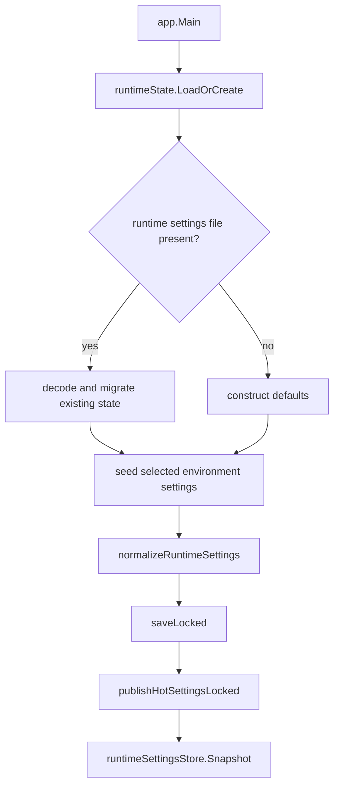
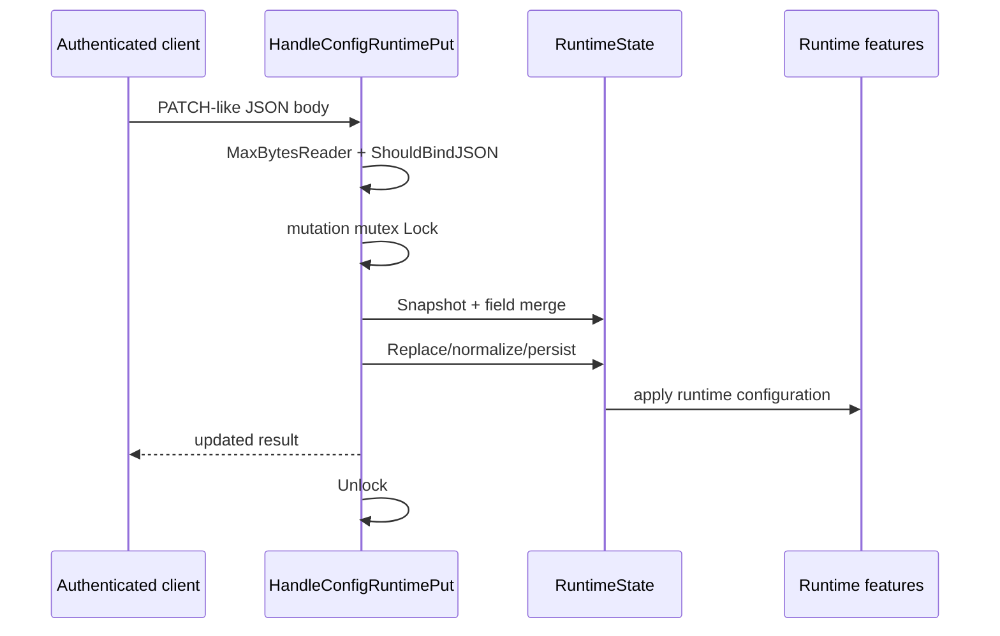
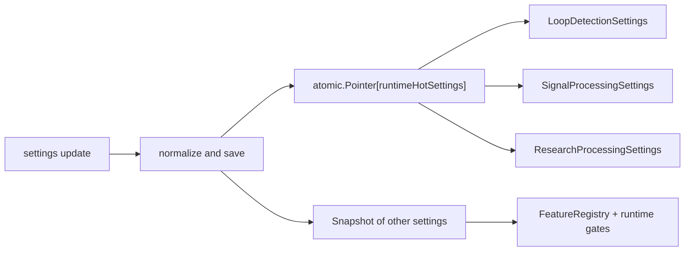
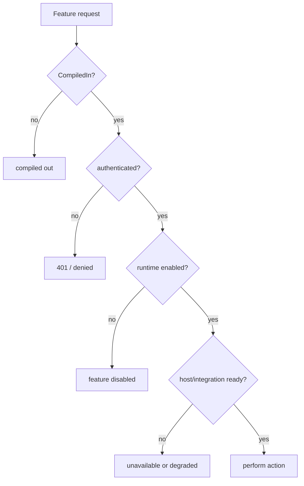

# RuntimeSettings：持久化、热更新、门控和 Token

> 对应：`backend/app/statepersistenceruntime.go`、`backend/app/stateenvruntime.go`、`backend/app/handlers/runtimeconfig.go`、`backend/app/feature_manifest.go`、`backend/app/helpers_auth.go`、`backend/app/desktop_session.go`。

## 1. 加载及配置来源

后端初始化 `runtimeState.LoadOrCreate`；运行设置位于实际用户的 RuntimeSettings 文件中，首次初始化、旧版本迁移及环境变量 seed 由 `statepersistenceruntime.go` 和 `stateenvruntime.go` 实现。`normalizeRuntimeSettings` 会填充缺省值并限制非法或过大参数，不能仅看环境变量名推断最终开启状态。

## 2. HTTP 更新是 patch-like，而不是覆写其他字段

`handlers.HandleConfigRuntimePut` 使用 `RuntimeSettingsPatch` 中指针字段表达“提供 / 未提供”；体积限制为 `1<<20` bytes。`runtimeSettingsMutationMu` 在读取、合并、持久化、更新副作用期间串行化修改。`runtimeState.Replace` 仍进行 normalize、持久化与 ML runtime 更新。

## 3. 与热路径同步的方式

`runtimeHotSettings` 是一个不可变快照，包含 loop detection、research processing 和 signal processing；`runtimeState.publishHotSettingsLocked` 使用 `atomic.Pointer` 发布，事件热路径通过对应 accessor 不必反复持有 `runtimeState` 读锁。其他配置仍要通过 `Snapshot` 与领域服务读取。

## 4. 门控与运行能力要分层检查

| 层 | 检查位置 | 说明 |
| --- | --- | --- |
| 编译 | `feature_build_*.go`、`FeatureRegistry.CompiledIn` | 本二进制是否带有路由/实现 |
| Runtime | `RuntimeSettings` + specific middleware | 当前是否允许功能被执行 |
| Auth | `helpers_auth.go` | 是否有授权令牌与符合环境要求 |
| Host | `kernel_capabilities.go`、sandbox status | 是否有匹配 Linux 特权与内核挂载 |
| Integration | `tls/capturecontrollertls.go` 等 | 目标可执行文件/探针/下游是否正常 |

## 5. Token 生命周期与意外行为

`generateAccessToken` 使用 `crypto/rand` 创建 24 字节随机值并 hex 编码；`ExpectedToken` 优先读取已保存设置，空值时才尝试列出的环境 Token；`RotateAccessToken` 保存新令牌，已有客户端须同步更新。Renew 私有启动时通过 `desktopSession.publishToken` 在生命期 socket 交付令牌，不应把它写入公开 URL 或日志。`DISABLE_AUTH=true` 仅应在明确受控的开发环境使用。

## 6. 实际默认值与容量

`stateenvruntime.go` 定义 `defaultEventStoreMaxRecords = 250000`、`defaultEventStoreMaxAge = "168h"` 和上限 `10000000`；与 `runtime_event_log_writer.go` 的队列 `4096` 不同，前者是保留记录限制，后者是写入待处理容量。有关内存、磁盘、水位报警见 [存储与可观测性](./storage-observability.md)。

回归测试：`backend/app/state_hot_settings_test.go`、`backend/app/stateenvruntime_test.go`、`backend/app/handlers/runtimeconfig_test.go`、`backend/app/helpers_auth_test.go`。
