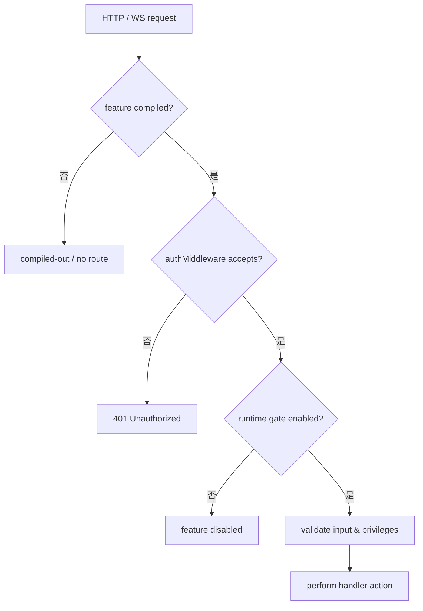
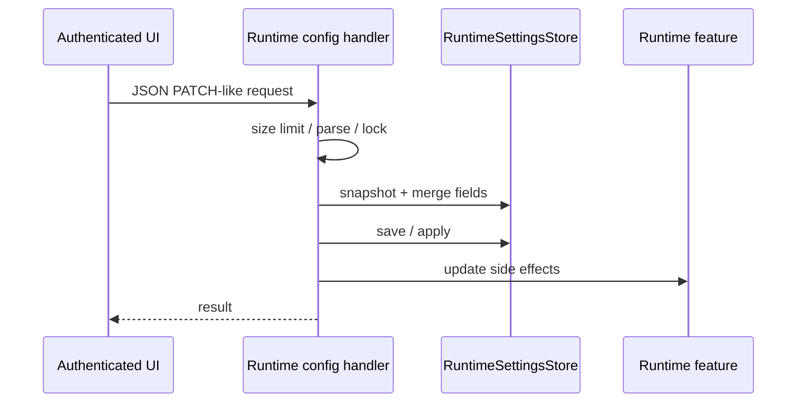
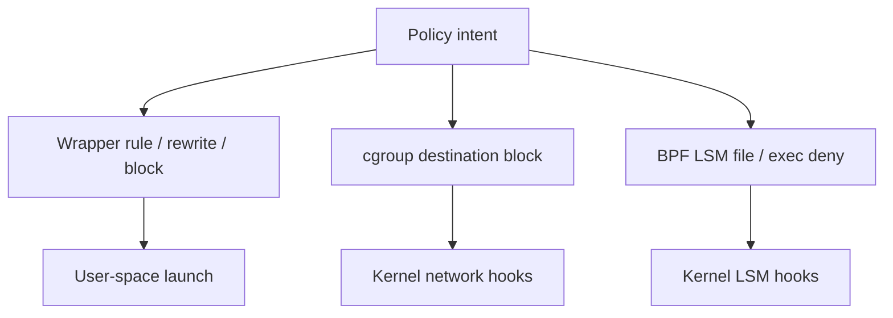
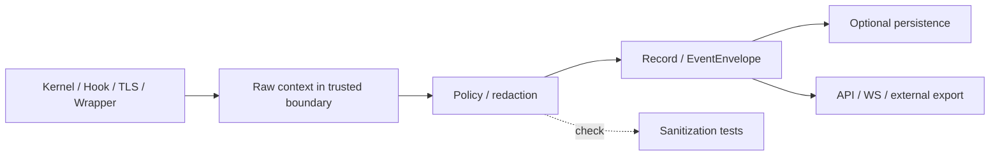

# 认证、配置门控、策略与隐私

**代码锚点**：`backend/app/helpers_auth.go`、`backend/app/feature_manifest.go`、`backend/app/handlers/runtimeconfig.go`、`backend/app/server_uds.go`、`backend/redaction/`、`backend/app/redaction_engine.go`、`backend/ebpf/cgroup_sandbox.c`、`backend/ebpf/lsm_enforcer.c`。

## 1. 三种不同的控制判断

在实际 `authMiddleware` 中，release 模式且 `DISABLE_AUTH != "true"` 时会检查 Token（`?key=`、`X-API-KEY` 或 Bearer），并使用常量时间比较；调试配置与集群通道有各自条件。敏感路由还必须通过 Feature Build、Runtime Gate。**不要把“开发环境未启用认证”写成生产安全保证。**

## 2. 特性清单可检查不可推测

`FeatureManifestResponse.Features` 返回 `compiledIn`、`runtimeEnabled`、`runtimeGate`、`authRequired`、`dangerLevel`、`buildTag`、`routePrefixes` 等字段。`feature_build_default.go` 未指定 build tags 时 `enableAllBuildFeatures()`；这只是 **编译可能性**，实际需再次检验开关与宿主条件。

| 典型功能 | Build Feature | Runtime Gate |
| --- | --- | --- |
| Shell | `shell_sessions` | `ShellSessionsEnabled` |
| 文件/命令 API | `system_run` | `SystemRunEnabled` |
| Hook 管理 | `hooks` | `HookManagementEnabled` |
| 策略编辑 | `policy_management` | `PolicyManagementEnabled` |
| TLS capture | `tls_capture` | `TlsCaptureEnabled` |
| OTLP | `otlp` | `OtlpEnabled` |
| Forward proxy | `domain_forward` | `DomainForwardProxy.Enabled` |
| ML | `ml` | `MLConfig.Enabled` |

## 3. 热更新不是盲目替换

`handlers.HandleConfigRuntimePut` 采用可选字段的 PATCH 语义、最大 `1 MiB` 请求体和 `runtimeSettingsMutationMu`，保证持久化与副作用在同一临界区，避免并发请求以旧 gate 状态覆盖新状态。

## 4. 策略分层

`Wrapper` 拦截所包装的命令；`cgroup` 拦截适用的 connect/sendmsg；`BPF LSM` 拦截内核 hook 覆盖的文件/执行操作。三种策略的阻断点、失败返回与配置对象互不等同。

## 5. 敏感数据边界

`backend/redaction/` 具备规则、泛化、伪名、格式保留等实现；`app/events/envelope_redaction.go` 与采集归档路径结合。TLS、Hook 和请求正文可能包含高敏感数据，应分别查看实际 ingress、redaction、存储和 export 路径，**不要假设所有第三方输出自动完全脱敏**。

## 6. 最低安全检查

验证 release auth；分别开启/关闭策略、TLS、system_run；测试非法路径及超大输入；检查 `/sandbox/*/status` 与 `/system/features`；确认 Renew 私有 socket 与 wrapper UDS 不是同一个接口。参考 `backend/app/helpers_auth_test.go`、`backend/app/ws_api_security_test.go`、`backend/app/plugin_files_security_test.go`。
