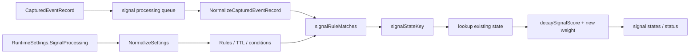
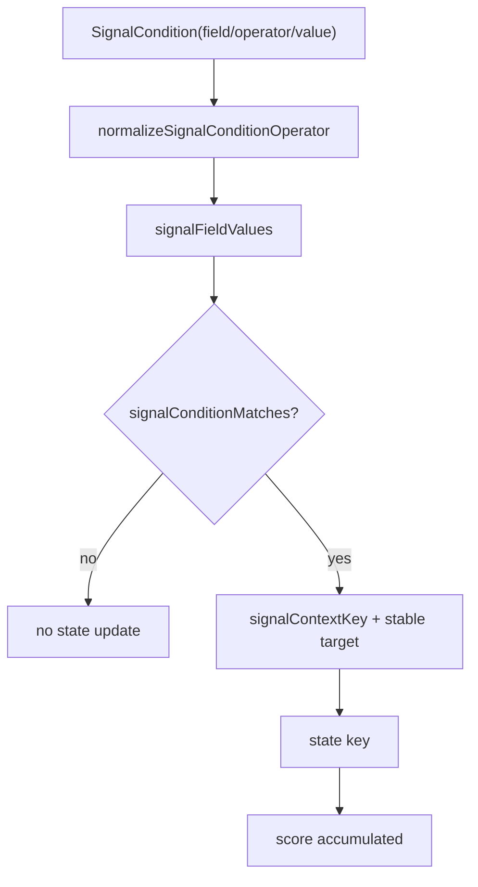
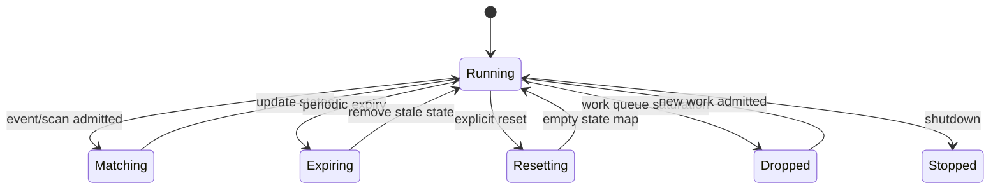
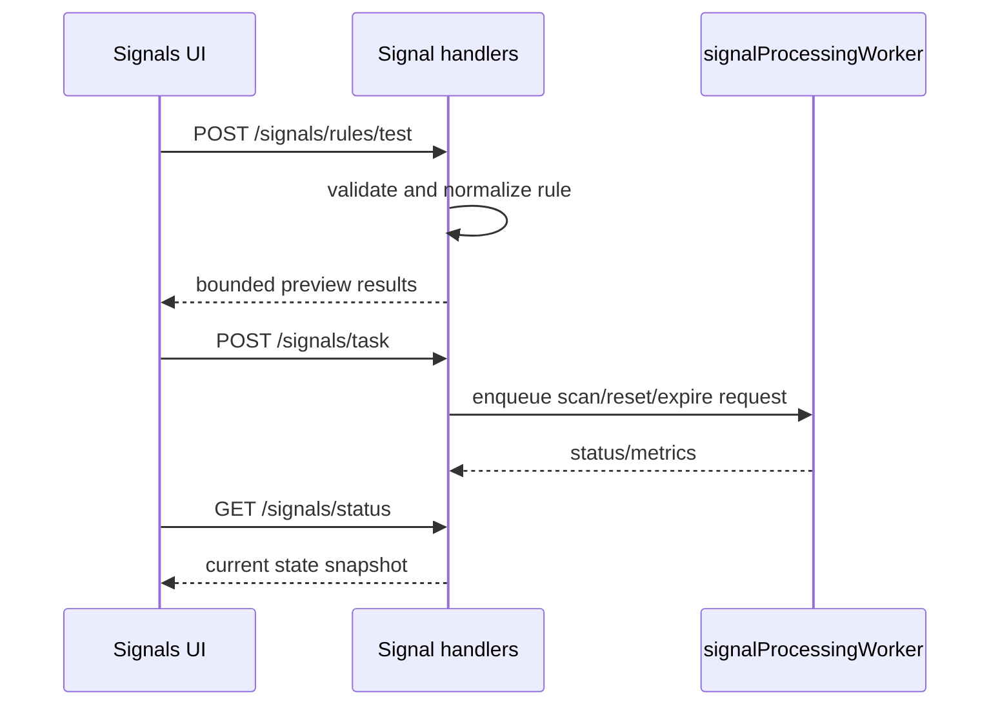

# Signal Runtime：规则状态、TTL 衰减、队列和重放

**对应源码**：`backend/app/signalruntime/runtime.go`、`backend/app/signalruntime/runtime_matching.go`、`backend/app/signalruntime/runtime_handlers.go`、`backend/app/signalruntime/runtime_logs.go`、`backend/app/signalruntime/runtime_log_writer.go`、`backend/app/statepersistenceruntime.go`。

## 1. 规则状态和单次告警不同

`SignalRule` 在 `NormalizeSettings` 归一化，运行时 `signalProcessingWorker` 从事件队列消费 `CapturedEventRecord`，通过 `signalRuleMatches` 判断是否满足规则。匹配后 `signalStateKey` 根据事件上下文和 target 建立相关联的状态，`decaySignalScore` 对旧分数按 TTL 衰减再叠加新权重。UI 的 Signal 行表示跨事件累计状态，而不仅是最近一次事件原始 risk score。

## 2. Condition 字段是明确列举的

`signalFieldValues` 根据字段名读取 `pb.Event` 中的 path、extra path、comm、event type、command、cwd、tool name、network endpoint、decision 等白名单字段。它不是允许用户任意表达式执行的解释器，条件操作符通过 `normalizeSignalConditionOperator` 和 `signalConditionMatches` 解释。

## 3. 后台任务与状态边界

`signalProcessingWorker.Start` 启动 worker，任务有 event、scan、reset 与 expire；`runCron` 按运行设置触发周期操作。`expireNow` 进行过期，`resetNow` 清空内部状态，`EnqueueScan` 用于研究式重算。队列满时的 drop 必须单独统计，而不是把“无信号”当成“无行为”。

## 4. API 是管理与诊断，而不是任意执行

`runtime_handlers.go` 导出 `HandleStatus`、`HandleTask`、`HandleRuleTest`、`HandleProgramLogs`、`HandleProgramLogDownload`，对应 `/signals/status`、`/signals/task`、`/signals/rules/test` 与程序日志接口。RuleTest 只检验规则如何匹配采样事件，不会自动修改已配置策略。用户可先测试候选规则，确定归属与 TTL 后再单独更新 RuntimeSettings。

## 5. 何时与 semantic alert / ML 混用

Signal、`BuildSemanticAlerts`、ML risk 分数和 KernelRiskFeedback 的责任不同。文档与 UI 应保留每个风险信号的来源、时间窗、采样完整性与是否已执行策略；详见 [风险与证据](./detection-evidence.md)。

测试：`backend/app/signalruntime/runtime_test.go`、`backend/app/signalruntime/runtime_log_writer_test.go`、`backend/app/signalruntime/runtime_log_count_cache_test.go`。
