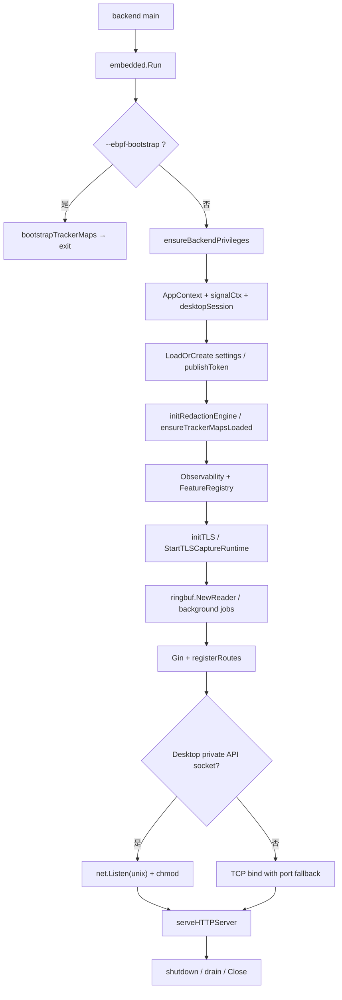
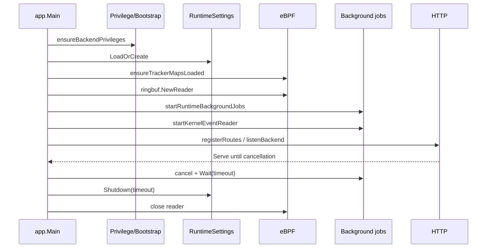
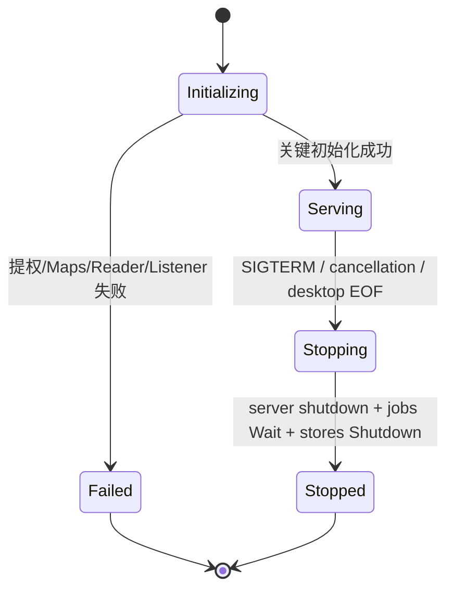

# 后端启动、服务绑定与优雅退出

**源代码**：`backend/main.go`、`backend/app/main.go`、`backend/app/runtime_ebpf.go`、`backend/app/jobs_background.go`、`backend/app/startup_server.go`、`backend/app/desktop_session.go`。

## 1. 实际启动路径

`backend/main.go` 调用 `embedded.Run(args)`；主应用控制函数为 `app.Main()`。普通模式首先检查是否需要重新提升后端权限，接着初始化上下文、加载 RuntimeSettings、建 eBPF 映射/链接、启动读取器、创建路由和 HTTP listener。**引导模式**（`--ebpf-bootstrap`）只完成 bootstrap 并返回。

## 2. 关键初始化顺序

1. `AppCtx` 注入网络、设置、事件存储、图谱和插件等依赖。
2. `runtimeSettingsStore.LoadOrCreate()`；Renew 私有会话时通过 `publishToken` 握手交付令牌。
3. 非 Renew 私有会话路径调用 `runtime.KillPreviousBackendProcesses()`；之后初始化脱敏、加载 eBPF 并设置采集态。
4. 按编译功能启动域名转发，初始化 TLS controller；不开启 TLS capture 不代表移除 controller 所有代码路径。
5. `ringbuf.NewReader(trackerMaps.Events)` 打开 BPF ring buffer；`startRuntimeBackgroundJobs` 与 `startKernelEventReader` 按生命周期归入 task group。
6. `registerRoutes` 绑定不同接口组；`listenBackend` 决定 listener 类型；随后 `serveHTTPServer`。

## 3. TCP 与私有 Unix API 是互斥选择

`listenBackend()` 在配置了桌面 Unix API Socket 时 `net.Listen("unix", socket)`，权限设置后返回端口 `0`，注释明确 **不打开 TCP 监听、不写端口文件、不做集群心跳**。普通启动在配置的起始端口附近尝试 TCP 绑定。不要把这两种模式画成永远同时监听。

## 4. 后台任务与错误语义

`startRuntimeBackgroundJobs` 启动 UDS wrapper server、网络 GC、采集 profile watcher、风险反馈、loop 检测、研究/信号处理等具体任务（条件由实现决定）；任务由 `taskgroup.Group` 管理。`startKernelEventReader` 将可复用 ringbuf sample 拷入所需生命周期后解码，再进入 broadcast 队列。无法初始化 eBPF ring reader 等核心依赖会导致启动返回错误，**不是默认降级到纯用户态 collector**。

## 5. 代码查验

- 监听：`backend/app/startup_server.go` 中 `listenBackend`、`serveHTTPServer`。
- eBPF 生命周期：`backend/app/runtime_ebpf.go` 的 `ensureTrackerMapsLoaded`、`pinMaps`、`pinLinks`。
- 读取器取消测试：`backend/app/kernel_event_reader_lifecycle_test.go`。
- 桌面子进程退出与私有 socket：`desktop/renew/backend.go`、`backend/app/desktop_session.go`。
