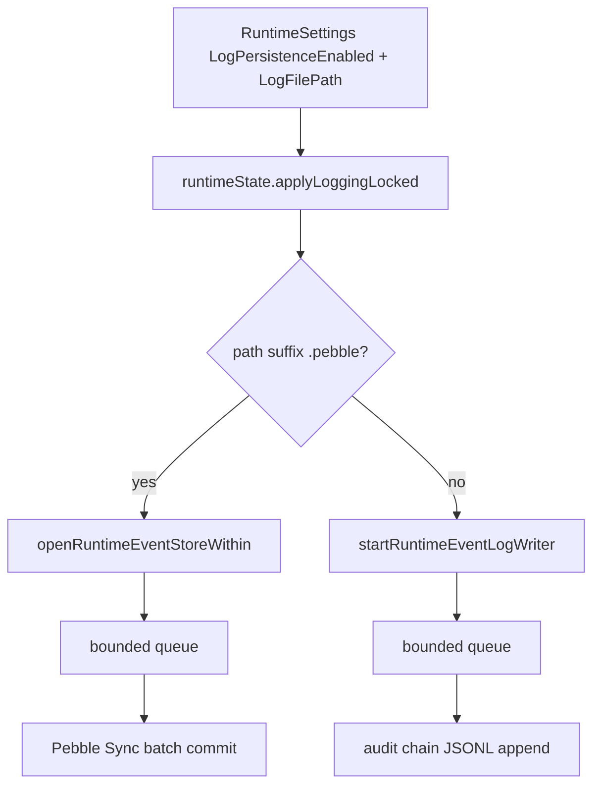
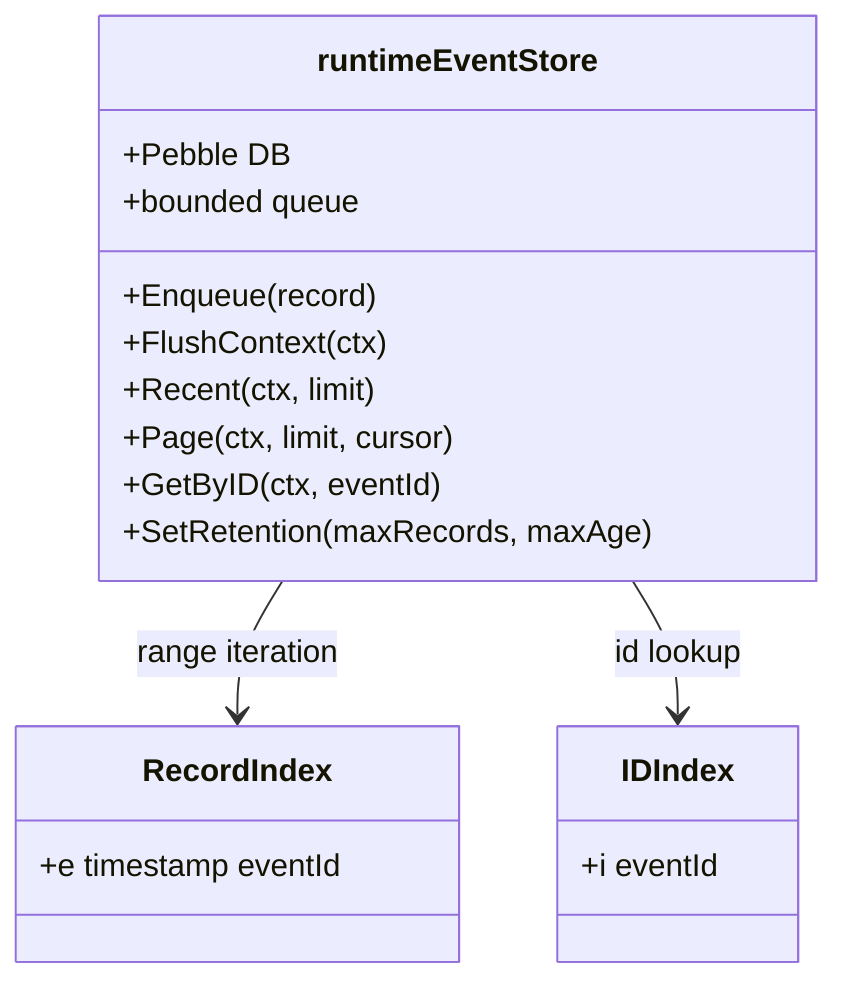
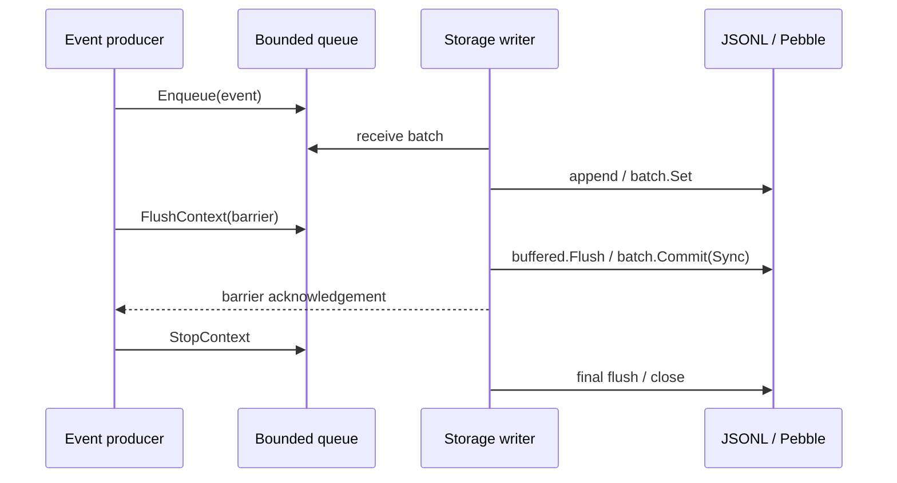
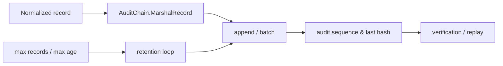

# 事件存储内部协议：JSONL、Pebble、Flush Barrier 与审计链

**代码入口**：`backend/app/statepersistenceruntime.go`、`backend/app/runtime_event_log_writer.go`、`backend/app/runtime_event_store_pebble.go`、`backend/app/runtime_event_log_reader.go`、`backend/app/recording/audit_chain.go`、`backend/app/runtime_event_log_path.go`。

## 1. 后端根据路径选择存储后端

`runtimeState.applyLoggingLocked` 通过 `isPebbleEventStorePath` 判断是否以 `.pebble` 结尾；否则使用 JSONL writer。开启/关闭持久化时可以停掉旧 writer/store，然后创建新目标。`RecentEventsContext` 会考虑正在使用的 store、writer flush 及已有内存 archive，不能把任意一条查询路径误称为全部历史数据的数据库扫描。

## 2. Pebble 的 Key 与索引

`eventStoreRecordKey` 构造前缀 `'e'` + 8 字节时间排序字段 + event ID，`eventStoreIDKey` 以 `'i'` + event ID 作二级索引。`Page` 提供 cursor 分页，`GetByID` 用 ID 索引寻找记录；`Recent` 和 `Page` 查询前尝试 `FlushContext`，保证本进程排队的可见性，不等于外部无锁一致性数据库事务。

## 3. Batch + Barrier 明确写入时机

JSONL Writer 与 Pebble Store 均将持久化数据、flush 控制信号放入单 writer 队列。队列对事件有 `runtimeEventLogQueueSize=4096` 容量预算，并额外保留控制槽；`FlushContext` 会排队 barrier 等前面的事件提交，`StopContext` 关闭入口并等待 worker。`runtimeEventLogFlushBatch=128`、`runtimeEventLogFlushInterval=250ms` 是批处理的代码阈值，不能用其直接声称平均 I/O latency 为 250ms。

## 4. Retention 与审计必须分别核对

`runtimeEventStore.SetRetention` 更新 max records/max age，`prune` 类实现逐步执行保留清理。`recording.AuditChain` 负责签入事件链，状态携带 sequence 与 last hash。审计链能够帮助识别记录顺序或内容被改变，但“拥有最后一个 hash”不是具有不可篡改存储或可信时间戳的证明。

## 5. 风险与测试约定

- 接收成功 ≠ commit 成功；分别观测 queue accepted、persisted、failed、dropped。
- 配置持久化路径时要求路径解析与用户权限控制，不应通过前端输入放任任意文件覆盖。
- 记录层、回放层和 API 的 `CapturedEventRecord` 都要明确脱敏边界。
- 测试：`backend/app/runtime_event_log_writer_test.go`、`backend/app/runtime_event_store_pebble_test.go`、`backend/app/recording/audit_chain_test.go`、`backend/app/runtime_event_log_path_test.go`。
