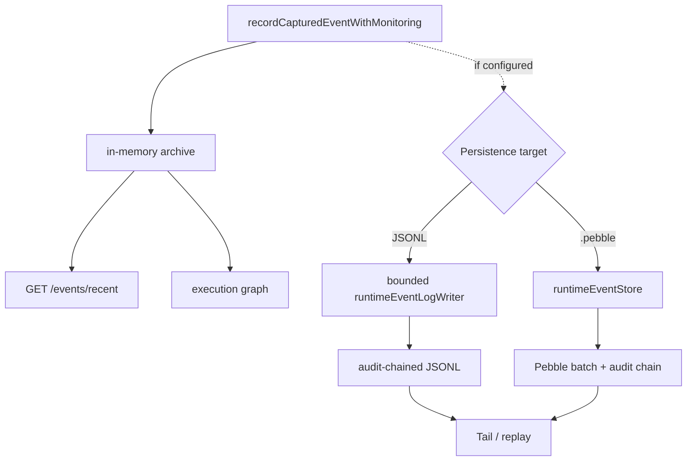
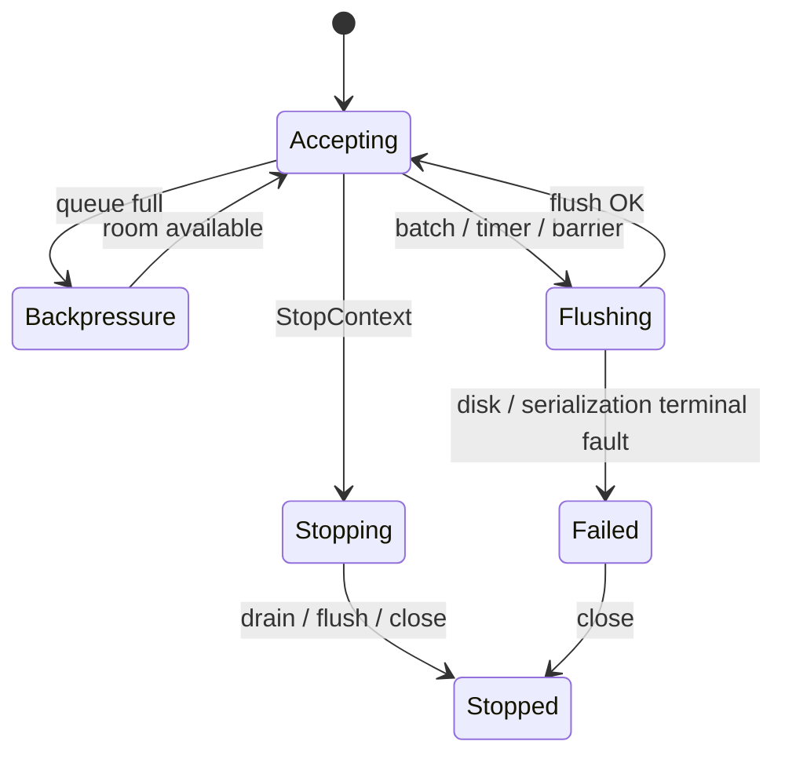
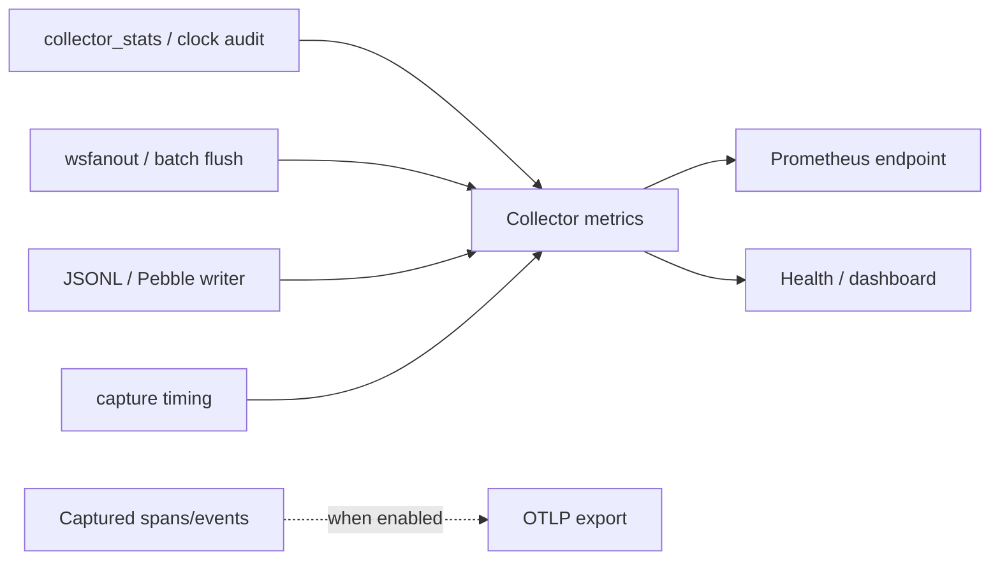

# 持久化、背压、指标与事件审计

**代码锚点**：`backend/app/statepersistenceruntime.go`、`backend/app/runtime_event_log_writer.go`、`backend/app/runtime_event_store_pebble.go`、`backend/app/runtime_event_log_reader.go`、`backend/app/recording/`、`backend/app/observability/metrics_prometheus.go`、`backend/app/export_otel.go`。

## 1. 内存与磁盘是两层

实时事件存储在事件归档中用于近期查询；`runtimeState` 同时持有 `logWriter`（兼容 JSONL）与 `eventStore`（Pebble）。落盘是可配置的附加能力。`.pebble` 路径由 `isPebbleEventStorePath` 判定，不能在未验证状态下把每次读取都描述为直接查询数据库。

## 2. 持久化写入模型

`runtime_event_log_writer.go` 定义 queue capacity `4096`、batch `128`、flush `250ms` 和额外的 flush 控制槽。写队列满时拒绝新事件，不无限增长内存；`FlushContext` 等待明确 barrier，`StopContext` 停止接收并尝试安全收尾。Pebble store 同样有 bounded queue 和 batch commit，记录了 persisted、failed、dropped 计数。

## 3. 审计链和敏感内容

`recording.NewAuditChain` 与 `MarshalRecord` 被持久化 writer 使用；审计链字段会暴露在 `runtimeEventLogStatus`，如 `auditChainVersion`、`auditSequence`、`auditLastHash`。哈希审计证明的是序列的可检测变化，不代表防篡改存储硬件，也不代表敏感 payload 可以无控制落盘。路径限定由 `runtime_event_log_path.go` 等实现负责。

## 4. 指标种类

`observability.HandlePrometheusMetrics` 输出 text/plain Prometheus exposition；内核采集统计、广播 flush、归档、持久化、TLS timing、进程/网络等还有各自的运行统计。将 `collector dropped`、`WS write failures`、`log dropped` 分开监控。

## 5. 排障路径

1. 先检查 kernel reserve 失败和事件队列丢弃，再检查持久化 writer 的 `EnqueuedTotal`/`PersistedTotal`/`FailedTotal`/`DroppedTotal`。
2. 对存储关注日志路径、权限、可用空间、尾部审计链与 `LastError`；不要用单一“事件数”替代链路延迟指标。
3. 使用 `backend/app/runtime_event_log_writer_test.go`、`backend/app/runtime_event_store_pebble_test.go`、`backend/app/observability/metrics_prometheus_test.go` 回归；性能应在固定内核、CPU、负载、采样参数下复测。
