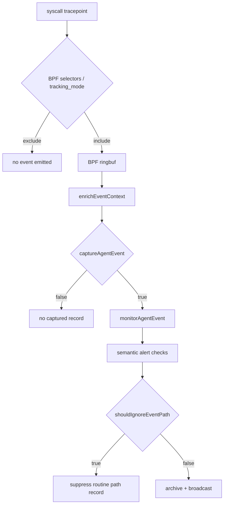
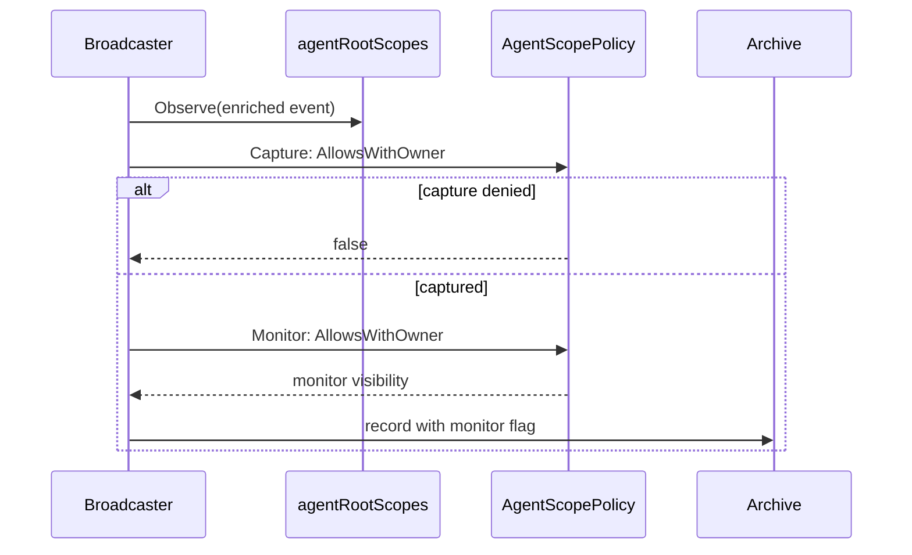
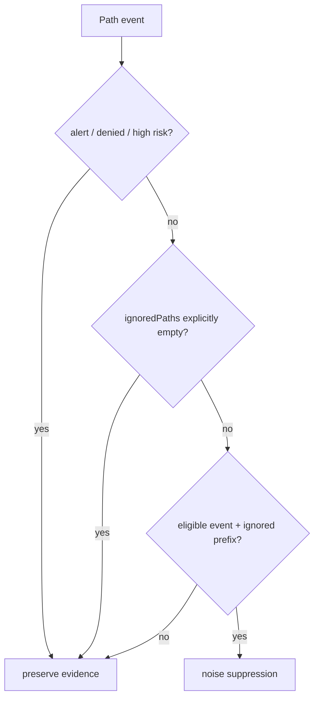
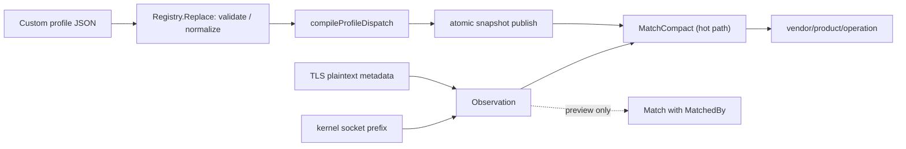

# 采集选择器、Agent Scope 与 API Capture Profiles

> 对应：`backend/app/runtime_ebpf.go`、`backend/ebpf/agent_tracker_common.h`、`backend/app/agent_scope_policy.go`、`backend/app/event_path_filter.go`、`backend/internal/eventnoise/filter.go`、`backend/app/captureprofile/profile.go`、`backend/app/captureprofile/profile_index.go`、`backend/app/captureprofile_control.go`。

## 1. 三个阶段的过滤位置不同

内核通过 `agent_pids`、`tracked_comms`、`tracked_paths`、`tracked_prefixes` 和 `tracking_mode` 控制采集选择。事件到 Go 后，`captureAgentEvent` 判定是否被采集作用域接纳，`monitorAgentEvent` 判定日常监控范围，最后 `shouldIgnoreEventPath` 处理可忽略路径噪声。它们不能互相替代：禁用一个 UI 视图不意味着 kernel probe 被卸载。

## 2. Scope 配置的两套列表

`agentScopePolicy` 包含 `Capture`、`Monitor` 两个独立列表，底层 `agentscope` 具备 blacklist / whitelist 匹配与输入规范化。`agentRootScopes.Observe` 必须在 capture filtering 之前看到事件，以便 root 归属参与后续过滤，但这只是当前 admission 的身份缓存，**不等于权威历史进程树**。

## 3. 忽略路径之前必须保留高风险证据

`event_path_filter.go` 明确：噪声过滤在语义告警评估之后运行；风险事件、告警以及拒绝操作不因匹配 routine path 而被隐藏；用户将 ignoredPaths 显式设为空数组时关闭内置 noise suppression。路径前缀归一化位于 `internal/eventnoise`。

## 4. API fingerprint 是元数据规则，不是全文模式匹配

`captureprofile.Observation` 仅使用来源、协议、请求方向、method、host、path、header names、content type、remote address、process 等元数据，并**特意不收集请求体和凭据以用于 fingerprint**。`captureprofile.Registry` 先 normalize + validate，再建立索引与不可变 `profileSnapshot`，通过 atomic pointer 对热路径发布；`MatchCompact` 避免产生 `MatchedBy` 诊断 slice 的事件级分配。

## 5. API 与安全界限

`GET /network/capture-profiles` 返回 builtin/custom/effective profiles；`PUT /network/capture-profiles` 更新 overlay；`POST /network/capture-profiles/preview` 在不改变全局规则的前提下预览匹配。`maxCaptureProfilePreviewObservations=500`，overlay 默认 `api-capture-profiles.json`，也可由 `AGENT_EBPF_API_PROFILES` 选择路径。`persistCaptureProfileOverlay` 使用 staged file 进行原子发布后 reload snapshot。

| 操作 | 目的 | 需注意 |
| --- | --- | --- |
| GET profiles | 展示有效配置、matcher 状态、能力枚举 | 内置与自定义配置不能混为一份 |
| PUT profiles | 替换自定义 profile | 需要输入校验和安全文件写入 |
| POST preview | 用模拟 Observation 验证规则 | 不能当成实际流量抓包 |
| MatchCompact | 运行期低开销分类 | 不等同于请求体隐私泄露检测 |

测试锚点：`backend/app/captureprofile/profile_test.go`、`backend/app/captureprofile/profile_bench_test.go`、`backend/app/agent_scope_policy_test.go`、`backend/app/event_path_filter_test.go`。
