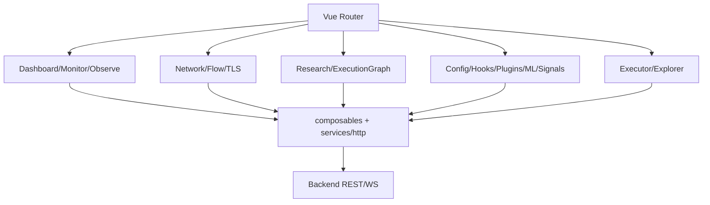
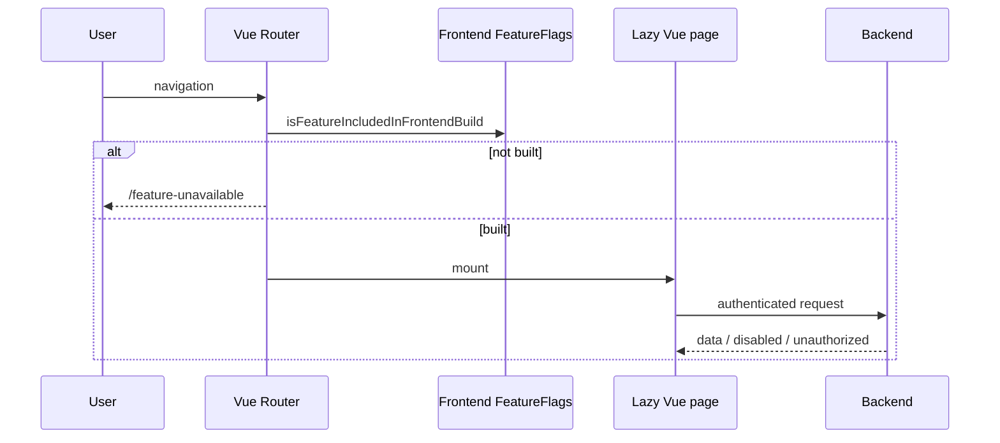
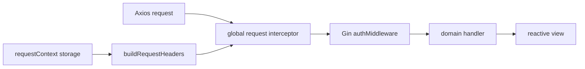
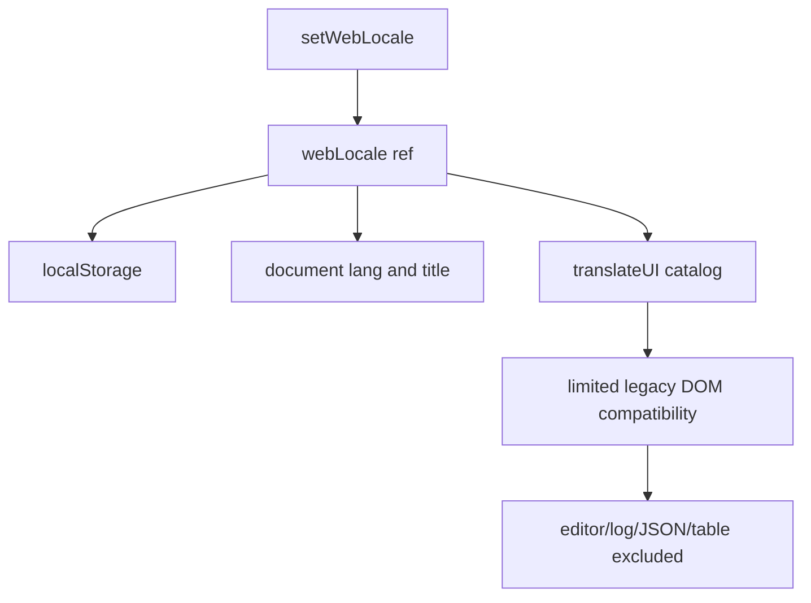

# Vue Workbench 内部边界：路由、特性裁剪、状态与国际化

**对应源码**：`frontend/src/router/index.ts`、`frontend/src/config/featureFlags.ts`、`frontend/src/services/http.ts`、`frontend/src/utils/requestContext.ts`、`frontend/src/i18n/index.ts`、`frontend/src/i18n/messages.ts`、`frontend/src/views/`、`frontend/src/composables/`。

## 1. 页面与业务服务分离

`router/index.ts` 用懒加载导入 Dashboard、Monitor、Observe、Network、Execution Graph、Research、Explorer、Executor、Hooks、ML、Plugins、Config、Signals 等 Vue 页面。`/agentsight/:tab?` 和 `/config/ml/:subtab?` 属兼容 redirect，而旧 Web Renew 页面已不再是 Vue route。

## 2. build feature 与 runtime gate 是两道关

`featureFlags.ts` 从构建环境解析允许的 frontend feature，`router.beforeEach` 调用 `isFeatureIncludedInFrontendBuild`，页面编译裁剪时转到 `/feature-unavailable`。进入页面之后，真正的后端读写仍需通过 `authMiddleware` 和 runtime gate；前端禁用隐藏按钮不能替代后端授权。

## 3. HTTP 请求上下文的真正入口

`services/http.ts` 在全局 axios interceptor 中调用 `buildRequestHeaders` 注入 Token 与 cluster targeting context，并对首次请求预加载保存的请求上下文。新增组件应复用统一客户端，不应各自硬编码访问令牌、HTTP Origin 或服务端部署拓扑；切换上下文时还必须验证刷新与清理行为。

## 4. 国际化使用精确匹配过渡层

`i18n/index.ts` 的 `webLocale` 是 `zh-CN` / `en-US` reactive ref，切换后写入 `agent.webui.locale.v1` 并设置 HTML lang/title。`mountLegacyUITranslations` 只翻译词典精确匹配的 UI 字符串/可访问属性；编辑器、日志、JSON、表格记录等刻意忽略。新代码应走明确的翻译调用，不应以 DOM 观察器作为任意业务文本翻译工具。

## 5. 验证路径

| 变更 | 应测试 |
| --- | --- |
| 新 route | build feature、路由重定向与懒加载 chunk |
| HTTP 请求 | 初始 Token、账号/cluster 切换、401/403 响应 |
| 新页面 | 浏览器 WS 二进制/JSON frame 的消费类型 |
| 国际化 | 语言即时切换、重载持久化、动态弹窗可访问标签 |
| 深色模式 | `frontend/src/composables/useSystemTheme.ts` 与用户主题选择 |

参考测试 `frontend/tests/i18n.test.ts`、`frontend/tests/system-theme.test.ts`、`frontend/scripts/test-i18n-pages.mjs`；已有旧版技术图在 `docs/frontend/`，本页以最新 `src` 为准。
